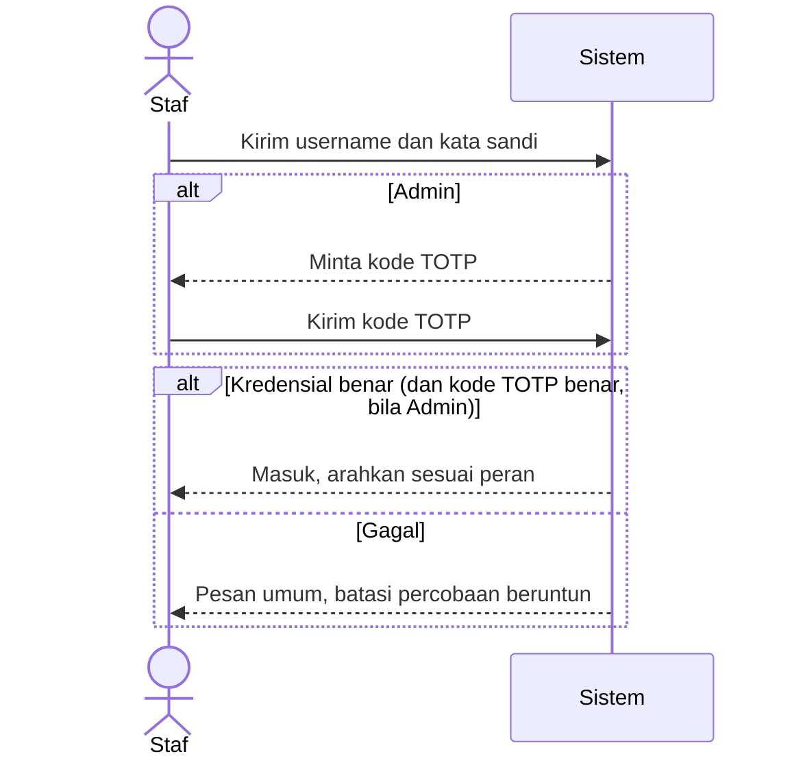
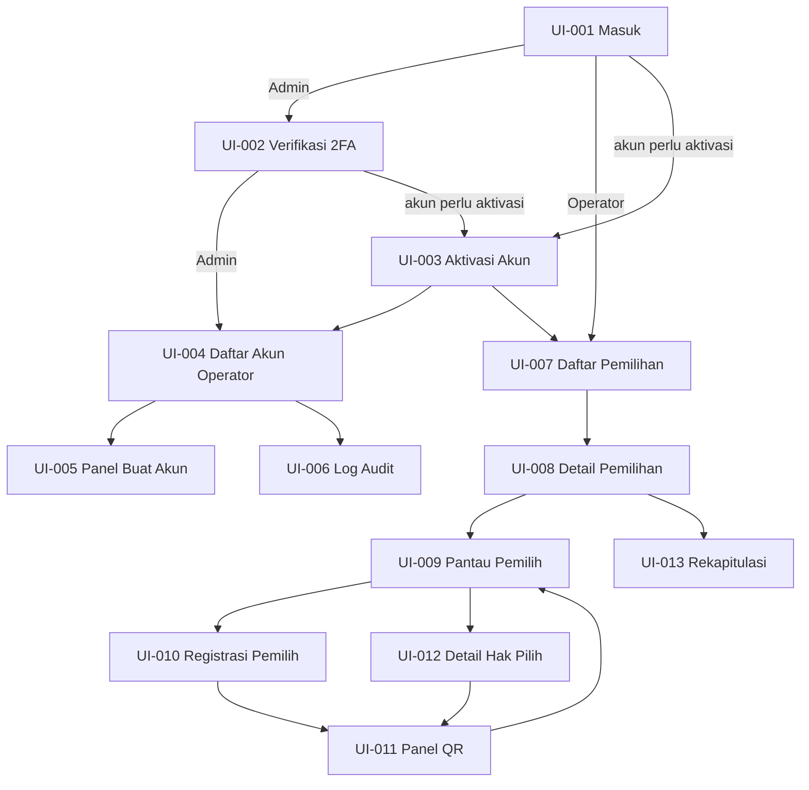

# Amandemen PRD — TOTP Hanya untuk Admin

| Atribut | Nilai |
|---|---|
| Mengubah | PRD v1.0 — Sistem E-Voting Berbasis QR Token (17 November 2026) |
| Tanggal amandemen | 17 November 2026 |
| Diputuskan oleh | Veo (pemilik produk) |
| Status | Berlaku — terapkan ke PRD (menjadi v1.1) dan bawa ke BLUEPRINT.md |
| File PRD | `PRD.md` (di folder yang sama) |

---

## 1. Keputusan

**TOTP/2FA hanya untuk Admin, bukan Operator.**

- Admin login dengan username + kata sandi + kode TOTP.
- Operator login cukup dengan username + kata sandi.
- Aktivasi TOTP dan reset TOTP hanya berlaku untuk akun Admin.

**Alasan:** pemilu ini dipakai sekali, dalam satu hari. Kalau operator kehilangan
HP/autentikator di tengah pemilihan, pemilihan macet sampai ada yang mereset.
Password yang kuat sudah cukup untuk Operator yang bekerja di bilik dengan
verifikasi identitas langsung. Admin tetap memakai TOTP karena Admin memegang
pengelolaan akun.

---

## 2. Daftar perubahan

Terapkan tiap butir di bawah ke PRD v1.0. Teks lama dikutip persis dari PRD;
teks baru adalah penggantinya.

### 2.1 FR-001 — Login akun staf (PRD 3.1)

**Lama:**
> Sistem mengautentikasi Admin/Operator dengan username dan kata sandi, lalu
> kode TOTP; setelah berhasil, mengarahkan sesuai peran. Pesan gagal tidak
> membedakan username salah dan kata sandi salah.

**Baru:**
> Sistem mengautentikasi Admin dengan username, kata sandi, lalu kode TOTP;
> Operator dengan username dan kata sandi saja. Setelah berhasil, sistem
> mengarahkan sesuai peran. Pesan gagal tidak membedakan username salah dan
> kata sandi salah.

Kolom Status menjadi: Disepakati (kewajiban autentikasi kuat); TOTP hanya
Admin (keputusan pemilik produk 2026-11-17).

### 2.2 FR-002 — Aktivasi akun pertama (PRD 3.1)

**Lama:**
> Akun yang baru dibuat atau direset wajib mengganti kata sandi sementara dan
> mengaktifkan TOTP sebelum mengakses fitur lain.

**Baru:**
> Akun Admin yang baru dibuat atau direset wajib mengganti kata sandi sementara
> dan mengaktifkan TOTP sebelum mengakses fitur lain. Akun Operator yang baru
> dibuat atau direset wajib mengganti kata sandi sementara saja.

### 2.3 FR-007 — Reset kredensial Operator (PRD 3.1)

**Lama:**
> Admin dapat mereset kata sandi (menghasilkan kata sandi sementara baru) atau
> mereset TOTP (memaksa aktivasi ulang).

**Baru:**
> Admin dapat mereset kata sandi Operator (menghasilkan kata sandi sementara
> baru). Reset TOTP tidak berlaku untuk Operator karena Operator tidak memakai
> TOTP; bila Admin kehilangan autentikator, reset TOTP dilakukan Pengelola
> Sistem di luar aplikasi.

### 2.4 BR-022 — Autentikasi kuat (PRD 3.7)

**Lama:**
> Akun staf wajib dilindungi autentikasi yang kuat (kata sandi dan TOTP).

**Baru:**
> Akun Admin wajib dilindungi kata sandi dan TOTP. Akun Operator cukup
> dilindungi kata sandi.

### 2.5 NFR-001 — Security, autentikasi (PRD 3.4)

**Lama:**
> Akun staf dilindungi kata sandi dan faktor kedua; percobaan masuk beruntun
> dibatasi.
>
> Indikator: (1) Login tanpa TOTP yang benar selalu ditolak. (3) Tidak ada
> akun staf dengan TOTP belum aktif yang dapat mengakses fitur selain `UI-003`.

**Baru:**
> Akun Admin dilindungi kata sandi dan faktor kedua; akun Operator dilindungi
> kata sandi; percobaan masuk beruntun dibatasi.
>
> Indikator: (1) Login Admin tanpa TOTP yang benar selalu ditolak.
> (3) Tidak ada akun Admin dengan TOTP belum aktif yang dapat mengakses fitur
> selain `UI-003`.

### 2.6 UI-001 — Masuk (PRD 3.6)

**Lama (kolom Perubahan setelah aksi):**
> Lolos tahap 1 → `UI-002`. Gagal → tetap di halaman

**Baru:**
> Admin lolos tahap 1 → `UI-002`. Operator lolos tahap 1 → beranda sesuai
> peran. Gagal → tetap di halaman

### 2.7 UI-002 — Verifikasi 2FA (PRD 3.6)

Kolom Aktor menjadi: **Admin** saja (hapus Operator).

### 2.8 UI-003 — Aktivasi Akun (PRD 3.6)

**Lama:**
> Langkah 1: ganti kata sandi. Langkah 2: kode QR/kunci TOTP dan isian
> konfirmasi kode

**Baru:**
> Admin — Langkah 1: ganti kata sandi. Langkah 2: kode QR/kunci TOTP dan
> isian konfirmasi kode. Operator — hanya Langkah 1: ganti kata sandi.

### 2.9 UI-004 — Daftar Akun Operator (PRD 3.6)

**Lama (kolom Aksi tersedia):**
> Buat akun, Nonaktifkan/Aktifkan, Reset kata sandi, Reset TOTP

**Baru:**
> Buat akun, Nonaktifkan/Aktifkan, Reset kata sandi

### 2.10 WF-002 — Provisi dan pengelolaan akun staf (PRD 3.5)

**Lama:**
> `B["Admin login, ganti kata sandi sementara, aktifkan TOTP"]`
> `E["Operator login pertama: ganti kata sandi, aktifkan TOTP"]`
> `I["Admin reset kata sandi atau TOTP"]`

**Baru:**
> `B["Admin login, ganti kata sandi sementara, aktifkan TOTP"]` (tetap)
> `E["Operator login pertama: ganti kata sandi saja"]`
> `I["Admin reset kata sandi"]`

### 2.11 WF-003 — Login staf (PRD 3.5)

Langkah TOTP hanya untuk Admin. Diagram menjadi:

### 2.12 AC-001 (PRD 3.8)

**Lama:**
> **Given** akun aktif dengan TOTP aktif, **when** username dan kata sandi benar
> lalu kode TOTP benar, **then** staf masuk ke beranda sesuai peran. Bila kata
> sandi benar tetapi kode TOTP salah, **then** tidak masuk.

**Baru:**
> **Given** akun Admin aktif dengan TOTP aktif, **when** username dan kata
> sandi benar lalu kode TOTP benar, **then** Admin masuk ke beranda. Bila kata
> sandi benar tetapi kode TOTP salah, **then** tidak masuk. **Given** akun
> Operator aktif, **when** username dan kata sandi benar, **then** Operator
> masuk ke beranda tanpa kode TOTP.

### 2.13 AC-003 (PRD 3.8)

**Lama:**
> **Given** akun baru atau hasil reset, **when** login, **then** staf dipaksa
> mengganti kata sandi dan mengaktifkan TOTP; sebelum selesai, semua halaman
> lain mengalihkan ke `UI-003`.

**Baru:**
> **Given** akun Admin baru atau hasil reset, **when** login, **then** Admin
> dipaksa mengganti kata sandi dan mengaktifkan TOTP; sebelum selesai, semua
> halaman lain mengalihkan ke `UI-003`. **Given** akun Operator baru atau
> hasil reset, **when** login, **then** Operator dipaksa mengganti kata sandi
> saja.

### 2.14 AC-008 (PRD 3.8)

**Lama:**
> **Given** Admin, **when** mereset kata sandi Operator, **then** kata sandi
> sementara baru tampil sekali dan Operator wajib menggantinya; **when**
> mereset TOTP, **then** Operator wajib mengaktifkan ulang sebelum mengakses
> fitur.

**Baru:**
> **Given** Admin, **when** mereset kata sandi Operator, **then** kata sandi
> sementara baru tampil sekali dan Operator wajib menggantinya.
> (Bagian reset TOTP dihapus — Operator tidak memakai TOTP.)

### 2.15 Diagram navigasi antarlayar (PRD 3.6)

Operator tidak lagi melewati `UI-002`. Diagram menjadi:

### 2.16 Glosarium §2.9 — entri 2FA / TOTP

Tambahkan "(hanya Admin)" pada definisi:

> Autentikasi dua faktor dengan kode sekali pakai berbasis waktu dari aplikasi
> autentikator (hanya Admin).

Catatan kolom menjadi: `D§6` ("autentikasi yang kuat"); cakupan: keputusan
pemilik produk 2026-11-17.

---

## 3. Yang tidak berubah

- **Matriks relasi 3.3** — rujukan `FR` ↔ `BR` ↔ `NFR` tetap valid; tidak
  ada baris yang perlu dihapus atau ditambah.
- **KP-004 (sesi 10 menit + bisa lanjut di browser yang sama)** — sudah benar,
  itu keputusan pemilik produk sebagai jalan tengah. Jangan diubah.
- **KP-006 (perintah seed `npm run seed:admin` / `seed:operator`)** — tidak
  diubah di PRD; pemetaan ke konvensi Laravel (artisan command, atau npm
  script yang membungkus artisan) adalah urusan BLUEPRINT.md.
- **OD-012** — tetap terbuka untuk parameter (panjang kata sandi, batas
  percobaan masuk, batas idle sesi staf); yang diputuskan di sini hanya
  cakupan TOTP-nya.
- Semua kebutuhan, aturan, workflow, halaman, dan kriteria penerimaan lain
  yang tidak disebut di bagian 2.

---

## 4. Instruksi untuk AI dokumen

1. Terapkan seluruh butir bagian 2 ke `PRD.md`, lalu naikkan versi PRD
   menjadi **v1.1** dengan catatan perubahan yang merujuk ke amandemen ini.
2. Bawa keputusan yang sama ke `BLUEPRINT.md` (modul autentikasi, skema
   akun, endpoint login, validator, test case): tidak ada kolom atau alur
   TOTP untuk Operator.
3. Setelah menerapkan, periksa ulang: cari kata "TOTP" di PRD dan BLUEPRINT,
   pastikan tidak ada lagi kalimat yang mewajibkan TOTP untuk Operator.
4. Laporkan: PRD v1.1 selesai, dan daftar bagian yang berubah.
