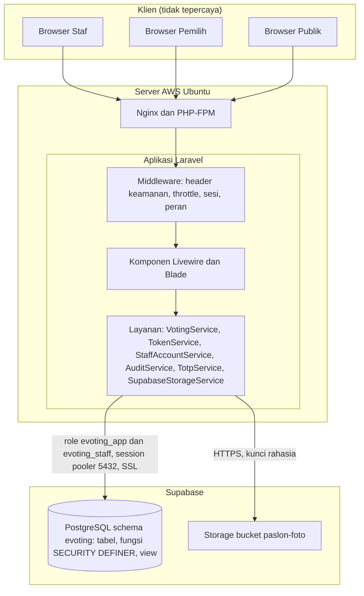
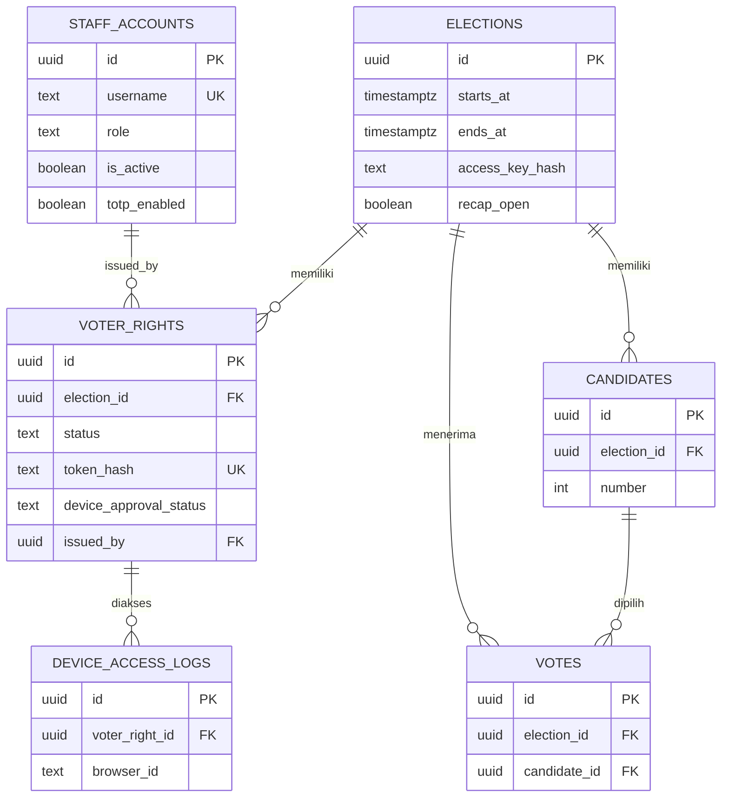
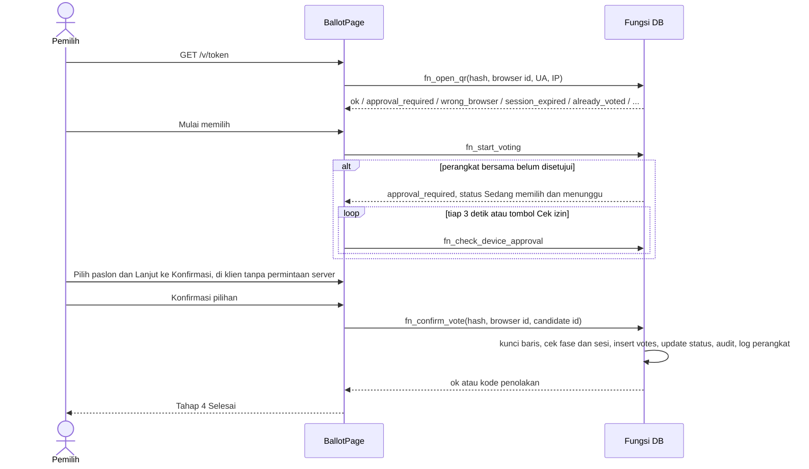
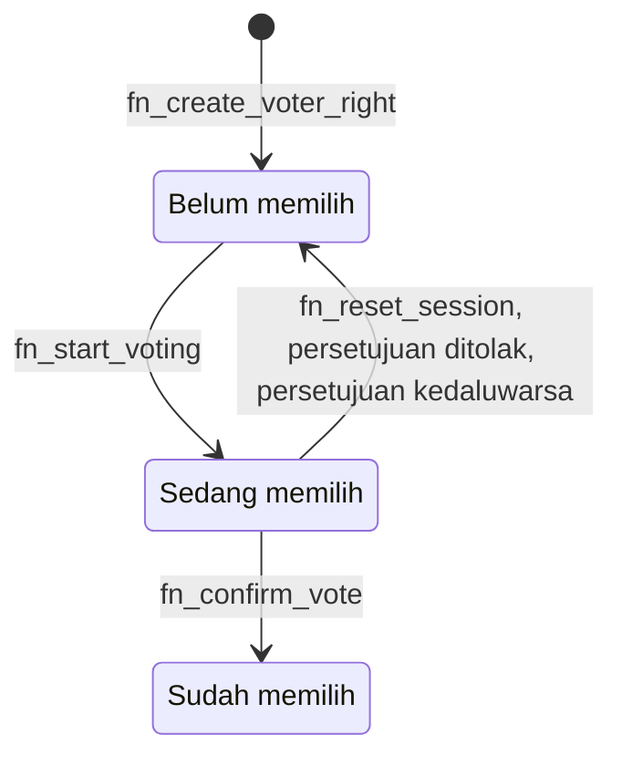

# BLUEPRINT — Dokumentasi Arsitektur dan Implementasi DigiVoting

| Atribut | Nilai |
|---|---|
| Versi | **1.1** — dokumentasi atas sistem yang sudah dibangun (menggantikan v1.0 yang berfungsi sebagai fondasi/rencana) |
| Tanggal | 26 November 2026 |
| Basis kode | Repositori `otherveo/evoting`, cabang `main`, commit `f01eaba` (26 November 2026) |
| Dokumen sumber | `PRD.md` v1.1 |
| Bahasa | Indonesia |

> **Posisi dokumen.** Dokumen ini **menjelaskan sistem sebagaimana adanya di kode**, bukan sebagaimana direncanakan. Setiap pernyataan teknis diambil dari berkas sumber pada commit di atas (rujukan berkas diberikan dalam tanda `` ` ``). Hal yang direncanakan pada v1.0 tetapi tidak dibangun, atau dibangun berbeda, dicatat sebagai `GAP` (Bagian 4). **Tidak ada kode aplikasi yang dijalankan dan tidak ada tes yang dieksekusi** untuk menyusun dokumen ini; "terimplementasi" berarti terbaca di kode, bukan terbukti lulus uji.
>
> **Posisi terhadap v1.0.** SQL migrasi yang saya tulis pada v1.0 **tidak dipakai**; repositori memakai `schema.sql` buatan tim. Klaim v1.0 tentang trigger penjaga, tabel `voter_tokens`/`voting_sessions`/`devices`, dan enum **tidak berlaku** karena tidak ada di skema yang berjalan.
>
> Skema basis data **tidak disalin** ke dokumen ini. Sumber kebenarannya adalah `schema.sql` di repositori; Bagian 3.4 menjelaskan isinya.

---

# 1. Cara Membaca Dokumen

## 1.1 Struktur

| Bagian | Isi |
|---|---|
| 2 | Tujuan, referensi, prinsip, batasan, asumsi, keputusan teknis |
| 3.1 – 3.3 | Stack, arsitektur sistem, arsitektur modul |
| 3.4 | Arsitektur basis data (menjelaskan `schema.sql`) |
| 3.5 – 3.9 | Autentikasi, alur voting, status, token QR, perangkat |
| 3.10 – 3.14 | Endpoint, keamanan, validasi, galat, pemetaan UI |
| 3.15 – 3.16 | Pengujian, penyebaran |
| 3.17 | Keterlacakan (PRD → modul → tabel → endpoint → validator → tes) |
| 4 | Kesenjangan dan temuan (`GAP`) |
| 5 | Riwayat perubahan |

## 1.2 Konvensi ID

ID berformat `PREFIX-NNN`. `FR`, `NFR`, `BR`, `WF`, `UI`, `AC`, `ACT`, `KP`, `CH`, `OD` didefinisikan di `PRD.md`.

| Prefix | Arti | Bagian |
|---|---|---|
| `MOD` | Modul teknis | 3.3 |
| `DB` | Entitas/struktur basis data. **Mengikuti penomoran komentar di `schema.sql`.** `DB-020b` dan `DB-028b` ditulis apa adanya di skema | 3.4 |
| `API` | Rute halaman, aksi Livewire, endpoint HTTP | 3.10 |
| `VAL` | Aturan validasi | 3.12 |
| `SEC` | Kebutuhan/kontrol keamanan | 3.11 |
| `TC` | Test case (otomatis yang ada, dan yang direkomendasikan) | 3.15 |
| `PRM` | Parameter konfigurasi | 3.5.5 |
| `GAP` | Kesenjangan antara PRD/tujuan dan kode | 4 |

ID `DB-005`, `DB-006`, `DB-009`, `DB-014` pernah diusulkan pada v1.0 dan **tidak dipakai**; tidak diberikan ulang.

## 1.3 Notasi

| Notasi | Arti |
|---|---|
| **[TERIMPLEMENTASI]** | Terbaca di kode. |
| **[SEBAGIAN]** | Ada, tetapi tidak sepenuhnya memenuhi PRD; lihat `GAP`. |
| **[REKOMENDASI]** | Saran penyusun; belum dibangun. |
| `o_result_code` | Kode hasil dari fungsi basis data (3.13). |

---

# 2. Penjelasan Awal

## 2.1 Tujuan

Menjadi acuan teknis tunggal untuk memahami, memelihara, dan mengembangkan DigiVoting: bagaimana kebutuhan PRD dipenuhi di kode, di mana aturan ditegakkan (aplikasi atau basis data), apa yang belum terpenuhi, dan bagaimana sistem disebarkan dan diuji.

## 2.2 Referensi

`PRD.md` v1.1 (kebutuhan), `schema.sql` (skema), `DEPLOY.md` (penyebaran), `README.md` (ringkasan; beberapa bagiannya tidak sinkron, `GAP-004`), `docs/update-v1.md` – `update-v5.md` (catatan perubahan), `AMANDEMEN-PRD.md`.

## 2.3 Prinsip arsitektur yang terlihat di kode

| # | Prinsip | Bukti |
|---|---|---|
| AP-1 | **Mutasi kritis hanya lewat fungsi `SECURITY DEFINER`** di basis data (buat Hak Pilih, mulai, konfirmasi, reset, terbit ulang, jadwal, persetujuan perangkat, hapus pemilihan, Access Key). | `schema.sql`; `app/Services/VotingService.php` memanggil fungsi `evoting.fn_*` |
| AP-2 | **Pemisahan identitas dan Suara secara struktural.** Tabel `votes` tanpa waktu dan tanpa relasi ke Hak Pilih; role aplikasi tanpa hak apa pun pada `votes`. | `schema.sql` bagian `DB-007`, hak akses |
| AP-3 | **Token dan kunci hanya disimpan sebagai hash** (SHA-256 heksadesimal). | `TokenService`, kolom `token_hash`, `access_key_hash` |
| AP-4 | **Fase Pemilihan diturunkan dari jadwal**, tanpa kolom status dan tanpa tugas terjadwal. | `fn_election_phase`, view `v_elections` |
| AP-5 | **Aplikasi server-rendered Livewire**; tidak ada API JSON publik. | `routes/web.php` |
| AP-6 | **Idempotensi sisi aplikasi** untuk aksi pembuatan: kunci `Cache::add` dan tombol terkunci. | `HandlesSafeErrors`, komponen Operator |
| AP-7 | **Pesan galat aman**: detail teknis dicatat ke log, pengguna melihat pesan umum. | `app/Livewire/Concerns/HandlesSafeErrors.php` |
| AP-8 | **Dua login basis data berhak minimum.** `evoting_app` melayani Pemilih dan halaman publik; `evoting_staff` melayani operasi staf, sesi, dan cache. | `schema.sql` bagian hak akses; `config/database.php` koneksi `pgsql` dan `staff` |
| AP-9 | **Otorisasi diperbarui pada setiap permintaan.** Halaman staf memeriksa ulang peran, keaktifan, dan versi sesi di setiap permintaan Livewire; fungsi staf yang mengubah data memeriksa Operator aktif. | `app/Livewire/StaffPage.php`, `AppServiceProvider`, `require_active_operator` |

## 2.4 Batasan teknis

1. Supabase hanya sebagai PostgreSQL terkelola dan Storage untuk foto paslon (`KP-002`, `KP-010`); tidak memakai Supabase Auth, PostgREST, atau Realtime.
2. Antarmuka Blade + Livewire; pembaruan berkala memakai `wire:poll` (`KP-003`).
3. Skema dikelola satu berkas `schema.sql` yang dijalankan sekali pada database kosong; Laravel tidak menjalankan `migrate` untuk tabel aplikasi.
4. Koneksi aplikasi lewat Supavisor *session mode* (port 5432); *transaction mode* (6543) tidak dipakai karena DDL dan state sesi. Ada **dua kredensial** (`DB_*` untuk `evoting_app`, `STAFF_DB_*` untuk `evoting_staff`).
5. Tidak ada email, antrean, penjadwal, atau WebSocket.

## 2.5 Asumsi

| # | Asumsi |
|---|---|
| AS-1 | Skala sekolah (ratusan–ribuan Hak Pilih); batas aplikasi 10.000 per pemilihan. |
| AS-2 | Pemindaian QR dilakukan oleh kamera/pembaca QR perangkat; aplikasi tidak memindai. |
| AS-3 | Aplikasi di belakang reverse proxy yang mengakhiri TLS; IP klien diteruskan lewat header proxy. |
| AS-4 | Satu server aplikasi (cache dan sesi berbasis berkas tidak dibagi antar-instans). |

## 2.6 Keputusan teknis yang berlaku

| Keputusan | Status | Rujukan |
|---|---|---|
| Laravel `^13.17`, Livewire `^4.4`, PHP `^8.3` (penyebaran PHP 8.4) | [TERIMPLEMENTASI] | `composer.json`, `DEPLOY.md` |
| Autentikasi dengan guard `staff` buatan sendiri; **tanpa Fortify**; TOTP buatan sendiri hanya Admin | [TERIMPLEMENTASI] | `KP-009`; `TotpService` |
| Sesi dan cache memakai driver berkas | [TERIMPLEMENTASI] | `.env.example` |
| Foto paslon di Supabase Storage lewat HTTP API dengan kunci rahasia | [TERIMPLEMENTASI] | `SupabaseStorageService` |
| Interval polling Operator 3 detik, hanya halaman 1 | [TERIMPLEMENTASI] | Blade `wire:poll.3s.visible` |
| Hosting AWS Ubuntu + Nginx/PHP-FPM | [TERIMPLEMENTASI] (per `DEPLOY.md`) | `KP-011` |
| Dua login basis data (`evoting_app`, `evoting_staff`); fungsi staf yang mengubah data memeriksa Operator aktif; sesi staf berversi; proxy tepercaya lewat `TRUSTED_PROXIES` | [TERIMPLEMENTASI] | `KP-022` |
| Daftar Paslon Publik (`/paslon`, `/{election}/paslon`) | [TERIMPLEMENTASI] | `KP-024` |
| Batas dua penggunaan per perangkat per pemilihan; blokir manual perangkat oleh Admin; halaman Admin Penggunaan Perangkat; gerbang visi-misi Pemilih dicabut | [TERIMPLEMENTASI] | `KP-025`, `KP-026` |
| Batas perangkat v8 (simulasi ikut dihitung, QR ketiga ditolak saat dibuka); pengerasan keamanan web (Origin, daftar putih, CSP laporan, HSTS, IP Cloudflare); peristiwa keamanan berantai hash | [TERIMPLEMENTASI] | `KP-027`, `KP-028` |

## 2.7 Terminologi teknis: label resmi dan nilai teknis

| Konsep | Label resmi | Nilai teknis (kolom teks, bukan enum) |
|---|---|---|
| Status Hak Pilih | `Belum memilih` / `Sedang memilih` / `Sudah memilih` | `belum_memilih` / `sedang_memilih` / `sudah_memilih` |
| Fase Pemilihan | `Persiapan` / `Berlangsung` / `Ditutup` | `persiapan` / `berlangsung` / `ditutup` (kolom `fase` pada `v_elections`) |
| Persetujuan Perangkat | tidak perlu / menunggu / disetujui / ditolak | `tidak_perlu` / `menunggu` / `disetujui` / `ditolak` (`device_approval_status`) |
| Peran | Admin / Operator | `admin` / `operator` |
| Aktor audit | Admin / Operator / Pemilih / sistem | `admin` / `operator` / `pemilih` / `sistem` |
| Mode QR | Kustom / Standar | `kustom` / `standar` (disimpan di tabel `cache`) |

`Sesi Kedaluwarsa` dan `Peringatan Perangkat` adalah **indikator turunan** (kolom `session_expired` dan `device_warning` di `v_voter_right_monitor`), bukan status.

---

# 3. Isi Utama

## 3.1 Technology Stack (sebagaimana dipakai)

| Lapisan | Pilihan | Peran | Bukti |
|---|---|---|---|
| Bahasa | PHP `^8.3` (produksi PHP 8.4) | Aplikasi | `composer.json`, `DEPLOY.md` |
| Framework | Laravel `^13.17` | Routing, middleware, sesi, ORM, rate limiter, konsol | `composer.json` |
| Antarmuka | Blade + **Livewire `^4.4`** (Alpine bawaan) | Halaman server-driven, `wire:poll` | `composer.json`, `resources/views` |
| Styling | CSS kustom dipecah per fitur di `public/css/shared/*.css`, `public/css/operator`, `public/css/voter`, dimuat berurutan oleh `resources/views/partials/shared-styles.blade.php` (`suarasekolah.css` tunggal sudah dihapus). Vite dan Tailwind `^4` terpasang di perangkat build tetapi tidak dipakai layout | Tampilan | `resources/views/layouts/*`, `package.json` |
| Database | Supabase PostgreSQL, schema `evoting`; **dua role** `evoting_app` (Pemilih dan publik) dan `evoting_staff` (operasi staf), keduanya NOBYPASSRLS; koneksi Laravel `pgsql` dan `staff`; `DB_SSLMODE=require`, `DB_PERSISTENT=true`, `DB_SEARCH_PATH` | Penyimpanan, integritas, fungsi transisi | `schema.sql`, `.env.example`, `config/database.php` |
| Akses data | Eloquent (model staf memakai koneksi `staff`; `PublicElection` memakai `pgsql`) dan `DB::select` memanggil `evoting.fn_*` | Baca/tulis | `app/Models`, `app/Services/VotingService.php` |
| Skema | `schema.sql` dijalankan manual di Supabase SQL Editor/psql | Membangun skema | komentar kepala `schema.sql` |
| Autentikasi | Guard sesi `staff` + `StaffAccount`; **TOTP buatan sendiri** (`TotpService`, RFC 6238) untuk Admin; **tanpa Fortify** | Login staf | `config/auth.php`, `TotpService` |
| Otorisasi | Middleware `staff.auth`, `staff.role:{admin,operator}` yang juga didaftarkan sebagai **middleware persisten Livewire**; kelas dasar `StaffPage` + Gate `use-staff-area` memeriksa peran, keaktifan, aktivasi, versi sesi, dan (Admin) verifikasi TOTP pada setiap permintaan | Pembatasan peran | `bootstrap/app.php`, `AppServiceProvider`, `StaffPage` |
| QR | `bacon/bacon-qr-code ^3.1`, keluaran SVG di server (Kustom: ECL H dengan logo; Standar: ECL M) | Gambar QR | `TokenService` |
| Pemindaian QR | Kamera/pembaca QR perangkat | — | tidak ada pustaka dekoder |
| Penyimpanan foto | Supabase Storage via HTTP (`SUPABASE_SECRET_KEY`), bucket publik `paslon-foto` | Foto paslon | `SupabaseStorageService`, `config/evoting.php` |
| Sesi/cache | Driver **berkas** (`SESSION_DRIVER=file`, `CACHE_STORE=file`, `SESSION_LIFETIME=30`); koneksi bawaan sesi dan cache berbasis database adalah `staff`; tabel `evoting.sessions`, `cache`, `cache_locks` dipakai sebagian lewat `DB::table`; `staff_accounts.session_version` menginvalidasi sesi lama | Sesi, rate limiter, kunci idempotensi | `.env.example`, `config/session.php`, `config/cache.php` |
| Antrean | `QUEUE_CONNECTION=sync` (tidak dipakai) | — | `.env.example` |
| Rate limiting | `RateLimiter`: `voter-access` **900/menit per IP dan 30/menit per QR (hash token)**; `public-access` 120/menit/IP; `live-recap` 40/menit/IP; login dan TOTP 5 per 60 detik per username+IP; Access Key 10 per 60 detik; limiter `livewire-update` dan `ThrottleSensitiveActions` (membatasi laju pemanggilan metode Livewire sensitif per kelompok: voting, registrasi, aksi staf) | Pembatasan | `AppServiceProvider`, `config/evoting.php`, `LiveRecapPage` |
| Validasi | Validator Livewire (`#[Validate]`/`$this->validate`) + CHECK dan fungsi basis data | Dua lapis | komponen Livewire, `schema.sql` |
| State | Properti komponen Livewire; wizard dan Reveal memakai Alpine di klien | UI | `resources/views/livewire` |
| Pengujian | **PHPUnit `^12.5`**: `EvotingSystemTest` (12 metode), `HardeningTest` (8), `SecurityHttpTest` (8); tes **browser Node** `tests/Browser/livewire-feedback.test.cjs`; tes integrasi memakai **PostgreSQL lokal dari template** (`UsesLocalVotingDatabase`; dilewati bila `EVOTING_TEST_*` tidak diatur); tes unggah foto membutuhkan layanan Supabase Storage (tidak ada `Http::fake`); `laravel/pint` | Lihat 3.15 | `phpunit.xml`, `tests/` |
| Logging | Kanal `daily` | Diagnostik | `.env.example` |
| Monitoring | Rute `/up`; galat basis data dilaporkan dengan nomor insiden dan metadata terbatas | Kesehatan | `bootstrap/app.php` |
| Pengerasan permintaan web | Middleware `RestoreCloudflareClientIp`, `EnsureSameOriginRequest` (Origin sama), `EnforceRequestWhitelist` (daftar putih rute, parameter, dan payload Livewire, `config/request_whitelist.php`), `SecurityHeadersMiddleware` (CSP mode laporan, HSTS); mode diatur `config/security.php` (`enforce`/`report`/`off`) | Menolak permintaan di luar bentuk yang dikenal | `bootstrap/app.php`, `config/security.php` |
| CI keamanan | `.github/workflows/security.yml`: audit dependensi terkunci, lingkungan uji terisolasi, `security:whitelist-check` dan tes fitur | Verifikasi otomatis | `.github/workflows/security.yml` |
| Proxy tepercaya | `TRUSTED_PROXIES` (daftar alamat/CIDR; kosong bila tidak diatur) | IP klien akurat | `config/evoting.php`, `AppServiceProvider` |
| Hosting | AWS Ubuntu + Nginx/PHP-FPM | Produksi | `DEPLOY.md` |
| Zona waktu | `config/app.php` = UTC; tampilan `config('evoting.display_timezone')` = `APP_TIMEZONE` (bawaan Asia/Makassar) | Jadwal | `config/evoting.php` |
| Skrip CLI | `npm run seed:admin`, `npm run seed:operator` membungkus `php artisan seed:admin|seed:operator` | `KP-006` | `package.json`, `app/Console/Commands` |

## 3.2 System Architecture

### Batas tanggung jawab

| Layer | Tanggung jawab | Catatan |
|---|---|---|
| Presentasi (Blade, Livewire, Alpine) | Render, state tampilan, polling, wizard dan Reveal di klien | Tidak mengambil keputusan hak akses |
| Aplikasi (middleware, komponen) | Autentikasi, otorisasi rute dan per permintaan Livewire, validasi input, rate limit, cookie, pemetaan `o_result_code` ke pesan | Sebagian aturan hanya di sini (`GAP-006`) |
| Layanan | Token, hash, QR, pemanggilan fungsi DB, audit, TOTP, penyimpanan foto | — |
| Data (PostgreSQL) | Atomisitas transisi, fase, hak akses, immutabilitas `votes` dan `audit_logs`, agregasi, pemeriksaan Operator aktif di fungsi staf yang mengubah data, gerbang rekap | — |

### Batas kepercayaan

| Batas | Kontrol | `SEC` |
|---|---|---|
| Internet → aplikasi | HTTPS (proxy), CSRF Livewire, cookie, rate limit, validasi, middleware peran | SEC-001 – SEC-007, SEC-011 – SEC-013 |
| Aplikasi → basis data | Dua role berhak minimum: `evoting_app` (Pemilih/publik) tanpa akses `votes`, staf, dan hasil Operator; `evoting_staff` tanpa akses `votes` dan tanpa UPDATE/DELETE `audit_logs`; mutasi kritis hanya lewat fungsi (fungsi staf yang mengubah data memeriksa Operator aktif) | SEC-008, SEC-009 |
| Basis data → Supabase publik | Schema `evoting` tidak diekspos Data API; RLS aktif | SEC-010 |

### Komponen eksternal

Supabase PostgreSQL dan Storage; reverse proxy/TLS. Tidak ada email, pihak ketiga QR, atau CDN skrip.

## 3.3 Module Architecture

| ID | Modul | Berkas utama | Tanggung jawab | `FR` |
|---|---|---|---|---|
| MOD-001 | Autentikasi dan sesi staf | `Livewire/Auth/{LoginPage,VerifyTwoFactorPage,ActivateAccountPage}`, `Livewire/StaffPage`, `Http/Controllers/AuthController`, `Middleware/{EnsureStaffAuthenticated,EnsureStaffRole}`, `Models/StaffAccount`, `Services/TotpService` | Login, TOTP Admin, aktivasi, logout, gerbang akun aktif, versi sesi, otorisasi tiap permintaan Livewire | FR-001 – FR-004 |
| MOD-002 | Manajemen akun staf | `Livewire/Admin/OperatorIndexPage`, `Services/StaffAccountService` | Buat/aktif/nonaktif/reset kata sandi Operator | FR-005 – FR-007 |
| MOD-003 | Pemilihan, jadwal, paslon | `Livewire/Operator/{ElectionIndexPage,ElectionDetailPage}`, `Models/{Election,Candidate}`, `Services/SupabaseStorageService`, fungsi `DB-025`, `DB-031` | Wizard, draft, jadwal, paslon (foto/visi/misi), hapus pemilihan, Access Key | FR-008 – FR-011, FR-035 – FR-037 |
| MOD-004 | Registrasi pemilih dan QR | `Livewire/Operator/VoterMonitorPage`, `Services/VotingService`, `Services/TokenService` | Registrasi, Nama Kembar, QR sekali tampil, QR ulang | FR-012 – FR-014, FR-028, FR-029 |
| MOD-005 | Token, QR, Pengenal Browser | `Services/TokenService` | Token 256-bit, SHA-256, URL, gambar QR, cookie browser, Mode QR, Access Key | FR-014, FR-033, FR-037 |
| MOD-006 | Akses dan proses voting | `Livewire/Voter/BallotPage`, `Services/VotingService`, `resources/views/layouts/voter` | Empat tahap (tahap Memilih dan Konfirmasi berjalan di klien dengan Alpine; hanya `startVoting`, `confirmVote`, dan pemeriksaan persetujuan yang menyentuh server); persetujuan perangkat (sisi Pemilih); tahap `ditolak_perangkat` | FR-015 – FR-018, FR-034, FR-043 (FR-040 dicabut) |
| MOD-007 | Mesin status dan integritas (basis data) | `schema.sql` fungsi `DB-020` – `DB-032` | Transisi atomik, fase, hasil, integritas | FR-010, FR-019, FR-030, FR-032 |
| MOD-008 | Monitoring Operator | `Livewire/Operator/VoterMonitorPage`, view `v_voter_right_monitor` | Daftar 25/halaman, filter, polling 3 detik, persetujuan perangkat (sisi Operator) | FR-023, FR-025, FR-034 |
| MOD-009 | Perangkat | tabel `device_access_logs` ditulis dalam fungsi `DB-020b`/`021`/`022`; gerbang batas perangkat di fungsi yang sama dan fungsi pembantu `DB-042` | Pencatatan akses, indikator, dan batas dua penggunaan | FR-024, FR-025, FR-043 |
| MOD-010 | Audit | `Services/AuditService`, `Livewire/Admin/AuditLogPage`, tabel `audit_logs` | Tulis dan tinjau audit | FR-026, FR-027 |
| MOD-011 | Rekap dan halaman publik | `Livewire/Operator/ElectionRecapPage`, `Livewire/Public/{PublicTurnoutPage,PublicResultsPage,LiveRecapPage}` | Rekapitulasi (kunci; setelan dan pemutaran Reveal/Balapan), halaman publik, Rekap Langsung | FR-020 – FR-022, FR-037 – FR-039 |
| MOD-012 | Antarmuka bersama | `resources/views/layouts`, komponen Blade, `public/css/shared/*.css`, `Livewire/Concerns/HandlesSafeErrors` | Layout, popup, kunci tombol, galat aman, beranda | FR-031, FR-041 |
| MOD-013 | Keamanan lintas modul | `Middleware/{SecurityHeadersMiddleware,EnsureSameOriginRequest,EnforceRequestWhitelist,RestoreCloudflareClientIp,ThrottleSensitiveActions}`, `Services/SecurityAudit`, `AppServiceProvider`, `bootstrap/app.php`, `config/{security,request_whitelist,evoting}.php` | Header, Origin, daftar putih, IP klien, rate limiter, proxy tepercaya, middleware persisten Livewire, pelaporan galat, peristiwa keamanan | NFR-003, NFR-004, NFR-017 |
| MOD-014 | Basis data dan skema | `schema.sql`, `config/database.php` | Tabel, fungsi, view, hak akses, RLS, bucket | NFR-005, NFR-007, NFR-008, NFR-015 |
| MOD-015 | CLI provisi | `Console/Commands/{SeedAdminCommand,SeedOperatorCommand}` | Buat akun staf dari konsol | FR-005, FR-002 |
| MOD-016 | Mode QR | `TokenService` (baca/tulis konfigurasi), `OperatorIndexPage::setQrMode` | Pengaturan Admin | FR-033 |
| MOD-017 | Daftar Paslon Publik | `Http/Controllers/PublicCandidatesController`, `Models/PublicElection`, view `public/candidates`, `ElectionDetailPage::setCandidatePublicPhoto` | Daftar paslon tanpa login, penyaring nama pelatihan/simulasi/tes, visibilitas foto | FR-042 |
| MOD-018 | Penggunaan Perangkat (Admin) | `Livewire/Admin/DeviceUsagePage`, `VotingService::{blockDevice,unblockDevice}`, view `v_device_usage`, fungsi `DB-038`, `DB-039` | Daftar penggunaan perangkat per pemilihan, blokir dan buka blokir | FR-044 |
| MOD-019 | Peristiwa keamanan dan verifikasi | `Services/SecurityAudit`, tabel `security_events`, fungsi `fn_record_security_event`, `fn_verify_security_events`, perintah `audit:verify` dan `security:whitelist-check` (`routes/console.php`) | Mencatat peristiwa keamanan minimal berantai hash dan memverifikasi rantai | NFR-017 |

Relasi: MOD-004/006 → MOD-005 → MOD-007; MOD-008/009 membaca keluaran MOD-007; MOD-010 dipanggil oleh MOD-001 – MOD-004 dan fungsi basis data; MOD-011 membaca MOD-007; MOD-016 mempengaruhi MOD-004/005.

## 3.4 Database Architecture

Sumber kebenaran: **`schema.sql`** (± 1.740 baris; dijalankan sekali, DDL tidak lewat transaction pooler). Bagian ini menjelaskan isinya; SQL tidak disalin agar tidak melenceng dari berkas aslinya.

### 3.4.1 Entitas dan relasi

`votes` **tidak berelasi** dengan `voter_rights`, `device_access_logs`, maupun `staff_accounts`, dan tidak memiliki kolom waktu (`BR-016`). `audit_logs`, `sessions`, `cache`, `cache_locks` berdiri sendiri (referensi `actor_id`/`object_id` tanpa FK).

### 3.4.2 Tabel

| ID | Tabel | Kolom penting | Constraint dan indeks | `FR` |
|---|---|---|---|---|
| DB-001 | `staff_accounts` | `username`, `full_name`, `password_hash`, `role` (`admin`/`operator`), `is_active`, `totp_secret`, `totp_enabled`, `must_change_password`, `session_version` | Unik `username` (huruf kecil); CHECK Operator tidak boleh punya `totp_secret`; CHECK `totp_enabled` ⇒ `totp_secret` ada; `session_version` dinaikkan saat reset/nonaktif/ganti kata sandi untuk menginvalidasi sesi lama | FR-001 – FR-007 |
| DB-002 | `elections` | `name`, `max_voter_rights` (CHECK ≥ 1; aplikasi 3–10.000), `starts_at`, `ends_at`, `access_key_hash` (+`access_key_created_at`), `recap_open`, `recap_mode` (`biasa`/`animasi`), `reveal_order` (jsonb), `reveal_mode` (`satu`/`semua`), `reveal_delay_ms` (20–10.000), `reveal_locked`, `revealed_ids`, `reveal_locked_by`, `device_limit_cutover_at` (cutoff batas perangkat; dibekukan untuk simulasi yang ada saat v8 diaktifkan) | CHECK `ends_at > starts_at`; **tanpa kolom status** (fase turunan, `DB-026`) | FR-008, FR-009, FR-037 – FR-039, FR-043 |
| DB-003 | `candidates` | `election_id`, `number`, `name`, `photo_path`, `public_photo_visible` (bawaan `true`), `vision`, `missions` (jsonb) | Unik `(election_id, number)`; FK RESTRICT | FR-011, FR-042 |
| DB-004 | `voter_rights` | `name`, `name_normalized`, `status`, `token_hash` (SHA-256 hex, 64 karakter), `session_started_at`, `session_browser_id`, `device_approval_status`, `device_approval_requested_at`, `issued_by`, `registration_id` | Unik `token_hash`; unik `(election_id, registration_id)` (idempotensi registrasi); indeks `(election_id, status)` dan `(election_id, name_normalized)`; **tidak ada unik nama** (penjagaan Nama Kembar di fungsi) | FR-012 – FR-019, FR-034 |
| DB-007 | `votes` | `election_id`, `candidate_id` | Indeks `(election_id, candidate_id)`; trigger melarang UPDATE; DELETE hanya saat penghapusan pemilihan | FR-018, FR-020 |
| DB-008 | `device_access_logs` | `voter_right_id`, `access_type`, `browser_id`, `user_agent`, `ip_address`, `accessed_at` | Indeks per Hak Pilih dan per `browser_id` | FR-024, FR-025 |
| DB-010 | `audit_logs` | `actor_type`, `actor_id`, `action` (teks bebas), `object_type`, `object_id`, `detail` (jsonb), `created_at` | Indeks waktu dan aktor; trigger melarang UPDATE; DELETE hanya saat penghapusan pemilihan | FR-026, FR-027 |
| DB-011 | `sessions` | tabel sesi Laravel | Indeks `user_id`, `last_activity` | — |
| DB-012 | `cache`, `cache_locks` | tabel cache dan kunci Laravel | — | — |
| DB-040 | `device_blocks` | `election_id`, `browser_id`, `reason`, `blocked_by`, `created_at`, `unblocked_at`, `unblocked_by` | Unik `(election_id, browser_id)` di antara baris yang belum dibuka blokirnya; dihapus bersama pemilihan (`fn_delete_election`) | FR-044 |

Penyimpanan di luar tabel domain: konfigurasi **Mode QR** (`evoting_config:qr_mode`) dan penanda **QR ditolak** (`rejected_token:<hash>`) ditulis ke tabel `cache` (`GAP-012`). Foto paslon di Supabase Storage bucket `paslon-foto` (bucket publik dan kebijakan baca publik didefinisikan di bagian akhir `schema.sql`; unggah memakai kunci rahasia dari server).

### 3.4.3 View

| ID | View | Isi |
|---|---|---|
| DB-026 | `v_elections` | Pemilihan beserta `fase` (`persiapan`/`berlangsung`/`ditutup`) yang dihitung dari `now()` dan jadwal lewat `fn_election_phase` |
| DB-013 | `v_voter_right_monitor` | Hak Pilih + `session_expired` (status `sedang_memilih` dan `now() > session_started_at + 10 menit`) + `device_warning` (browser yang sama dipakai Hak Pilih lain di pemilihan yang sama, **simetris**) + status persetujuan + `issued_by` |
| DB-041 | `v_device_usage` | Per pemilihan dan `browser_id`: `use_count` (Hak Pilih berbeda), `open_count`, `last_accessed_at`, `last_user_agent`, `is_blocked`; hanya akses `qr_dibuka` sejak penanda v7; mengecualikan pemilihan bernama pelatihan/simulasi/tes (komentar `schema.sql` menandainya `DB-035`) |

### 3.4.4 Fungsi (satu-satunya jalur mutasi kritis)

Semua `SECURITY DEFINER`, `search_path = evoting`, dapat dieksekusi `evoting_app`. Mengembalikan `o_result_code` + `o_message` (kecuali dicatat lain); penolakan bisnis berupa kode, bukan exception (3.13).

| ID | Fungsi | Tujuan | Kode hasil selain `ok` |
|---|---|---|---|
| DB-033 | `fn_election_phase(election_id)` | Fase dari jadwal | — |
| DB-020 | `fn_create_voter_right` | Buat Hak Pilih + hash token (+ Operator penerbit); memeriksa Operator aktif, fase, batas, **pengenal registrasi** (idempoten), dan **jumlah nama kembar yang dikonfirmasi** (`p_confirmed_matches`) di bawah kunci pemilihan | `not_found`, `wrong_phase`, `limit_reached`, `already_issued`, `duplicate_name` |
| DB-020b | `fn_open_qr` | Buka halaman QR: catat `qr_dibuka`, tentukan keadaan; **gerbang batas perangkat** sebelum mencatat (penolakan dicatat `akses_ditolak` dan audit `tolak_batas_perangkat`/`tolak_perangkat_diblokir`) | `invalid_token`, `wrong_phase`, `already_voted`, `wrong_browser`, `session_expired`, `approval_required`, `device_rejected`, `device_limit_reached`, `device_blocked` |
| DB-021 | `fn_start_voting` | `Belum memilih` → `Sedang memilih` atomik; tentukan persetujuan perangkat; periksa blokir dan batas perangkat di bawah kunci advisory | `invalid_token`, `wrong_phase`, `already_voted`, `wrong_browser`, `session_expired`, `approval_required`, `approval_expired`, `device_rejected`, `device_limit_reached`, `device_blocked`, `wrong_status` |
| DB-022 | `fn_confirm_vote` | Simpan Suara + `Sudah memilih` dalam satu transaksi; mengulang pemeriksaan blokir dan batas perangkat (pertahanan berlapis) | `invalid_token`, `wrong_phase`, `wrong_status`, `wrong_browser`, `session_expired`, `approval_required`, `device_rejected`, `device_limit_reached`, `device_blocked`, `invalid_candidate`, `already_voted` |
| DB-023 | `fn_reset_session` | Reset Sesi | `not_found`, `wrong_phase`, `wrong_status`, `invalid_reason` |
| DB-024 | `fn_reissue_token` | Terbitkan Ulang QR (menimpa `token_hash`) | `not_found`, `wrong_phase`, `wrong_status`, `invalid_reason`, `invalid_token` |
| DB-025 | `fn_set_election_schedule` | Atur jadwal | `not_found`, `wrong_phase`, `schedule_invalid`, `too_few_candidates` |
| DB-027 | `fn_integrity_report` | Hitungan Suara, `Sudah memilih`, Hak Pilih, konsistensi | `not_found` |
| DB-028 | `fn_election_results` | Hasil per paslon, **hanya Fase `Ditutup`** | `not_found`, `not_ended` |
| DB-028b | `fn_operator_election_results` | Hasil per paslon untuk Operator; **digerbangi di basis data**: `recap_open` dan (Fase `Ditutup` atau kuota hak suara penuh); tidak memeriksa Operator aktif (hanya dapat dipanggil login `evoting_staff`) | `not_found`, `recap_locked` |
| DB-029 | `fn_decide_device_approval` | Setujui/Tolak; hanya Operator penerbit (Hak Pilih tanpa penerbit tidak dapat diputuskan); memeriksa Operator aktif | `not_found`, `wrong_phase`, `wrong_status`, `invalid_decision`, `bukan_penerbit`, `approval_expired` |
| DB-030 | `fn_check_device_approval` | Pemilih memeriksa status persetujuan | `pending`, `approved`, `rejected`, `approval_expired`, `invalid_token` |
| DB-031 | `fn_delete_election` | Hapus pemilihan permanen (`Persiapan`/`Ditutup`; nama harus cocok); memeriksa Operator aktif | `not_found`, `wrong_phase`, `name_mismatch` |
| DB-032 | `fn_issue_access_key`, `fn_revoke_access_key`, `fn_live_election_results` | Access Key dan hasil langsung | `not_found`, `invalid_key` |
| DB-038 | `fn_block_device` | Admin memblokir perangkat pada pemilihan (hanya bila `use_count` ≥ 2); memeriksa Admin aktif; audit `blokir_perangkat` (komentar `schema.sql`: `DB-033`) | `not_found`, `invalid_browser`, `below_device_limit`, `already_blocked` |
| DB-039 | `fn_unblock_device` | Admin membuka blokir; audit `buka_blokir_perangkat` (komentar `schema.sql`: `DB-034`) | `not_found` |
| DB-042 | Fungsi pembantu perangkat | `fn_device_limit_since` (penanda `device_limit_v7_since` di tabel `cache`), `fn_device_election_cutoff(election)` (cutover per pemilihan, bila kosong memakai penanda v7; penanda v8 `device_limit_v8_since`), `fn_device_session_gate` (kunci advisory; `device_blocked`; sesi sebelum cutoff lolos; token yang belum dibuka di perangkat ini → `device_limit_reached`), `fn_device_use_count`, `fn_device_blocked`, `fn_device_open_gate`, `require_active_admin` | — |
| DB-043 | `security_events` | `details` (jsonb, hanya bidang `event`, `route`, `method`, `ip`, `session_hash`, `browser`, `request_id`, maksimal 768 byte), `prev_hash`, `hash`; fungsi `fn_security_event_hash`, `fn_record_security_event` (EXECUTE `evoting_app`, kunci advisory), `fn_verify_security_events` (EXECUTE `evoting_staff`); RLS aktif dan tanpa hak tabel bagi `evoting_staff` | FR-026 (konteks), NFR-017 |

### 3.4.5 Trigger, hak akses, RLS

| ID | Elemen | Penjelasan |
|---|---|---|
| DB-034 | Trigger | `fn_touch_updated_at` (mengisi `updated_at` pada tabel berkolom itu); `fn_forbid_change` pada `votes` (UPDATE) dan `audit_logs` (UPDATE) dan DELETE. DELETE diizinkan hanya bila bendera transaksi `evoting.allow_election_delete` aktif, yang hanya dipasang `fn_delete_election` (`GAP-003`) |
| DB-035 | Hak akses dua role | **`evoting_app`** (Pemilih/publik): SELECT `v_elections` dan `candidates`; EXECUTE `fn_open_qr`, `fn_start_voting`, `fn_confirm_vote`, `fn_check_device_approval`, `fn_election_results`, `fn_integrity_report`, `fn_live_election_results`, dan pembantu `fn_device_use_count`, `fn_device_blocked`, `fn_device_limit_since`, `fn_device_open_gate`; **tanpa** hak pada `votes`, `staff_accounts`, `elections` (tabel), `sessions`, `cache`. **`evoting_staff`** (operasi staf): `staff_accounts` SELECT, INSERT dan UPDATE kolom tertentu (`password_hash`, `is_active`, `totp_*`, `must_change_password`, `session_version`, `updated_at`); `elections` SELECT, INSERT dan UPDATE kolom `name`, `max_voter_rights`, `recap_*`, `reveal_*`, `revealed_ids`, `updated_at`; `candidates` DML penuh; `voter_rights` SELECT kolom tertentu (tanpa `token_hash`); `device_access_logs` dan `audit_logs` SELECT, INSERT; `sessions`, `cache`, `cache_locks` DML penuh; view SELECT (termasuk `v_device_usage`); EXECUTE fungsi staf (`fn_create_voter_right`, `fn_reset_session`, `fn_reissue_token`, `fn_set_election_schedule`, `fn_operator_election_results`, `fn_decide_device_approval`, `fn_delete_election`, `fn_issue_access_key`, `fn_revoke_access_key`, `fn_integrity_report`, `fn_block_device`, `fn_unblock_device`, dan pembantu perangkat). Tidak ada role yang memiliki hak pada `votes`. `fn_record_security_event` hanya untuk `evoting_app`, `fn_verify_security_events` hanya untuk `evoting_staff` |
| DB-036 | RLS | RLS aktif pada semua tabel schema `evoting` dengan kebijakan `evoting_app_access` untuk kedua role aplikasi (`to evoting_app, evoting_staff`); role Supabase bawaan tidak diberi hak. Kebijakan Storage `Paslon foto dapat dibaca publik` |
| DB-037 | `require_active_operator(operator_id)` | Fungsi pembantu `SECURITY DEFINER`: memastikan akun ada, berperan Operator, aktif, dan tidak sedang menunggu aktivasi; dipanggil di awal fungsi staf (`insufficient_privilege` bila gagal) |

### 3.4.6 Aturan integritas dan di mana ditegakkan

| Aturan | Dasar | DB | Aplikasi | Catatan |
|---|---|---|---|---|
| Satu token → satu Sesi/Suara | BR-008, BR-010 | Ya (fungsi, kunci baris) | — | Terkonfirmasi di fungsi |
| Suara + status satu transaksi | BR-009 | Ya | — | — |
| Suara tanpa tautan identitas | BR-016 | Ya (skema, hak akses) | — | — |
| Fase otomatis dan gerbang waktu | BR-023, BR-032 | Ya | Tampilan | — |
| Hasil publik hanya setelah selesai | BR-026 | Ya (`fn_election_results`; `fn_operator_election_results` menggerbangi `recap_open` dan fase/kuota) | — | Jalur Rekap Langsung memakai Access Key (`fn_live_election_results`) |
| Penguncian nama / Nama Kembar | BR-003, BR-004 | **Ya** (hitungan kecocokan dikonfirmasi dan `registration_id` unik, di bawah kunci pemilihan) | Ya (tampilan dan centang) | `TC-014` |
| Paslon hanya saat Persiapan; batas ≥ jumlah Hak Pilih | BR-024, BR-018 | **Sebagian** (jadwal ≥ 2 paslon) | Ya | `GAP-006` |
| Otorisasi Operator | BR-021 | **Ya** (`require_active_operator` di fungsi staf yang mengubah data; penerbit pada persetujuan; hak akses dua role) | Ya (rute, Gate per permintaan, versi sesi) | Fungsi pembaca agregat (`fn_integrity_report`) tidak memeriksa peran |
| Audit tidak berubah | BR-020 | Ya, kecuali hapus pemilihan | — | `GAP-003` |

### 3.4.7 Retensi dan penghapusan

Akun staf tidak dihapus (hanya dinonaktifkan). Hak Pilih, Suara, dan log tidak dihapus oleh aplikasi **kecuali** lewat `fn_delete_election`, yang juga menghapus entri audit terkait (`GAP-003`). Tidak ada retensi otomatis untuk `device_access_logs` dan `audit_logs` (`OD-004`). Baris `sessions` dan `cache` tidak dibersihkan otomatis selain mekanisme Laravel.

### 3.4.8 Menjalankan skema

Satu kali, pada project Supabase kosong: SQL Editor atau `psql` ke koneksi langsung/session pooler (5432). Skema membuat schema `evoting`, **dua role** (`evoting_app`, `evoting_staff`) **tanpa kata sandi**, tabel, view, fungsi, hak akses, RLS, dan bucket; kata sandi kedua role diatur terpisah lewat pengelola rahasia setelah provisioning. Pemakaian: aplikasi masuk sebagai `evoting_app.<project-ref>` (`DB_*`) dan `evoting_staff.<project-ref>` (`STAFF_DB_*`) lewat session pooler. Kata sandi `evoting_app` versi lama sempat tertulis di `schema.sql` yang dipublikasikan sebelum commit `4bd8985` (`GAP-001`): perlakukan sebagai bocor.

## 3.5 Authentication & Authorization

### 3.5.1 Autentikasi staf [TERIMPLEMENTASI]

| Aspek | Perilaku |
|---|---|
| Guard | `staff` (sesi), penyedia model `StaffAccount` (tabel `evoting.staff_accounts`). Tanpa Fortify |
| Tahap 1 | Username (dikecilkan) + kata sandi (`Hash`); gagal → pesan umum; kunci pembatas `username|IP`, 5 percobaan per 60 detik; kolom kata sandi dapat ditampilkan |
| Admin | Setelah tahap 1 → `/auth/2fa` (kode 6 digit, jendela ±1 langkah 30 detik, kode yang sama tidak dapat dipakai ulang dalam 90 detik lewat cache). Akun Admin tanpa TOTP → `/auth/activate` untuk ganti kata sandi dan aktivasi TOTP |
| Operator | Tahap 1 cukup; `must_change_password` → `/auth/activate` (ganti kata sandi saja); CHECK DB melarang `totp_secret` pada Operator |
| TOTP | Implementasi RFC 6238 sendiri (`TotpService`); rahasia dienkripsi Laravel (cast `encrypted`); **tanpa kode pemulihan** (`GAP-014`) |
| Sesi | Driver berkas; `SESSION_LIFETIME` (contoh 30 menit); sesi diregenerasi saat masuk; menyimpan `staff_session_version`; keluar lewat `POST /logout` |
| Penonaktifan dan reset | Akun `is_active = false` ditolak oleh middleware rute dan oleh Gate pada setiap permintaan Livewire. Reset kata sandi, penonaktifan, dan ganti kata sandi menaikkan `session_version`; sesi dengan versi lama tidak lolos Gate (`hasCurrentSession`) |
| Kata sandi sementara | Dibuat `StaffAccountService`, tampil sekali; wajib diganti; minimal 8 karakter (`PRM-004`) |
| Pembuatan akun | Admin lewat `OperatorIndexPage`; CLI `seed:admin` / `seed:operator` (audit aktor `sistem`) |
| Tanpa | Registrasi mandiri, "lupa kata sandi", "ingat saya", email |

### 3.5.2 Otorisasi [TERIMPLEMENTASI]

| Peran | Rute | Pembatas |
|---|---|---|
| Admin | `/admin/*` | `staff.auth` + `staff.role:admin` |
| Operator | `/operator/*` | `staff.auth` + `staff.role:operator` |
| Pemilih | `/v/{token}` | Token sah + `throttle:voter-access` |
| Publik | `/p/{election}/turnout`, `/results`; `/paslon`, `/{election}/paslon`; `/pantau-rekap/{election}` | `throttle:public-access`; `live-recap` + Access Key |

| Lapisan | Perilaku |
|---|---|
| Per permintaan Livewire | Seluruh halaman staf (`AuditLogPage`, `OperatorIndexPage`, `ElectionIndexPage`, `ElectionDetailPage`, `VoterMonitorPage`, `ElectionRecapPage`) mewarisi `StaffPage` yang pada `boot()` menolak (403) kecuali Gate `use-staff-area` terpenuhi: peran sesuai, akun aktif, aktivasi selesai, versi sesi terkini, dan untuk Admin TOTP terverifikasi. `Livewire::addPersistentMiddleware` juga mendaftarkan `EnsureStaffAuthenticated` dan `EnsureStaffRole` |
| Di basis data | Fungsi staf yang mengubah data memanggil `require_active_operator` (fungsi baca agregat tidak); persetujuan perangkat memeriksa penerbit; dua role dengan hak minimum (DB-035) |
| Pemeriksaan tambahan | `ElectionRecapPage` memeriksa Operator aktif pada tiap aksi |

### 3.5.3 Akses Pemilih tanpa akun

Token 256-bit di URL; hash dicocokkan di `fn_open_qr`/`fn_start_voting`/`fn_confirm_vote`. Cookie `evoting_browser_id` (24 byte acak, base64url; HttpOnly; SameSite Lax; 30 hari) mengikat Sesi Memilih ke browser dan mengenali perangkat.

### 3.5.4 Kebijakan akun

Kata sandi ≥ 8 karakter tanpa aturan kompleksitas (`GAP-004`); hash `bcrypt` (`BCRYPT_ROUNDS`); TOTP wajib Admin; akun dinonaktifkan, bukan dihapus; Admin mereset kata sandi Operator; tidak ada reset mandiri.

### 3.5.5 Parameter konfigurasi

| ID | Parameter | Nilai | Sumber | Status |
|---|---|---|---|---|
| PRM-001 | Durasi Sesi Memilih | **10 menit, tertulis langsung di SQL dan PHP**; kunci `evoting.voting_session_minutes` di `config/evoting.php` **tidak dipakai** | `schema.sql`, `BallotPage` | `GAP-002` |
| PRM-002 | Interval polling Operator | **3 detik, tertulis di Blade**; `evoting.operator_poll_seconds` tidak dipakai | Blade | `GAP-002` |
| PRM-003 | Percobaan login | 5 per 60 detik (`login_max_attempts`, `login_decay_seconds`) | `config/evoting.php` | dipakai |
| PRM-004 | Panjang kata sandi minimal | 8 (`min_password_length`) | `config/evoting.php` | dipakai |
| PRM-005 | Idle sesi staf | `SESSION_LIFETIME` | `.env` | dipakai |
| PRM-006 | Cookie Pengenal Browser | nama, umur 30 hari (`browser_cookie_*`) | `config/evoting.php` | dipakai |
| PRM-007 | Rate limit Pemilih | 60/menit/IP | `AppServiceProvider` | dipakai |
| PRM-008 | Rate limit publik | 120/menit/IP; Rekap Langsung 40/menit/IP | `AppServiceProvider` | dipakai |
| PRM-009 | Access Key | 64 karakter; 10 percobaan/60 detik | `TokenService`, `LiveRecapPage` | dipakai |
| PRM-010 | Zona waktu tampilan | `APP_TIMEZONE` (bawaan Asia/Makassar) | `config/evoting.php` | dipakai |
| PRM-011 | Ukuran halaman | monitor dan audit 25 | komponen | dipakai |
| PRM-012 | Proxy tepercaya | `TRUSTED_PROXIES` (daftar dipisah koma; kosong = tidak ada proxy tepercaya) | `config/evoting.php` | dipakai |

## 3.6 Voting Workflow — Technical Flow

### 3.6.1 Pembuatan Hak Pilih dan QR

`VoterMonitorPage::registerVoter` → validasi nama (`VAL-010`) → deteksi Nama Kembar di aplikasi (nama dinormalkan; bila ada, Operator harus mencentang `VAL-011`) → kunci idempotensi `Cache::add` dan **pengenal registrasi** unik → `TokenService::generatePair` (token mentah + SHA-256) → `VotingService::createVoterRight` memanggil `fn_create_voter_right` (Operator aktif, fase, batas, pengenal registrasi, jumlah nama kembar yang dikonfirmasi, insert, audit `buat_hak_pilih`) → gambar QR SVG dari URL `APP_URL/v/{token}` mengikuti Mode QR → tampil di panel; token mentah hanya ada di memori komponen.

### 3.6.2 Alur Pemilih

Pemilihan paslon, dialog visi-misi (opsional), dan transisi ke tahap Konfirmasi dijalankan di klien (Alpine); **tidak ada tulis ke basis data** sebelum `fn_confirm_vote`. Gerbang baca visi-misi (`proceedToConfirm`, daftar paslon terbaca pada `confirmVote`) **telah dicabut** pada commit `fac2b91` (`KP-026`).

### 3.6.3 Persetujuan perangkat

`fn_start_voting` menentukan apakah browser yang sama sudah dipakai Hak Pilih lain pada pemilihan itu; bila ya dan belum disetujui, `device_approval_status` menjadi `menunggu` (dan `device_approval_requested_at` diisi). Operator penerbit melihat popup (polling halaman 1) dan memutuskan lewat `fn_decide_device_approval`: `disetujui` → Pemilih lanjut; `ditolak` → sesi berakhir, status kembali `Belum memilih`, token ditimpa sehingga QR lama tidak berlaku, dan penanda penolakan disimpan di `cache` agar Pemilih melihat pesan khusus. Tanpa keputusan dalam 10 menit → `approval_expired` dan kembali ke awal. Operator yang bukan penerbit mendapat `bukan_penerbit`; Hak Pilih tanpa `issued_by` **tidak dapat diputuskan siapa pun** (`GAP-017`) sampai Terbitkan Ulang QR mengisi penerbit.

### 3.6.4 Pencegahan dobel suara dan permintaan simultan

Fungsi mengunci baris `voter_rights` (`for update`) sebelum memeriksa status; permintaan kedua membaca status terbaru dan ditolak (`wrong_status`/`already_voted`). `fn_confirm_vote` mengulang jawaban `already_voted` secara idempoten. (`TC` konkurensi: belum ada, `GAP-011`.)

### 3.6.4b Batas penggunaan perangkat (v7, diperluas v8)

Gerbang dijalankan di `fn_open_qr`, `fn_start_voting`, `fn_confirm_vote`, `fn_check_device_approval`, dan keputusan persetujuan (`fn_decide_device_approval`) lewat `fn_device_open_gate` (saat membuka tautan) dan `fn_device_session_gate` (saat sesi berjalan). Keduanya mengambil kunci advisory transaksi per `(pemilihan, browser_id)`. Aturan: (1) perangkat diblokir Admin → `device_blocked`; (2) Hak Pilih yang sesinya dimulai sebelum cutoff pemilihan tidak terkena batas; (3) saat tautan dibuka, bila token ini belum pernah dibuka di perangkat ini sejak cutoff dan sudah ada dua Hak Pilih lain yang membuka tautan di perangkat ini → `device_limit_reached`. Membuka ulang token yang sama bukan penggunaan baru. **QR ketiga ditolak saat dibuka dan tidak menambah hitungan** (tidak ada log `qr_dibuka`, tidak ada sesi, tidak ada permintaan persetujuan): dicatat sebagai `akses_ditolak` dan audit `tolak_batas_perangkat` atau `tolak_perangkat_diblokir` (aktor `sistem`), dan aplikasi menampilkan tahap `ditolak_perangkat`. Cutoff per pemilihan: `elections.device_limit_cutover_at` bila ada, jika tidak penanda v7 di tabel `cache`; pada update v8 pemilihan simulasi (nama berawalan train/training, simulasi/simulation, tes/test/testing, latih/latihan; ekspresi reguler, `GAP-018`) yang sudah ada dibekukan pada saat penerapan skema, sehingga **pemilihan simulasi kini ikut dihitung** untuk penggunaan baru. `v_device_usage` dan halaman Admin tetap mengecualikan simulasi. Operator penerbit melihat banner dan label merah **Batas perangkat tercapai** pada pembaruan monitor berikutnya, dibaca dari audit `tolak_batas_perangkat` per Hak Pilih; pembukaan berhasil pada browser lain membersihkan peringatan aktif.

### 3.6.5 Kegagalan dan proses terputus

Konfirmasi gagal di tengah → seluruh transaksi fungsi dibatalkan (tidak ada Suara parsial), status tetap `Sedang memilih`. Browser sama < 10 menit dapat melanjutkan lewat `fn_open_qr`. Selebihnya Reset Sesi (`fn_reset_session`).

## 3.7 Status Management

| Dari → ke | Pemicu | Fungsi | Ditolak bila |
|---|---|---|---|
| (baru) → `Belum memilih` | Registrasi | `fn_create_voter_right` | Fase ≠ `Berlangsung`, batas tercapai |
| `Belum memilih` → `Sedang memilih` | `Mulai memilih` | `fn_start_voting` | Token tidak dikenal, fase salah, status salah, persetujuan ditolak |
| `Sedang memilih` → `Sudah memilih` | `Konfirmasi pilihan` | `fn_confirm_vote` | Sesi tidak sah/kedaluwarsa/browser lain, perangkat belum disetujui, paslon tidak valid, fase salah |
| `Sedang memilih` → `Belum memilih` | Reset Sesi; persetujuan ditolak; persetujuan kedaluwarsa | `fn_reset_session`, `fn_decide_device_approval`, `fn_start_voting`/`fn_open_qr` | Status bukan `Sedang memilih`; fase salah; alasan kosong |
| `Sudah memilih` | final | — | semua perubahan |

Tidak ada trigger atau constraint yang melarang transisi lain pada `voter_rights.status`; penegakan bergantung pada fungsi, dan role aplikasi tidak memiliki UPDATE pada tabel itu (`GAP-007`). Tidak ada status tambahan di luar tiga status. `Sesi Kedaluwarsa` dihitung di view, tanpa tugas terjadwal. Fase Pemilihan dihitung `fn_election_phase` dari `starts_at`/`ends_at` terhadap `now()` basis data.

## 3.8 QR Token Architecture

| Aspek | Implementasi |
|---|---|
| Pembuatan | `random_bytes(32)` → base64url tanpa padding (43 karakter) (`TokenService::generatePair`) |
| Penyimpanan | `SHA-256(token)` heksadesimal 64 karakter pada `voter_rights.token_hash` (unik); token mentah tidak disimpan |
| Relasi | Satu token aktif per Hak Pilih (kolom pada `voter_rights`; tanpa tabel riwayat) |
| URL | `APP_URL/v/{token}`; QR SVG memuat URL itu (Kustom: logo + ECL H; Standar: ECL M) |
| Akses | `GET /v/{token}` → `fn_open_qr` |
| Kedaluwarsa/pencabutan | Tidak ada kedaluwarsa jam (`OD-003`); dicabut dengan Terbitkan Ulang QR (`token_hash` ditimpa) atau penolakan persetujuan perangkat |
| Validasi | Hash dicocokkan di setiap fungsi; token tidak dikenal → `invalid_token` seragam; QR yang ditolak menampilkan pesan khusus lewat penanda di `cache` |
| Anti-replay | Mesin status (`Sudah memilih` final); satu sesi per Hak Pilih; throttle per IP; Pengenal Browser mengikat sesi |
| Kebocoran | `Referrer-Policy: no-referrer`; `Cache-Control: no-store` dan `noindex` pada `/v/*`. **Log akses web server mencatat path `/v/{token}`** kecuali dikonfigurasi lain; `DEPLOY.md` meminta redaksi bagian token pada path `/v/{token}` di log proxy, CDN, dan APM serta tidak mencatat isi request Livewire dan parameter SQL |

## 3.9 Device Identification & Audit

| Data | Sumber | Penyimpanan |
|---|---|---|
| Pengenal Browser | Cookie `evoting_browser_id` | `device_access_logs.browser_id`; `voter_rights.session_browser_id` |
| User-Agent | Header (dipotong 500 karakter) | `device_access_logs.user_agent` |
| IP | Request (dengan proxy tepercaya) | `device_access_logs.ip_address` |
| Waktu | `now()` basis data | `device_access_logs.accessed_at` |
| Sesi | Waktu mulai dan browser pemilik sesi | `voter_rights.session_started_at`, `session_browser_id` (tidak ada kolom sesi pada log) |
| Jenis akses | `qr_dibuka`, `mulai_memilih`, `konfirmasi_pilihan`, `akses_ditolak` | `access_type` |

**Peringatan Perangkat** (`v_voter_right_monitor.device_warning`): ada Hak Pilih lain di pemilihan yang sama dengan log pada `browser_id` yang sama. Simetris: kedua Hak Pilih ditandai (`GAP-016`). Panel detail menampilkan riwayat dan anggota Perangkat yang sama. Sejak update v7 perangkat **dapat** menjadi dasar penolakan otomatis (batas dua Hak Pilih per perangkat per pemilihan) dan blokir manual Admin (`FR-043`, `FR-044`, `CH-011`), di samping gerbang persetujuan Operator (`FR-034`). Admin melihat agregat per perangkat lewat `v_device_usage` (tanpa nama pemilih). Batas yang diketahui: cookie dapat dihapus; IP dan User-Agent tidak unik.

## 3.10 API / Endpoint / Path Specification

Tiga jenis: **Halaman** (rute GET yang dirender komponen Livewire), **Aksi Livewire** (metode komponen yang dipanggil browser lewat endpoint pembaruan Livewire bawaan framework; bukan rute yang didefinisikan aplikasi, dilindungi CSRF dan sesi), dan **Endpoint HTTP** (rute klasik). Tidak ada API JSON. Pesan galat dan kode hasil: 3.13.

### Rute

| ID | Jenis | Method dan path | Aktor/Auth | Tujuan | Efek DB | `FR` |
|---|---|---|---|---|---|---|
| API-001 | Halaman | `GET /` | Semua | Beranda (landing) | — | FR-041 |
| API-002 | Halaman | `GET /login` (`LoginPage`) | Tamu | Masuk (aksi `login` dengan throttle) | audit `login_*` | FR-001 |
| API-003 | Halaman | `GET /auth/2fa` (`VerifyTwoFactorPage`) | Staf tahap 1 (Admin) | Verifikasi TOTP | audit | FR-001 |
| API-004 | Halaman | `GET /auth/activate` (`ActivateAccountPage`) | Staf yang perlu aktivasi | Ganti kata sandi; Admin aktifkan TOTP | `staff_accounts`, audit | FR-002 |
| API-005 | HTTP | `POST /logout` (`AuthController`) | Staf | Akhiri sesi | audit | FR-003 |
| API-006 | Halaman | `GET /admin/operators` (`OperatorIndexPage`) | Admin | Daftar akun, aksi akun, Mode QR | — | FR-005 – FR-007, FR-033 |
| API-007 | Halaman | `GET /admin/audit-logs` (`AuditLogPage`) | Admin | Tinjau audit | — | FR-027 |
| API-008 | Halaman | `GET /operator/elections` (`ElectionIndexPage`) | Operator | Daftar pemilihan, wizard, hapus | — | FR-008, FR-035, FR-036 |
| API-009 | Halaman | `GET /operator/elections/{election}` (`ElectionDetailPage`) | Operator | Detail: info, paslon, jadwal, tautan publik, Access Key, hapus | — | FR-008 – FR-011, FR-036, FR-037 |
| API-010 | Halaman | `GET /operator/elections/{election}/monitor` (`VoterMonitorPage`) | Operator | Pemantauan; panel registrasi, QR, detail; persetujuan perangkat | — | FR-012, FR-023, FR-025, FR-034 |
| API-011 | Halaman | `GET /operator/elections/{election}/recap` (`ElectionRecapPage`) | Operator | Rekapitulasi (kunci, mode, Reveal) | — | FR-020, FR-038, FR-039 |
| API-012 | Halaman | `GET /v/{token}` (`BallotPage`), throttle 60/menit/IP | Pemilih | Empat tahap voting | `fn_open_qr` mencatat log perangkat | FR-015, FR-024 |
| API-013 | Halaman | `GET /p/{election}/turnout` (`PublicTurnoutPage`), throttle 120/menit/IP | Publik | Jumlah pemilih | — | FR-021 |
| API-014 | Halaman | `GET /p/{election}/results` (`PublicResultsPage`) | Publik | Hasil setelah selesai | — | FR-022 |
| API-015 | Halaman | `GET /pantau-rekap/{election}` (`LiveRecapPage`), throttle 40/menit/IP | Publik dengan Access Key | Rekap Langsung | — | FR-037 |
| API-016 | HTTP | `GET /up` | Pemantau | Kesehatan | — | NFR-010 |
| API-040 | Halaman | `GET /admin/device-usage` (`DeviceUsagePage`) | Admin | Penggunaan perangkat per pemilihan; blokir dan buka blokir | — | FR-044 |
| API-017 | Halaman | `GET /operator/elections/{election}/recap/reveal` (`ElectionRecapPage`) | Operator | Pemutaran Reveal Bertahap (perlu setelan di sesi dan Kunci Rekapitulasi terbuka; selain itu dialihkan ke `/recap`) | — | FR-039 |
| API-018 | Halaman | `GET /operator/elections/{election}/recap/balapan` (`ElectionRecapPage`) | Operator | Pemutaran Balapan (syarat sama) | — | FR-039 |
| API-019 | Halaman | `GET /paslon` dan `GET /{election}/paslon` (`PublicCandidatesController`), throttle 120/menit/IP | Publik | Daftar paslon; indeks pemilihan tercantum (satu pemilihan → langsung ke daftarnya, `?pilih=1` memaksa indeks) | — | FR-042 |

`election` pada rute dibatasi `whereUuid`; pemilihan tidak ada → 404.

### Aksi Livewire

| ID | Komponen::aksi | Aktor | Input → validasi | Output | Efek DB | `FR` |
|---|---|---|---|---|---|---|
| API-020 | `LoginPage::login` | Tamu | `VAL-001` | Arahkan ke 2FA/aktivasi/beranda; galat umum | audit | FR-001 |
| API-021 | `VerifyTwoFactorPage::verify` | Admin | `VAL-002` | Masuk atau galat | audit | FR-001 |
| API-022 | `ActivateAccountPage::{updatePassword,confirmTotp}` | Staf | `VAL-003`, `VAL-002` | Akun aktif | `staff_accounts`, audit | FR-002 |
| API-023 | `OperatorIndexPage::{createOperator,executeConfirmedAction}` (nonaktif/aktif dan reset kata sandi lewat modal konfirmasi) | Admin | `VAL-004`, `VAL-006` | Kata sandi sementara sekali | `staff_accounts`, audit | FR-005 – FR-007 |
| API-024 | `OperatorIndexPage::setQrMode` | Admin | nilai `kustom`/`standar` | Mode tersimpan | `cache`, audit | FR-033 |
| API-025 | `ElectionIndexPage::{createElection,saveWizardDraft,completeWizard,confirmDeleteElection}` | Operator | `VAL-007`, `VAL-009`, `VAL-008`, `VAL-024` | Pemilihan/draft dibuat atau dihapus | `elections`, `candidates`, Storage, `fn_delete_election`, audit | FR-008, FR-035, FR-036 |
| API-026 | `ElectionDetailPage::{saveElectionInfo,saveCandidate,confirmDeleteCandidate,confirmDeleteElection}` | Operator | `VAL-007`, `VAL-009` | Tersimpan | `elections`, `candidates`, Storage, audit | FR-008, FR-011 |
| API-027 | `ElectionDetailPage::{saveSchedule,startElectionNow,confirmEndEarly}` | Operator | `VAL-008` | Jadwal tersimpan | `fn_set_election_schedule` | FR-009, FR-010 |
| API-028 | `ElectionDetailPage::{issueAccessKey,confirmRevokeAccessKey}` | Operator | — | Kunci tampil sekali / dicabut | `fn_issue_access_key`, `fn_revoke_access_key`, audit | FR-037 |
| API-029 | `VoterMonitorPage::registerVoter` | Operator | `VAL-010`, `VAL-011`, `VAL-012` | Hak Pilih + QR | `fn_create_voter_right` | FR-012 – FR-014, FR-028 |
| API-030 | `VoterMonitorPage::resetVoterSession` | Operator | `VAL-017` | Status `Belum memilih` | `fn_reset_session` | FR-030 |
| API-031 | `VoterMonitorPage::reissueVoterQr` | Operator | `VAL-018` | QR baru sekali tampil | `fn_reissue_token` | FR-029 |
| API-032 | `VoterMonitorPage::{approveSharedDevice,rejectSharedDevice}` | Operator | penerbit QR | Persetujuan diputuskan | `fn_decide_device_approval` | FR-034 |
| API-033 | `ElectionRecapPage::{openRecap,closeRecap,setRecapMode,setRevealMode,toggleCandidateOrder,shuffleRevealOrder,saveRevealDelay,saveRevealSetup,saveRaceSetup,loadRaceSnapshot,fetchRevealResults,startReveal,markCandidatesRevealed,resetReveal}` | Operator aktif | `VAL-019`, `VAL-023` | Keadaan rekap tersimpan; setelan Reveal/Balapan disimpan di sesi Operator lalu pindah ke halaman pemutaran | `elections` (kolom rekap/reveal), `fn_operator_election_results` | FR-020, FR-038, FR-039 |
| API-034 | `BallotPage::startVoting` | Pemilih | `VAL-015` | Tahap Memilih atau menunggu persetujuan | `fn_start_voting` | FR-016, FR-034 |
| API-035 | Tahap Memilih dan Konfirmasi di klien (Alpine pada `ballot-page`): pilih paslon, dialog visi-misi, lanjut/kembali | Pemilih | `VAL-016` (diperiksa saat `confirmVote`) | Tahap Konfirmasi | — (tanpa permintaan server; gerbang visi-misi dicabut) | FR-017 |
| API-036 | `BallotPage::{pollDeviceApproval,checkDeviceApprovalManual}` | Pemilih | — | Status persetujuan | `fn_check_device_approval` | FR-034 |
| API-037 | `BallotPage::confirmVote` | Pemilih | `VAL-016` | Tahap Selesai atau penolakan | `fn_confirm_vote` | FR-018 |
| API-038 | `LiveRecapPage::{verifyAccessKey,lockRecapSession}` (pembaruan hasil lewat `wire:poll`) | Publik | `VAL-026` | Hasil langsung | `fn_live_election_results` | FR-037 |
| API-039 | `ElectionDetailPage::setCandidatePublicPhoto` | Operator | paslon berfoto | Foto tampil/sembunyi di daftar publik | `candidates.public_photo_visible`, audit `ubah_visibilitas_foto_paslon` | FR-042 |
| API-041 | `DeviceUsagePage::{selectElection,blockDevice,unblockDevice}` | Admin | `VAL-028` | Daftar dan status blokir diperbarui | `fn_block_device`, `fn_unblock_device`, audit | FR-044 |

## 3.11 Security Architecture

| ID | Kontrol | Penerapan | Status |
|---|---|---|---|
| SEC-001 | Autentikasi staf | Kata sandi `Hash`; TOTP Admin | [TERIMPLEMENTASI]; TOTP buatan sendiri (`GAP-014`) |
| SEC-002 | Pembatasan percobaan | Login/TOTP 5 per 60 detik per username+IP; Access Key 10 per 60 detik; QR: 900/menit per IP dan 30/menit per token (hash) | [TERIMPLEMENTASI] |
| SEC-003 | Sesi staf | Sesi berkas, regenerasi saat masuk, keluar menginvalidasi; `session_version` menginvalidasi sesi lama setelah reset/nonaktif/ganti kata sandi; akun nonaktif ditolak per permintaan | [TERIMPLEMENTASI] |
| SEC-004 | Otorisasi berlapis | Middleware rute dan middleware persisten Livewire; `StaffPage` + Gate pada setiap permintaan Livewire; `require_active_operator` di fungsi staf yang mengubah data; hak akses dua role | [TERIMPLEMENTASI] |
| SEC-005 | Token QR | 256-bit CSPRNG, hash SHA-256, tidak disimpan mentah; `no-referrer`, `no-store` | [TERIMPLEMENTASI]; log web server dapat memuat token (rekomendasi masking) |
| SEC-006 | Anti-replay dan penyalahgunaan | Mesin status, satu sesi per Hak Pilih, throttle IP | [TERIMPLEMENTASI] |
| SEC-007 | Pengikatan sesi Pemilih | `session_browser_id` = cookie Pengenal Browser; browser lain ditolak | [TERIMPLEMENTASI] |
| SEC-008 | Pemisahan identitas–Suara | `votes` tanpa relasi/waktu; role tanpa akses; fungsi satu-satunya jalur | [TERIMPLEMENTASI] |
| SEC-009 | Batas privilese DB | Dua role berhak minimum; `evoting_app` tidak dapat mengelola staf, mengubah pemilihan, menghapus pemilihan, atau membaca hasil Operator (diuji `HardeningTest`); `token_hash` tidak dapat di-SELECT | [TERIMPLEMENTASI] |
| SEC-010 | RLS dan non-ekspos | RLS aktif, kebijakan hanya `evoting_app`; role Supabase dicabut | [TERIMPLEMENTASI] |
| SEC-011 | Validasi input, SQL injection | Validator Livewire; Eloquent/parameter terikat pada pemanggilan fungsi | [TERIMPLEMENTASI] |
| SEC-012 | CSRF, XSS | CSRF Livewire (tidak digantikan oleh pemeriksaan Origin, diuji); Blade meng-escape; **CSP dalam mode laporan** (`SECURITY_CSP_MODE=report`), belum enforce | [SEBAGIAN] (`GAP-015`) |
| SEC-013 | Header dan transport | `X-Frame-Options: DENY`, `nosniff`, `Referrer-Policy: no-referrer`, `Permissions-Policy`; **HSTS** pada permintaan HTTPS (`SECURITY_HSTS_MAX_AGE`, bawaan 86.400 detik); `no-store`, `noindex` pada `/v/*`, `/admin*`, `/operator*`, `/auth*`, `/pantau-rekap*`; header diterapkan juga pada respons galat | [TERIMPLEMENTASI] |
| SEC-014 | Log audit tak berubah | Trigger melarang UPDATE dan DELETE (kecuali hapus pemilihan) | [SEBAGIAN] (`GAP-003`) |
| SEC-015 | Proteksi manipulasi hasil | `votes` tak dapat diubah; laporan integritas; hasil publik dan hasil Operator digerbangi di basis data; Rekap Langsung dengan Access Key | [SEBAGIAN] (`GAP-003`) |
| SEC-016 | Pengelolaan rahasia | `.env` di luar repositori; `schema.sql` kini tanpa kata sandi (role dibuat tanpa kata sandi; kata sandi lewat pengelola rahasia). Kata sandi `evoting_app` versi lama pernah terpublikasi | [SEBAGIAN] (`GAP-001`) |
| SEC-017 | Penggunaan perangkat | Pengenal Browser dipakai untuk indikator, persetujuan Operator, **batas dua Hak Pilih per perangkat**, dan blokir Admin; bukan bukti identitas | [TERIMPLEMENTASI]; lihat `GAP-020` |
| SEC-018 | Minimisasi data publik | Halaman publik hanya agregat; halaman Pemilih tanpa nama | [TERIMPLEMENTASI] |
| SEC-019 | Access Key | 64 karakter, hash saja, satu aktif, tampil sekali, dibatasi percobaannya, banner peringatan | [TERIMPLEMENTASI] |
| SEC-020 | Unggah foto | Validasi jenis dan ukuran; kunci rahasia Storage hanya di server; galat mentah disembunyikan | [TERIMPLEMENTASI] |
| SEC-021 | Proxy tepercaya | `TRUSTED_PROXIES` (daftar alamat/CIDR; kosong = tidak ada) | [TERIMPLEMENTASI] |
| SEC-022 | Pelaporan galat basis data | Galat `QueryException` dicatat dengan nomor insiden dan kode SQLSTATE saja; `mask_bindings_in_exception_messages` aktif (diuji `HardeningTest`) | [TERIMPLEMENTASI] |
| SEC-023 | Batas penggunaan perangkat | Gerbang di fungsi pembukaan tautan, mulai, pemeriksaan/keputusan persetujuan, dan konfirmasi dengan kunci advisory per pemilihan+perangkat; cutoff per pemilihan; blokir manual oleh Admin aktif | [TERIMPLEMENTASI]; menyimpang dari `D§5` (`CH-011`, `GAP-020`) |
| SEC-024 | Pemeriksaan Origin | `EnsureSameOriginRequest` pada grup `web` (`SECURITY_ORIGIN_MODE`: `enforce`/`report`/`off`); tidak menggantikan CSRF; origin lokal harus cocok dengan permintaan loopback dan dinonaktifkan di produksi | [TERIMPLEMENTASI] |
| SEC-025 | Daftar putih permintaan | `EnforceRequestWhitelist` memeriksa rute, parameter, dan bentuk payload/komponen Livewire sebelum hidrasi (`config/request_whitelist.php`, `SECURITY_WHITELIST_MODE`); `security:whitelist-check` memeriksa cakupan semua rute | [TERIMPLEMENTASI] |
| SEC-026 | Peristiwa keamanan berantai hash | `SecurityAudit` mencatat `csrf_rejected`, `rate_limited`, dan penolakan Origin/daftar putih ke `security_events` (bidang diizinkan saja, rantai hash SHA-256); `audit:verify` memverifikasi rantai | [TERIMPLEMENTASI] |
| SEC-027 | IP klien dari Cloudflare | `RestoreCloudflareClientIp` mempercayai IP klien hanya dari peer Cloudflare terpercaya (`SECURITY_CLOUDFLARE_RANGES`); penerusan HTTPS lewat FastCGI dijaga agar Livewire tetap di origin publik | [TERIMPLEMENTASI] |

Risiko residual yang tidak dapat dihilangkan dari sisi aplikasi: (1) administrator basis data dengan akses langsung dapat menghubungkan Hak Pilih dan Suara lewat metadata fisik baris (urutan penyimpanan, ID transaksi) walau skema tidak memuat tautan; (2) pengenalan perangkat tidak unik; (3) server aplikasi yang diretas dapat melihat token mentah saat QR ditampilkan dan dapat memanggil fungsi basis data yang diizinkan bagi kedua role.

## 3.12 Validation Rules

| ID | Objek | Aturan | Lapisan |
|---|---|---|---|
| VAL-001 | Login | Username dan kata sandi wajib; throttle | Livewire, RateLimiter |
| VAL-002 | Kode TOTP | 6 digit; jendela ±1; tidak dapat dipakai ulang dalam 90 detik | Livewire, `TotpService` |
| VAL-003 | Kata sandi baru | Minimal 8 karakter, konfirmasi cocok | Livewire |
| VAL-004 | Akun Operator | Username 3–40 karakter `[a-zA-Z0-9._-]`, unik tanpa memperhatikan huruf besar/kecil; nama lengkap wajib | Livewire, `StaffAccountService`, unik DB |
| VAL-005 | Akses staf | Akun aktif; aktivasi selesai; peran sesuai rute | Middleware |
| VAL-006 | Target aksi Admin | Hanya akun berperan Operator | `StaffAccountService` |
| VAL-007 | Pemilihan | Nama 3–160; batas 3–10.000 (DB: ≥ 1); tidak di bawah jumlah Hak Pilih | Livewire |
| VAL-008 | Jadwal | Selesai > mulai; jadwal baru belum berakhir; Waktu Mulai terkunci saat `Berlangsung`; tidak diubah saat `Ditutup`; paslon ≥ 2 | `fn_set_election_schedule` |
| VAL-009 | Paslon | Nomor 1–99 unik per pemilihan; nama 2–160; foto JPG/PNG/WEBP ≤ 2 MB; visi ≤ 600; misi ≤ 2000; hanya `Persiapan` | Livewire (fase hanya di aplikasi, `GAP-006`); unik DB |
| VAL-010 | Nama pemilih | 2–140 karakter | Livewire |
| VAL-011 | Nama Kembar dan idempotensi | Nama dinormalkan (huruf kecil, spasi dirapatkan); jumlah kecocokan yang dikonfirmasi harus sama dengan jumlah di basis data; pengenal registrasi unik per pemilihan | Aplikasi dan `fn_create_voter_right` |
| VAL-012 | Fase dan batas saat registrasi | Fase `Berlangsung`; jumlah < batas | `fn_create_voter_right` |
| VAL-013 | Token pada URL | Tidak ada pemeriksaan format; token apa pun di-hash dan dicari | `fn_open_qr` |
| VAL-014 | Resolusi token | Hash ada; belum ditimpa | Fungsi DB |
| VAL-015 | Prasyarat mulai | Token valid, fase `Berlangsung`, status `Belum memilih` (atau lanjut di browser sama), persetujuan perangkat | `fn_start_voting` |
| VAL-016 | Prasyarat konfirmasi | Status `Sedang memilih`; sesi sah, belum 10 menit, browser sama; persetujuan; fase; paslon milik pemilihan | `fn_confirm_vote` |
| VAL-017 | Reset Sesi | Status `Sedang memilih`; fase `Berlangsung`; alasan 3–300 (DB: tidak kosong) | Livewire, `fn_reset_session` |
| VAL-018 | Terbitkan Ulang QR | Status `Belum memilih`; fase `Berlangsung`; alasan 3–300 | Livewire, `fn_reissue_token` |
| VAL-019 | Pengaturan rekap | Operator aktif; kunci hanya dibuka bila kuota penuh atau `Ditutup`; delay 20–10.000 ms (CHECK DB); halaman pemutaran memerlukan setelan di sesi dan rekap terbuka | `ElectionRecapPage`, `fn_operator_election_results`, CHECK |
| VAL-020 | Akses hasil publik | Fase `Ditutup` | `fn_election_results` |
| VAL-021 | Rute publik | UUID; pemilihan ada | Rute, route binding |
| VAL-022 | Invarian | Suara = `Sudah memilih` ≤ Hak Pilih | `fn_integrity_report` |
| VAL-023 | Konfigurasi Reveal | Mode `biasa`/`animasi`, `satu`/`semua`; konfigurasi terkunci saat animasi berjalan | CHECK DB, aplikasi |
| VAL-024 | Hapus pemilihan | Fase ≠ `Berlangsung`; nama diketik sama persis | `fn_delete_election` |
| VAL-025 | Gerbang visi-misi | **Dicabut** (commit `fac2b91`); ID tidak dipakai ulang | — |
| VAL-027 | Batas penggunaan perangkat | Perangkat tidak diblokir; token ini sudah dibuka di perangkat ini, atau jumlah Hak Pilih berbeda di perangkat < 2 (hanya akses `qr_dibuka` sejak cutoff pemilihan; resmi dan simulasi ikut dihitung); sesi yang dimulai sebelum cutoff lolos | `fn_device_open_gate`, `fn_device_session_gate`, fungsi voting |
| VAL-029 | Origin permintaan | Header Origin/Referer harus sama dengan origin aplikasi (mode `enforce`) | `EnsureSameOriginRequest` |
| VAL-030 | Bentuk permintaan | Rute, metode, nama dan tipe parameter, serta payload Livewire sesuai daftar putih | `EnforceRequestWhitelist` |
| VAL-028 | Blokir manual | Admin aktif; pemilihan ada; `browser_id` tidak kosong; penggunaan perangkat ≥ 2; belum diblokir | `fn_block_device`, `fn_unblock_device` |
| VAL-026 | Access Key | Tepat 64 karakter; hash cocok dengan kunci aktif | `fn_live_election_results` |

## 3.13 Error Handling

Prinsip: detail teknis dicatat ke log (`HandlesSafeErrors`), pengguna melihat pesan Indonesia umum, tombol aktif kembali bila aksi gagal (`FR-031`).

| Kode hasil | Fungsi | Tampilan |
|---|---|---|
| `invalid_token` | open/start/confirm/reissue | `UI-017` "QR tidak valid" (bila QR sudah ditolak lewat persetujuan: pesan penolakan khusus) |
| `wrong_phase` | semua | "Pemilihan belum dimulai atau sudah berakhir" |
| `already_voted` | open/start/confirm | `UI-016` (idempoten) |
| `wrong_browser` | open/start/confirm | `UI-017` "proses berjalan di browser lain, hubungi Operator" |
| `session_expired` | open/start/confirm | `UI-017` "waktu memilih habis, hubungi Operator" |
| `approval_required` / `device_rejected` / `approval_expired` | open/start/confirm | Layar tunggu persetujuan / pesan penolakan / kembali ke awal |
| `wrong_status` | confirm/reset/reissue/decide | Pesan status tidak sesuai |
| `invalid_candidate` | confirm | Muat ulang pilihan |
| `limit_reached` | create | "Batas hak pilih tercapai" |
| `schedule_invalid`, `too_few_candidates` | schedule | Pesan aturan jadwal / minimal 2 paslon |
| `invalid_reason` | reset/reissue | Alasan wajib |
| `device_limit_reached` | open/start/confirm | Tahap `ditolak_perangkat`: batas dua penggunaan, pakai perangkat lain |
| `device_blocked` | open/start/confirm | Tahap `ditolak_perangkat`: perangkat diblokir Admin |
| `below_device_limit`, `already_blocked`, `invalid_browser` | block | Pesan galat umum pada halaman Admin |
| `duplicate_name` | create | Periksa daftar nama kembar dan konfirmasi orang berbeda |
| `already_issued` | create | "Permintaan telah diproses"; periksa monitor |
| `recap_locked` | operator results | Rekap terkunci (syarat belum terpenuhi atau ditutup Operator) |
| `insufficient_privilege` (SQLSTATE 42501) | fungsi staf | Operator aktif diperlukan; dilaporkan sebagai galat umum |
| `not_ended` | results | "Hasil belum tersedia" |
| `invalid_key` | live | Access Key salah |
| `bukan_penerbit` | decide | Bukan penerbit QR |
| `name_mismatch` | delete | Nama tidak cocok |

Pemulihan yang diperbolehkan: Reset Sesi, Terbitkan Ulang QR, penerbitan ulang Access Key, penjadwalan ulang saat belum `Ditutup`. Pelanggaran invarian basis data menghasilkan exception dan membatalkan transaksi.

## 3.14 UI/UX Technical Mapping

| UI | Rute | Komponen | State utama | Aksi → API |
|---|---|---|---|---|
| UI-001 | `/login` | `LoginPage` | kolom, tampil/sembunyi kata sandi | API-020 |
| UI-002 | `/auth/2fa` | `VerifyTwoFactorPage` | kode | API-021 |
| UI-003 | `/auth/activate` | `ActivateAccountPage` | langkah, kunci TOTP | API-022 |
| UI-004/005 | `/admin/operators` | `OperatorIndexPage` | daftar, modal, kata sandi sementara, Mode QR | API-023, API-024 |
| UI-006 | `/admin/audit-logs` | `AuditLogPage` | filter, halaman 25 | — |
| UI-007 | `/operator/elections` | `ElectionIndexPage` | wizard (Alpine), draft, modal hapus | API-025 |
| UI-008 | `/operator/elections/{id}` | `ElectionDetailPage` | section dapat dilipat, jadwal, Access Key, visibilitas foto publik | API-026 – API-028, API-039 |
| UI-009 – UI-012, UI-023 | `/operator/elections/{id}/monitor` | `VoterMonitorPage` | halaman, filter, modal registrasi/QR/detail, popup persetujuan, polling 3 detik hanya halaman 1 dan tanpa modal | API-029 – API-032 |
| UI-013 | `/operator/elections/{id}/recap`, `/recap/reveal`, `/recap/balapan` | `ElectionRecapPage` | `recap_open`, mode, setelan Reveal/Balapan di sesi, progres | API-017, API-018, API-033 |
| UI-014 – UI-017 | `/v/{token}` | `BallotPage` | tahap 1–4, pilihan, visi-misi dibuka, status persetujuan | API-034 – API-037 |
| UI-018/019 | `/p/{id}/turnout`, `/results` | `PublicTurnoutPage`, `PublicResultsPage` | snapshot dan waktu muat | — |
| UI-020 | — | view galat bawaan | — | — |
| UI-021 | `/` | `landing` | — | — |
| UI-025 | `/admin/device-usage` | `DeviceUsagePage` | pemilihan terpilih, tabel 25 per halaman, alasan blokir | API-040, API-041 |
| UI-026 | `/v/{token}` (tahap `ditolak_perangkat`) | `BallotPage` + partial `stage-ditolak-perangkat` | kode galat perangkat | — |
| UI-022 | `/pantau-rekap/{id}` | `LiveRecapPage` | kunci terverifikasi, polling 3 detik | API-038 |
| UI-024 | `/paslon`, `/{id}/paslon` | `PublicCandidatesController` + view `public/candidates` | daftar pemilihan atau kartu paslon, dialog visi-misi | API-019 |

## 3.15 Testing Strategy

**Keadaan saat ini (dibaca dari kode; tidak dijalankan):** tiga berkas PHPUnit, `tests/Feature/EvotingSystemTest.php` (12 metode), `tests/Feature/HardeningTest.php` (8), dan `tests/Feature/SecurityHttpTest.php` (8), ditambah satu tes browser Node `tests/Browser/livewire-feedback.test.cjs`. Tes integrasi memakai **PostgreSQL lokal yang dibuat dari template** (`tests/UsesLocalVotingDatabase.php`: satu basis data baru per tes dari `evoting_test_template`, dengan login `evoting_app` dan `evoting_staff`); tes **dilewati** bila `EVOTING_TEST_PORT` dan `EVOTING_TEST_OWNER_PASSWORD` tidak diatur. Tidak ada `Http::fake` pada kedua berkas: tes unggah foto (`TC-004`, `TC-005`) memakai `UploadedFile::fake` untuk berkasnya dan membutuhkan akses ke layanan Storage sesuai konfigurasi `SUPABASE_*`. `tests/Unit` hanya berisi contoh bawaan.

| TC | Metode tes | Menyentuh |
|---|---|---|
| TC-001 | `test_admin_requires_totp_while_operator_logs_in_with_password_only` | FR-001, BR-022 |
| TC-002 | `test_role_isolation_between_admin_and_operator` | FR-004, BR-021 |
| TC-003 | `test_first_login_activation_flow_for_operator_and_admin` | FR-002 |
| TC-004 | `test_candidate_photo_upload_to_supabase_storage_and_public_url_access` | FR-011 |
| TC-005 | `test_failed_photo_upload_hides_raw_curl_error_and_shows_friendly_message` | FR-031, SEC-020 |
| TC-006 | `test_full_election_lifecycle_and_database_integrity` | Siklus pemilihan dan integritas (FR-010, FR-012, FR-015 – FR-019, FR-020 – FR-022, FR-029, FR-030, FR-032) |
| TC-007 | `test_qr_custom_logo_mode_and_admin_fallback_toggle_and_app_name_branding` | FR-033, KP-013 |
| TC-008 | `test_update_v1_features_and_bug_fixes` | FR-034 – FR-037, FR-031, FR-008 |
| TC-009 | `test_update_v5_ballot_recap_reveal_and_css` (nama berubah setelah gerbang visi-misi dicabut) | FR-038, FR-039, FR-020 |
| TC-010 | `test_public_database_login_cannot_manage_staff_or_read_operator_results` | SEC-009, NFR-004 |
| TC-011 | `test_expired_and_consumed_enrollments_require_new_proof` | FR-002 |
| TC-012 | `test_operator_reset_revokes_an_open_component_and_the_old_session` | FR-006, FR-007, SEC-003 |
| TC-013 | `test_staff_page_refreshes_authorization_on_its_livewire_http_route` | FR-004, SEC-004 |
| TC-014 | `test_registration_request_and_confirmed_name_count_are_checked_under_the_election_lock` | FR-013, FR-012, BR-003, BR-004 |
| TC-015 | `test_database_errors_log_only_allowlisted_metadata` | SEC-022, FR-031 |
| TC-026 | `test_device_limit_two_uses_per_election_and_admin_block` | FR-043, FR-044, BR-040, BR-041 |
| TC-027 | `test_public_candidate_directory_respects_schedule_and_photo_visibility` | FR-042, BR-039 |
| TC-028 | `test_public_candidate_directory_excludes_election_names_with_practice_prefixes` | FR-042, GAP-018 |
| TC-029 | `test_security_events_are_minimized_and_hash_chain_detects_changes` | SEC-026, NFR-017 |
| TC-030 | `test_browser_payloads_can_sign_in_upload_and_cast_anonymous_ballot` | Alur login, unggah, dan suara anonim lewat payload browser (FR-001, FR-011, FR-016 – FR-018) |
| TC-031 | `SecurityHttpTest::test_origin_and_whitelist_enforce_report_and_off` | SEC-024, SEC-025 |
| TC-032 | `SecurityHttpTest::test_livewire_whitelist_checks_shape_and_values_before_hydration` | SEC-025, VAL-030 |
| TC-033 | `SecurityHttpTest::test_client_ip_comes_only_from_a_trusted_cloudflare_peer` | SEC-027 |
| TC-034 | `SecurityHttpTest::test_route_coverage_command_and_response_headers` | SEC-013, SEC-025 |
| TC-035 | `SecurityHttpTest::test_https_from_fastcgi_keeps_livewire_on_the_public_origin_after_real_ip_rewrite` dan `..._local_origin_must_match_the_loopback_request_and_is_disabled_in_production` | SEC-024, SEC-027 |
| TC-036 | `SecurityHttpTest::test_origin_and_whitelist_do_not_replace_csrf_validation` | SEC-012, SEC-024 |
| TC-037 | `SecurityHttpTest::test_qr_rate_limit_allows_other_tokens_using_the_same_ip` | SEC-002, SEC-006 |
| TC-038 | `tests/Browser/livewire-feedback.test.cjs` | FR-031, FR-023 (umpan balik permintaan dibatalkan dan pemulihan monitor) |

Pemetaan memakai nama dan ruang lingkup tes; tidak ditelusuri baris demi baris.

**[REKOMENDASI] Tes yang belum ada** (`GAP-011`):

| TC | Tes | Tujuan |
|---|---|---|
| TC-016 | Konkurensi: N permintaan `fn_start_voting` serentak satu token → satu sesi (beberapa koneksi nyata) | BR-008, NFR-007 |
| TC-017 | Konkurensi: N `fn_confirm_vote` serentak → satu Suara | BR-010, NFR-007 |
| TC-018 | Introspeksi skema: `votes` tanpa kolom waktu dan tanpa relasi ke identitas | BR-016, NFR-005 |
| TC-019 | Halaman publik: jumlah pemilih hanya satu angka; hasil sebelum/sesudah Waktu Selesai; 404 | FR-021, FR-022 |
| TC-020 | Pagination dan polling monitor (halaman 1 saja, dijeda saat modal) | FR-023 |
| TC-021 | Hapus pemilihan: aturan fase, nama, data terkait | FR-036 (`GAP-003`) |
| TC-022 | Persetujuan perangkat: hanya penerbit; kedaluwarsa 10 menit; Hak Pilih tanpa penerbit | FR-034 (`GAP-017`) |
| TC-023 | Rekap Langsung dan gerbang rekap di basis data | FR-037, FR-038 |
| TC-024 | Cookie dan header pada semua respons (sebagian tertutup oleh `TC-034`) | NFR-003 |
| TC-025 | Daftar Paslon Publik: tanpa data pemilih (sebagian tertutup oleh `TC-027`, `TC-028`) | FR-042, BR-039 |

Uji konkurensi memerlukan beberapa koneksi nyata (tidak cukup `DatabaseTransactions`); harness lokal berbasis template sudah tersedia untuk itu.

## 3.16 Deployment & Environment

Berdasarkan `DEPLOY.md`: AWS Ubuntu, PHP 8.4, Nginx/PHP-FPM, Supabase PostgreSQL dan Storage.

| Tahap | Isi (`DEPLOY.md`) |
|---|---|
| Server | `ca-certificates` mutakhir; CA bundle dikenali PHP CLI dan FPM (mencegah `cURL error 60` ke `*.supabase.co`) |
| Basis data | Jalankan `schema.sql` sekali; aplikasi memakai `evoting_app.<ref>` lewat Supavisor session mode (5432); verifikasi least privilege (mis. `evoting_app` tanpa hak pada `votes`) |
| Storage | Bucket `paslon-foto`; variabel `SUPABASE_*`; uji unggah foto pascadeploy |
| Aplikasi | Konfigurasi produksi `.env`; provisi akun awal (`seed:admin`); periksa `/up` |

### Variabel lingkungan (nama dari `.env.example`, `README.md`, `DEPLOY.md`)

| Kelompok | Variabel |
|---|---|
| Aplikasi | `APP_NAME`, `APP_ENV`, `APP_KEY`, `APP_DEBUG`, `APP_URL`, `APP_TIMEZONE` (zona tampilan; bawaan Asia/Makassar), `APP_LOCALE=id`, `BCRYPT_ROUNDS`, `TRUSTED_PROXIES` |
| Log | `LOG_CHANNEL=daily`, `LOG_STACK`, `LOG_LEVEL` |
| Database (`evoting_app`) | `DB_CONNECTION=pgsql`, `DB_HOST`, `DB_PORT`, `DB_DATABASE`, `DB_USERNAME` (`evoting_app.<ref>`), `DB_PASSWORD`, `DB_SEARCH_PATH`, `DB_SSLMODE=require`, `DB_PERSISTENT=true`, `DB_URL` (opsional) |
| Database (`evoting_staff`) | `STAFF_DB_USERNAME` (`evoting_staff.<ref>`), `STAFF_DB_PASSWORD`, `STAFF_DB_URL` (opsional); host, port, database, search path, dan SSL dipakai bersama |
| Sesi/cache/antrean | `SESSION_DRIVER=file`, `SESSION_LIFETIME=30`, `SESSION_ENCRYPT`, `SESSION_SECURE_COOKIE`, `SESSION_HTTP_ONLY`, `SESSION_SAME_SITE`, `CACHE_STORE=file`, `QUEUE_CONNECTION=sync`; untuk sesi/cache berbasis database pilih koneksi `staff` |
| Supabase | `SUPABASE_URL`, `SUPABASE_PUBLISHABLE_KEY`, `SUPABASE_SECRET_KEY`, `SUPABASE_STORAGE_BUCKET` |
| Keamanan web | `SECURITY_ORIGIN_MODE` (`enforce`), `SECURITY_WHITELIST_MODE` (`enforce`), `SECURITY_CSP_MODE` (`report`), `SECURITY_HSTS_MAX_AGE` (86400), `SECURITY_CLOUDFLARE_RANGES` |
| Pengujian | `EVOTING_TEST_PORT`, `EVOTING_TEST_OWNER_PASSWORD` |

Pertimbangan produksi: satu instans (sesi, cache, dan rate limiter berbasis berkas tidak dibagi antar-instans); `TRUSTED_PROXIES` diisi alamat proxy sebenarnya dan proxy mengganti header forwarding dari klien; redaksi bagian token pada path `/v/{token}` di log proxy, CDN, dan APM; jangan mencatat isi request Livewire dan parameter SQL; backup basis data mengikuti fitur Supabase; pemantauan lewat `/up` dan log harian; kata sandi kedua role diatur lewat pengelola rahasia dan sandi `evoting_app` lama dianggap bocor (`GAP-001`). Dokumen operasional keamanan ada di `docs/security/` (audit, rollout, daftar periksa staging, Cloudflare, skrip IP asli dan pengerasan permintaan Nginx, runbook pembaruan PHP); CI keamanan berjalan lewat `.github/workflows/security.yml`.

## 3.17 Requirement Traceability

### Kebutuhan fungsional

| FR | MOD | DB | API | VAL | TC |
|---|---|---|---|---|---|
| FR-001 | 001 | 001, 010 | 002, 003, 020, 021 | 001, 002, 005 | 001 |
| FR-002 | 001, 015 | 001 | 004, 022 | 003, 002 | 003 |
| FR-003 | 001 | 011 | 005 | 005 | — (rekomendasi) |
| FR-004 | 001, 013 | 035 | semua | 005, 006 | 002, 013 |
| FR-005 – FR-007 | 002, 015 | 001, 010 | 006, 023 | 004, 006 | — |
| FR-008 | 003 | 002, 026 | 008, 009, 025, 026 | 007 | 008 |
| FR-009, FR-010 | 003, 007 | 002, 025, 033 | 027 | 008 | 006 |
| FR-011 | 003 | 003 | 026 | 009 | 004 |
| FR-035 | 003 | 002, 003 | 025 | 007, 008, 009 | 008 |
| FR-036 | 003 | 031 | 025 | 024 | 008, 021 |
| FR-012, FR-013 | 004 | 004, 020 | 010, 029 | 010, 011, 012 | 006, 014 |
| FR-014 | 004, 005 | 004 | 029 | 010 | 006 |
| FR-015 | 006 | 020b, 008 | 012 | 013, 014 | 006 |
| FR-016 | 006, 007 | 004, 021 | 034 | 015 | 006, 016 |
| FR-017 | 006 | 003 | 035 | 016 | 009 |
| FR-040 | — | — | dicabut | dicabut | dicabut (`fac2b91`) |
| FR-043 | 006, 009 | 008, 020b, 021, 022, 042 | 012, 034, 037 | 027 | 026 |
| FR-044 | 018 | 038, 039, 040, 041 | 040, 041 | 028 | 026 |
| FR-018 | 006, 007 | 007, 022 | 037 | 016 | 006, 017 |
| FR-019 | 007 | 004, 021 – 024 | 034, 037 | 015 – 017 | 006 |
| FR-034 | 006, 008 | 004, 029, 030 | 032, 034, 036 | 015, 016 | 008, 022 |
| FR-020, FR-038, FR-039 | 011 | 028, 028b, 002 | 011, 033 | 019, 020, 023 | 006, 009, 023 |
| FR-021 | 011 | 027, 026 | 013 | 021 | 019 |
| FR-022 | 011 | 028 | 014 | 020, 021 | 006, 019 |
| FR-037 | 003, 011 | 032, 002 | 015, 028, 038 | 026 | 008, 023 |
| FR-023 | 008 | 013 | 010 | 005 | 020 |
| FR-024, FR-025 | 009 | 008, 013, 020b | 010, 012 | — | 006 |
| FR-026, FR-027 | 010 | 010 | 007 | 005 | — |
| FR-028 | 003, 004 | 002, 020 | 026, 029 | 007, 012 | 006 |
| FR-029 | 004 | 004, 024 | 031 | 018 | 006 |
| FR-030 | 007, 008 | 004, 023 | 030 | 017 | 006 |
| FR-031 | 012 | — | semua | — | 005, 008 |
| FR-032 | 007, 011 | 027 | 011 | 022 | 006 |
| FR-033 | 016, 005 | 012 | 006, 024 | — | 007 |
| FR-041 | 012 | — | 001 | — | 007 |
| FR-042 | 017 | 003 | 019, 039 | — | 025 (rekomendasi) |

### Kebutuhan non-fungsional

| NFR | Penerjemahan teknis | Tes |
|---|---|---|
| NFR-001 | SEC-001, SEC-002 | TC-001 |
| NFR-002 | SEC-005, DB-004 | TC-006 |
| NFR-003 | SEC-013, SEC-003, SEC-024, SEC-025 | TC-031 – TC-036 |
| NFR-004 | SEC-004, DB-035 | TC-002, TC-013 |
| NFR-005 | SEC-008, DB-007, DB-035 | TC-018 (rekomendasi) |
| NFR-006 | SEC-018 | TC-019 (rekomendasi) |
| NFR-007 | DB-020 – DB-024 (kunci baris, transaksi) | TC-016, TC-017 (rekomendasi) |
| NFR-008 | DB-034, SEC-014 | `GAP-003` |
| NFR-009 | 3.6.5 | TC-006 |
| NFR-010, NFR-011 | `/up`; belum ada target | — (`OD-001`, `OD-002`) |
| NFR-012, NFR-013 | MOD-012 | — |
| NFR-014 | MOD-010 | — |
| NFR-015 | MOD-014 | — |
| NFR-016 | 3.14 | TC-020 (rekomendasi) |
| NFR-017 | SEC-026, DB-043, MOD-019 | TC-029 |

### Aturan bisnis → penegakan

| BR | Ditegakkan di |
|---|---|
| BR-001, BR-005 | Prosedur Operator; tidak ada fitur impor |
| BR-002, BR-012 | `fn_open_qr`, SEC-005 |
| BR-003, BR-004 | DB-020 (jumlah kecocokan dikonfirmasi, `registration_id`) dan aplikasi |
| BR-006 – BR-010 | DB-020 – DB-022 |
| BR-011 | `fn_confirm_vote` (satu insert), pemeriksaan paslon |
| BR-013, BR-014 | DB-021, DB-022, DB-023 |
| BR-015, BR-029, BR-034 | DB-013, DB-021, DB-029; batas dua perangkat DB-042 |
| BR-016, BR-017 | DB-007, DB-035 |
| BR-018 | DB-020 (saat registrasi), aplikasi (rentang 3–10.000 dan penurunan batas) |
| BR-019 | DB-022, DB-027 |
| BR-020 | DB-034 (dengan pengecualian `GAP-003`) |
| BR-021, BR-030 | SEC-004, DB-037 |
| BR-022 | `TotpService`, CHECK `staff_accounts` |
| BR-023, BR-032 | DB-033 dan fungsi |
| BR-024, BR-025 | DB-025; paslon hanya aplikasi (`GAP-006`) |
| BR-026 | DB-028; jalur Operator/Live: DB-028b, DB-032 |
| BR-027 | DB-024 |
| BR-028, BR-031 | MOD-006, MOD-011 |
| BR-033 | MOD-016 |
| BR-035 | DB-032 |
| BR-036 | DB-031 |
| BR-037 | Dicabut (`fac2b91`) |
| BR-040, BR-041 | DB-020b, DB-021, DB-022, DB-038, DB-039, DB-042 |
| BR-039 | `PublicCandidatesController` (MOD-017) |
| BR-038 | DB-028b (`recap_open`, fase/kuota) dan `ElectionRecapPage` |

---

# 4. Kesenjangan dan Temuan (`GAP`)

Disusun dari pembacaan kode pada commit `4e31fb2` (temuan awal pada `c98c55b`; status diperbarui setelah pengerasan 21–22 November dan update v7). Tingkat: **Tinggi**, **Sedang**, **Rendah**. Tidak ada temuan yang dikonfirmasi dengan menjalankan aplikasi.

| ID | Status | Tingkat | Temuan | Saran |
|---|---|---|---|---|
| GAP-001 | **Sebagian tertutup** | Sedang | Kata sandi role `evoting_app` sempat tertulis di `schema.sql` yang dipublikasikan; commit `4bd8985` menggantinya dengan placeholder. Audit internal (`docs/security/AUDIT-2026-11.md`) menyatakan pemilik telah mengonfirmasi rotasi dan bahwa riwayat Git lokal masih memuat versi lama. Rotasi belum diverifikasi oleh penyusun dokumen. | Verifikasi bahwa kredensial lama tidak lagi berlaku dan semua pengguna kredensial memakai hasil rotasi. |
| GAP-002 | Terbuka | Rendah | `evoting.voting_session_minutes` dan `evoting.operator_poll_seconds` di `config/evoting.php` tidak dipakai: 10 menit tertulis di SQL dan PHP, 3 detik di Blade. | Hapus kunci atau sambungkan. |
| GAP-003 | Terbuka | **Tinggi** | `fn_delete_election` menghapus `votes` dan `audit_logs` terkait pemilihan lewat bendera transaksi yang membuka trigger `fn_forbid_change`. `docs/update-v1.md` (Perubahan 6) menyatakan audit tidak ikut dihapus. Fungsi kini memeriksa Operator aktif. | Putuskan kebijakan (`OD-016`); bila audit harus bertahan, kecualikan dari penghapusan. |
| GAP-004 | Terbuka | Sedang | `README.md` tidak sinkron dengan kode: kata sandi Operator "minimum 10 dengan kombinasi" (kode: minimal 8, tanpa kompleksitas), path publik `/p/{election}/partisipasi` dan `/hasil` (kode: `/turnout` dan `/results`), dan hasil terkunci hanya lewat `fn_election_results` (kini ada jalur Operator dan Rekap Langsung). | Perbarui `README.md`; putuskan `OD-015`. |
| GAP-005 | **Tertutup** | — | Penguncian Nama Kembar dan idempotensi registrasi kini di basis data (`p_confirmed_matches`, `registration_id` unik, kunci pemilihan). | — |
| GAP-006 | Terbuka | Sedang | "Paslon hanya diubah saat Persiapan" dan "batas tidak di bawah jumlah Hak Pilih" hanya di aplikasi; `evoting_staff` memiliki DML penuh pada `candidates` dan UPDATE `max_voter_rights`; kolom batas hanya ber-CHECK `>= 1`. | Trigger penjaga pada `candidates` dan `elections`. |
| GAP-007 | **Sebagian tertutup** | Rendah | Fungsi staf kini memanggil `require_active_operator`; `fn_operator_election_results` menggerbangi rekap di basis data. Sisa: `fn_operator_election_results` dan fungsi agregat (`fn_integrity_report`) tidak memeriksa Operator aktif (hanya dapat dipanggil login staf); kepemilikan pemilihan oleh Operator tidak diperiksa (semua Operator aktif setara). | Terima sebagai desain atau tambah pemeriksaan. |
| GAP-008 | **Tertutup** | — | Proxy tepercaya kini dari `TRUSTED_PROXIES` (kosong bawaan), bukan `*`. | Isi dengan alamat proxy sebenarnya. |
| GAP-009 | **Tertutup (di kode)** | — | Seluruh halaman staf mewarisi `StaffPage` (Gate pada setiap permintaan Livewire) dan middleware didaftarkan sebagai persisten. Diuji `HardeningTest` (tidak dijalankan di sini). | — |
| GAP-010 | **Tertutup (di kode)** | — | `staff_accounts.session_version` menginvalidasi sesi lama setelah reset/nonaktif/ganti kata sandi. | — |
| GAP-011 | **Sebagian tertutup** | Sedang | Kini 28 tes PHPUnit (12 + 8 + 8) dan satu tes browser Node memakai basis data lokal dari template. `docs/update-v8.md` menyebut kasus perebutan jatah terakhir dari dua koneksi (tidak ditelusuri penyusun); tetap tidak ada tes konkurensi untuk satu token satu suara, introspeksi skema privasi (`votes` tanpa waktu/relasi), halaman publik jumlah/hasil, polling monitor, atau hapus pemilihan. Tes dilewati bila variabel uji tidak diatur. Tidak dijalankan oleh penyusun dokumen. | Tambah `TC-016` – `TC-023`. |
| GAP-012 | Terbuka | Rendah | Terbitkan Ulang QR menimpa `token_hash` (tanpa riwayat); penanda QR ditolak (`rejected_token:*`) dan Mode QR (`evoting_config:*`) disimpan di tabel `cache`; menghapus cache menghilangkan keduanya. Akses dengan QR lama tidak tercatat di log perangkat. | Simpan di tabel khusus. |
| GAP-013 | Terbuka | Rendah | Audit `login_gagal` menyimpan teks username yang diketik dan IP; `buat_hak_pilih` menyimpan nama pemilih; tidak ada retensi (`OD-004`). | Tetapkan retensi. |
| GAP-014 | Terbuka | Sedang | TOTP buatan sendiri (`TotpService`, RFC 6238); tanpa kode pemulihan; pencegahan replay lewat cache berkas. | Pertimbangkan pustaka teruji dan kode pemulihan. |
| GAP-015 | **Sebagian tertutup** | Rendah | HSTS (bawaan 86.400 detik) dan CSP kini dikirim aplikasi, tetapi CSP masih dalam mode **laporan** (`SECURITY_CSP_MODE=report`) dan belum enforce. | Tinjau laporan lalu aktifkan `enforce`; sesuaikan dengan Livewire dan aset. |
| GAP-016 | Informasi | Rendah | Peringatan Perangkat simetris dan log perangkat tidak menyimpan Sesi Memilih; PRD diperbarui mengikuti implementasi. | — |
| GAP-017 | Terbuka | Rendah | `fn_decide_device_approval` menolak keputusan atas Hak Pilih tanpa `issued_by` (tidak ada Operator yang dapat memutuskan); jalan keluarnya Terbitkan Ulang QR. Berbeda dari draf awal PRD (`CH-009`). | Konfirmasi sebagai perilaku yang diinginkan. |
| GAP-018 | Terbuka | Rendah | Penyaring nama pelatihan/simulasi/tes (ekspresi reguler pada `elections.name`) dipakai oleh Daftar Paslon Publik **dan** oleh penghitungan batas perangkat dan `v_device_usage`; Daftar Paslon Publik tidak membatasi Fase. Pemilihan sungguhan bernama serupa tidak tercantum dan tidak terkena batas perangkat; tidak ada penanda eksplisit di skema. | Pertimbangkan kolom penanda. |
| GAP-019 | Terbuka | Rendah | Komentar `schema.sql` memberi label `DB-033`/`DB-034`/`DB-035` pada `fn_block_device`, `fn_unblock_device`, dan `v_device_usage`, bentrok dengan ID yang sudah dipakai BLUEPRINT ini (`DB-038`, `DB-039`, `DB-041` dipakai di dokumen). | Samakan penomoran di `schema.sql`. |
| GAP-020 | Terbuka | **Sedang** | Batas dua penggunaan per perangkat menjadikan Pengenal Browser dasar **penolakan otomatis**, bertentangan dengan `D§5` dan `BR-015` v1.0; sejak v8 berlaku juga untuk simulasi dan QR ketiga ditolak saat dibuka. Perangkat bersama milik panitia (tablet, komputer laboratorium) terkunci setelah dua pemilih; pengenalan memakai cookie sehingga dapat dihindari dan tidak unik (`OD-018`). Penanda cutoff (`device_limit_v7_since`, `device_limit_v8_since`) disimpan di tabel `cache` dan kolom `device_limit_cutover_at`. | Konfirmasi kebijakan; sediakan jalur untuk perangkat panitia. |
| GAP-022 | Terbuka | Sedang | Temuan audit keamanan November 2026 yang masih terbuka menurut `docs/security/AUDIT-2026-11.md` (bukan hasil verifikasi penyusun): tingkat patch PHP-FPM produksi belum terbukti; `config/database.php` memakai fallback TLS `prefer` sedangkan `DEPLOY.md` menetapkan `require`; plafon rate limit per IP pada NAT sekolah dan polling berbagi endpoint; detail audit bebas pada `AuditService::log`; header efektif Cloudflare/Nginx belum diinventarisasi. | Ikuti `docs/security/ROLLOUT.md` dan daftar periksa staging. |
| GAP-021 | Terbuka | Rendah | Fungsi pembantu `fn_device_use_count`, `fn_device_blocked`, `fn_device_limit_since`, `fn_device_open_gate` dapat dieksekusi `evoting_app` (login publik) sehingga siapa pun yang menguasai kredensial itu dapat menanyakan penggunaan dan blokir untuk pasangan pemilihan dan `browser_id` apa pun. | Batasi hak EXECUTE pembantu atau jadikan privat. |

Tambahan: log akses web server memuat `/v/{token}` kecuali diredaksi; `DEPLOY.md` kini meminta redaksi (lihat 3.8).

## Lampiran — Apa yang diverifikasi dan tidak

| Dilakukan | Tidak dilakukan |
|---|---|
| Membaca `schema.sql`, rute, middleware, layanan, model, komponen Livewire, konfigurasi, tes, `DEPLOY.md`, `README.md`, `docs/update-v1` – `v5` dan selisih commit sampai `f01eaba` (`docs/update-v7.md` tidak ada, v7 dibaca dari kode dan komentar `schema.sql`; `docs/update-v8.md` dan `docs/security/*` dibaca) | Menjalankan aplikasi atau tes, memeriksa lingkungan produksi |
| Memeriksa konsistensi ID PRD dan BLUEPRINT dan validitas sintaks diagram Mermaid | Memverifikasi perilaku Livewire pada permintaan pembaruan secara dinamis; menguji konkurensi pada kode yang dibangun |

---

# 5. Riwayat Perubahan

| Tanggal | Commit/sumber | Perubahan | Bagian terdampak |
|---|---|---|---|
| 17 November | `schema.sql` awal, `AMANDEMEN-PRD.md` | Skema tim menggantikan SQL v1.0; TOTP hanya Admin | 3.4, 3.5 |
| 18–21 November | `docs/update-v1` – `v5` | Rebranding, persetujuan perangkat, wizard, hapus pemilihan, Access Key dan Rekap Langsung, rekap berkunci dan animasi, gerbang visi-misi | 3.4 – 3.14 |
| 21–22 November | `4bd8985`, `1073087`, `d64d652`, `77719fb`, `6e062bd` | Dua role basis data (`evoting_app`, `evoting_staff`); `require_active_operator`; idempotensi registrasi dan penjaga Nama Kembar di basis data; gerbang rekap di basis data; `StaffPage` + Gate + middleware persisten; `session_version`; `TRUSTED_PROXIES`; pelaporan galat basis data aman; basis data uji lokal dari template dan `HardeningTest`; setelan dan pemutaran rekap dipisah (rute `/recap/reveal`, `/recap/balapan`), tipe Balapan | 2.3, 3.1, 3.2, 3.4, 3.5, 3.10, 3.11, 3.15, 3.16, 4 |
| 23 November | `fac2b91` | **Gerbang baca visi-misi dicabut** (`proceedToConfirm` dan daftar paslon terbaca pada `confirmVote` dihapus; tahap Konfirmasi di klien); perbaikan bug popup Operator | API-035, VAL-025 (dicabut), FR-040/BR-037 (dicabut) |
| 25 November | `00c83ef` | **Update v8:** `fn_device_election_cutoff`, `fn_device_session_gate`, kolom `elections.device_limit_cutover_at`, penanda `device_limit_v8_since`; batas perangkat berlaku untuk simulasi; QR ketiga ditolak saat dibuka tanpa menambah hitungan; banner dan label merah monitor Operator | DB-002, DB-042, 3.6.4b, FR-043, GAP-020 |
| 25–26 November | `bff3fa1`, `9b1e73f`, `ec2569d` | **Audit dan pengerasan keamanan web:** middleware `RestoreCloudflareClientIp`, `EnsureSameOriginRequest`, `EnforceRequestWhitelist`; `config/security.php` dan `config/request_whitelist.php`; CSP (laporan) dan HSTS; tabel `security_events` berantai hash, `SecurityAudit`, perintah `audit:verify` dan `security:whitelist-check`; CI `security.yml`; `docs/security/*`; `package-lock.json`; `SecurityHttpTest` | MOD-019, DB-043, SEC-024 – SEC-027, VAL-029, VAL-030, NFR-017, TC-029 – TC-037, GAP-015, GAP-022 |
| 26 November | `f01eaba` | Stylesheet tunggal `suarasekolah.css` dipecah per fitur ke `public/css/shared`, `operator`, `voter` dan dimuat lewat `partials/shared-styles.blade.php`; tidak ada perubahan perilaku | MOD-012, 3.1 |
| 26 November | `6cec566`, `4e31fb2` | Pemulihan monitor Livewire dan umpan balik permintaan dibatalkan (`public/js/livewire-feedback.js`, tes browser); validasi origin lokal; dokumentasi penerusan HTTPS tunnel | FR-031, FR-023, TC-035, TC-038 |
| 24–25 November | `7b9e110`, `6783d96`, `5f58566`, `c0079d3` | **Update v7 — batas penggunaan perangkat:** fungsi `fn_device_*`, `fn_block_device`, `fn_unblock_device`, tabel `device_blocks`, view `v_device_usage`; gerbang di `fn_open_qr`/`fn_start_voting`/`fn_confirm_vote`; halaman Admin `/admin/device-usage` (`DeviceUsagePage`); tahap Pemilih `ditolak_perangkat`; tes `test_device_limit_two_uses_per_election_and_admin_block` | MOD-018, DB-038 – DB-042, API-040, API-041, VAL-027, VAL-028, SEC-023, UI-025, UI-026, FR-043, FR-044, GAP-019 – GAP-021 |
| 22–23 November | `6e062bd`, `3871641` | **Daftar Paslon Publik** (`/paslon`, `/{election}/paslon`, `PublicCandidatesController`, `PublicElection`); kolom `candidates.public_photo_visible` dan aksi `setCandidatePublicPhoto` (audit `ubah_visibilitas_foto_paslon`); dialog visi-misi; penyempurnaan kontrol Operator dan landing | MOD-017, DB-003, API-019, API-039, UI-024, FR-042, GAP-018 |
