# PRD — Sistem E-Voting Berbasis QR Token

| Atribut | Nilai |
|---|---|
| Versi | 1.0 (draf untuk konfirmasi pemilik produk) |
| Tanggal | 17 November 2026 |
| Sumber kebenaran utama | `discussion.md` (kode rujukan `D§n` = bagian ke-n), lalu keputusan sesi tanya-jawab (`KP-xxx`) |
| Dokumen turunan | `BLUEPRINT.md` (arsitektur dan panduan implementasi teknis) |
| Bahasa | Indonesia |

---

# 1. Cara Membaca Dokumen

## 1.1 Struktur dan hierarki

| Bagian | Isi | Pertanyaan yang dijawab |
|---|---|---|
| 1. Cara Membaca Dokumen | Konvensi, notasi, penelusuran | Bagaimana membaca dokumen ini? |
| 2. Penjelasan Awal | Latar belakang, tujuan, ruang lingkup, aktor, keputusan, glosarium | Mengapa sistem ini ada dan apa batasnya? |
| 3.1 – 3.2 | Kebutuhan fungsional (`FR`) | **Apa** yang harus dilakukan sistem? |
| 3.3 | Relasi kebutuhan | Kebutuhan mana yang saling terkait? |
| 3.4 | Kebutuhan non-fungsional (`NFR`) | Seberapa baik sistem harus berperilaku, dan bagaimana diverifikasi? |
| 3.5 | Workflow (`WF`) | Bagaimana proses berjalan dari awal sampai akhir? |
| 3.6 | UI/UX konseptual (`UI`) | Halaman dan interaksi apa yang dibutuhkan? |
| 3.7 | Aturan bisnis (`BR`) | Aturan apa yang mengikat perilaku sistem? |
| 3.8 | Kriteria penerimaan (`AC`) | Bagaimana kebutuhan diuji? |

Hierarki penurunan: **Keputusan (`D§`, `KP`) → Aturan bisnis (`BR`) → Kebutuhan (`FR`, `NFR`) → Workflow (`WF`) dan UI (`UI`) → Kriteria penerimaan (`AC`)**. PRD ini hanya menjelaskan *apa* dan *mengapa*; cara teknis ada di `BLUEPRINT.md`.

## 1.2 Konvensi penomoran

Semua ID berformat `PREFIX-NNN` (tiga digit). Nomor tidak berubah ketika dokumen diperbarui; ID yang tidak lagi digunakan tidak diberikan ulang kepada kebutuhan lain.

| Prefix | Arti | Didefinisikan di |
|---|---|---|
| `ACT` | Aktor | PRD 2.6 |
| `KP` | Keputusan pemilik produk dari sesi tanya-jawab sebelum penulisan | PRD 2.7 |
| `CH` | Perubahan terhadap `discussion.md` | PRD 2.7 |
| `OD` | Keputusan terbuka (belum ditetapkan) | PRD 2.8 |
| `FR` | Kebutuhan fungsional | PRD 3.1, 3.2 |
| `NFR` | Kebutuhan non-fungsional | PRD 3.4 |
| `BR` | Aturan bisnis | PRD 3.7 |
| `WF` | Workflow | PRD 3.5 |
| `UI` | Kebutuhan UI/UX (halaman) | PRD 3.6 |
| `AC` | Kriteria penerimaan | PRD 3.8 |

Prefix `MOD`, `DB`, `API`, `VAL`, `SEC`, `TC`, dan `PRM` hanya didefinisikan dan digunakan di `BLUEPRINT.md`.

## 1.3 Notasi, simbol, prioritas, dan status

| Notasi | Arti |
|---|---|
| **Disepakati** | Berasal dari `discussion.md` atau sesi tanya-jawab (`KP`). Mengikat. |
| **Rekomendasi** | Usulan penyusun yang diperlukan agar kebutuhan dapat dijalankan, tetapi **belum disepakati**. Perlu konfirmasi; ditautkan ke `OD` bila berdampak. |
| **Terbuka** | Keputusan belum ada; dicatat di 2.8 beserta dampaknya. |
| **P1** | Prioritas 1 — tanpa ini pemilihan tidak dapat berjalan dengan benar dan aman. |
| **P2** | Prioritas 2 — diperlukan untuk operasi, audit, atau pemulihan, tetapi tidak memblokir alur suara. |
| `` `Belum memilih` `` | Kode font monospasi menandai nama status, tombol, atau istilah resmi yang harus ditulis persis. |
| `D§n` | Dasar: `discussion.md` bagian ke-n. |
| Given / When / Then | Format kriteria penerimaan (`AC`). |

## 1.4 Cara menelusuri hubungan antarkebutuhan

1. Setiap baris `FR`/`NFR`/`BR` memiliki kolom **Dasar** (asal keputusan) dan, bila relevan, rujukan ke ID lain.
2. Bagian 3.3 memuat matriks `FR` ↔ aktor ↔ `WF` ↔ `BR` ↔ `NFR` ↔ `UI`.
3. Setiap `AC` menyebut `FR`/`BR` yang diuji.
4. `BLUEPRINT.md` bagian 3.17 melanjutkan penelusuran ke modul, tabel, endpoint, validator, dan test case.

---

# 2. Penjelasan Awal

## 2.1 Latar belakang

Sekolah ingin menyelenggarakan pemilihan (misalnya pemilihan ketua organisasi) secara online agar pemungutan suara cepat, tertib, dan hasilnya dapat dipertanggungjawabkan. Peserta pemilihan tidak memiliki akun permanen, tidak seluruhnya memiliki perangkat sendiri, dan tidak ada kewajiban mengimpor daftar pemilih atau berintegrasi dengan sistem data sekolah `[D§1, D§2]`.

## 2.2 Permasalahan yang diselesaikan

| # | Masalah | Dampak bila tidak diselesaikan |
|---|---|---|
| 1 | Identitas pemilih harus dipastikan tanpa akun permanen | Orang yang tidak berhak dapat memilih |
| 2 | Satu orang dapat memilih lebih dari sekali (QR dipindai ulang atau dari banyak perangkat) | Hasil tidak sah |
| 3 | Kerahasiaan pilihan harus terjaga walau panitia mengelola data pemilih | Pilihan pemilih dapat ditelusuri |
| 4 | Proses voting dapat terputus (baterai habis, jaringan putus) | Pemilih terjebak dan tidak dapat memilih |
| 5 | Perangkat dapat dipakai bergantian oleh beberapa pemilih | Peringatan palsu atau penolakan keliru bila perangkat dijadikan bukti identitas |
| 6 | Hasil dan partisipasi perlu transparan kepada publik pada saat yang tepat | Kecurigaan terhadap hasil, atau hasil bocor sebelum waktunya |

## 2.3 Tujuan sistem

1. Setiap pemilih yang terverifikasi oleh Operator memilih **tepat satu kali** per pemilihan.
2. Pilihan tidak dapat dihubungkan dengan identitas pemilih oleh siapa pun yang menggunakan aplikasi (termasuk Operator dan Admin).
3. Operator mandiri: membuat pemilihan, mengatur jadwal, mengelola paslon, mendaftarkan pemilih, menangani masalah QR dan sesi terputus, serta memantau dan merekap tanpa bantuan Admin `[KP-005]`.
4. Publik dapat melihat jumlah pemilih yang sudah memilih, dan hasil pemilihan setelah masa pemilihan selesai `[KP-008]`.
5. Seluruh tindakan penting staf dapat diaudit `[D§6]`.

## 2.4 Ruang lingkup

**Dalam lingkup (MVP):**

- Autentikasi dan manajemen akun staf (Admin, Operator).
- Pemilihan, jadwal, paslon, registrasi pemilih oleh Operator, penerbitan QR.
- Voting oleh Pemilih melalui QR sekali pakai tanpa akun.
- Pemantauan, rekapitulasi, pemeriksaan integritas.
- Pencatatan perangkat sebagai indikator, log audit.
- Dua halaman publik: jumlah pemilih yang sudah memilih, dan hasil setelah masa pemilihan selesai.

**Di luar lingkup (MVP):**

| Item | Alasan | Rujukan |
|---|---|---|
| Impor daftar pemilih, integrasi data sekolah | Tidak diwajibkan | `D§2` |
| Fitur khusus gelombang/urutan kelas | Dikelola operasional oleh panitia | `D§8` |
| Foto atau visi-misi paslon | Belum diminta | OD-011 |
| Suara kosong / abstain | Belum diminta; pemilih memilih satu paslon | OD-011, `D§3` |
| Pembatalan atau koreksi nama hak pilih yang salah daftar | Belum diputuskan | OD-009 |
| Daftar/indeks publik seluruh pemilihan | Belum diminta | OD-014 |
| Notifikasi real-time selain pembaruan berkala halaman Operator | Dapat ditambah kemudian | `KP-003` |

## 2.5 Batasan sistem

1. Sistem tidak mengasumsikan setiap pemilih memiliki perangkat atau akun sendiri `[D§5]`.
2. Operator adalah validator identitas pemilih secara langsung; sistem tidak memverifikasi identitas lain `[D§1]`.
3. Data perangkat (User-Agent, pengenal browser, IP) hanya indikator/audit, bukan bukti identitas, dan bukan dasar tunggal penolakan `[D§5]`. Cookie dapat dihapus, browser dapat diganti, IP dapat dipakai bersama; karena itu pengenalan perangkat tidak dijamin unik.
4. Semua keputusan validasi dilakukan di backend `[D§9]`.
5. Tidak ada integrasi dengan sistem sekolah.

## 2.6 Aktor dan tanggung jawab

| ID | Aktor | Akun | Tanggung jawab | Dasar |
|---|---|---|---|---|
| ACT-001 | **Admin** | Ya (akun staf) | **Hanya** mengelola akun Operator (buat, aktif/nonaktif, reset kredensial) dan meninjau log audit (baca saja). Tidak mengakses data pemilihan, pemilih, maupun hasil. | `KP-005`, `KP-006`, OD-008 |
| ACT-002 | **Operator** | Ya (akun staf) | Mengelola mandiri seluruh siklus pemilihan: pemilihan, jadwal, batas hak pilih, paslon, verifikasi identitas dan registrasi pemilih, penerbitan QR, penanganan QR bermasalah dan sesi terputus, pemantauan, rekapitulasi. Tidak dapat melihat pilihan per pemilih dan tidak mengelola akun staf. | `D§1`, `D§2`, `KP-005` |
| ACT-003 | **Pemilih** | Tidak (anonim) | Memindai QR miliknya, menekan `Mulai memilih`, memilih satu paslon, menekan `Konfirmasi pilihan`. | `D§1`, `D§3` |
| ACT-004 | **Publik** | Tidak (anonim, tanpa QR) | Membuka dua halaman publik: jumlah pemilih yang sudah memilih, dan hasil setelah masa pemilihan selesai. | `KP-008` |
| ACT-005 | **Pengelola Sistem** | Di luar aplikasi | Menjalankan perintah CLI `seed:admin` dan `seed:operator` serta penyebaran sistem. Bukan pengguna aplikasi. | `KP-006` |

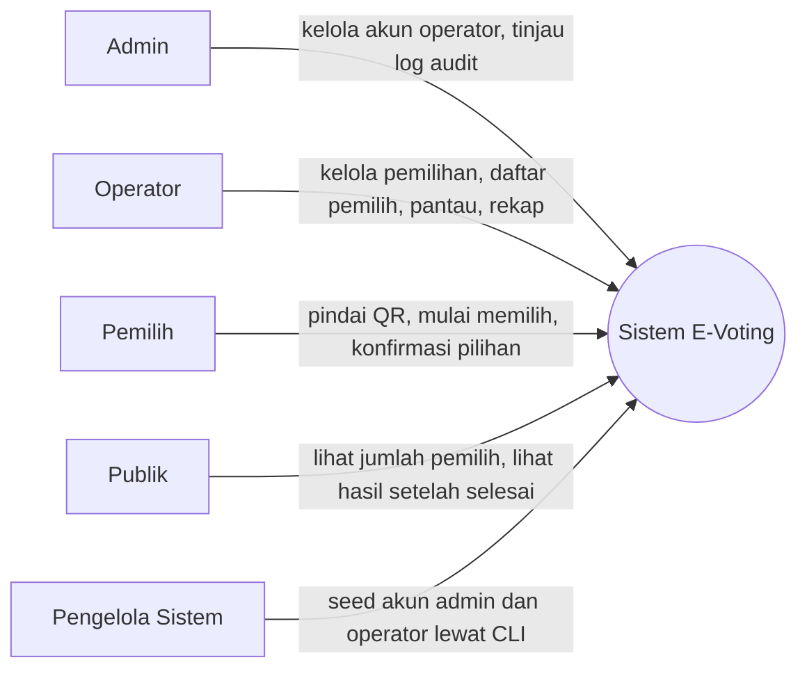

## 2.7 Keputusan yang telah ditetapkan

### Keputusan sesi tanya-jawab (`KP`)

| ID | Keputusan |
|---|---|
| KP-001 | Basis teknologi: **Laravel + Supabase**. |
| KP-002 | Supabase hanya sebagai **PostgreSQL terkelola**; Laravel terhubung langsung ke database; autentikasi dikelola Laravel. |
| KP-003 | Antarmuka **Blade + Livewire**. Halaman Operator memperbarui diri otomatis (polling) **setiap 3 detik**; halaman lain **harus di-refresh manual** untuk melihat perubahan data. Interval dan daftar halaman real-time dapat diubah nanti; dapat ditingkatkan ke Reverb bila perlu. |
| KP-004 | Sesi `Sedang memilih` yang terputus: pemilih **dapat melanjutkan di browser yang sama selama batas waktu 10 menit belum berjalan**. Operator dapat **mereset manual** dan proses diulang. |
| KP-005 | Aktor: **Admin** (hanya mengelola akun Operator dan hal relevan lain), **Operator** (mengelola semua hal lain secara mandiri), **Pemilih** (anonim). Batas maksimum hak pilih kini ditetapkan Operator. |
| KP-006 | Akun admin dibuat lewat CLI (contoh JS: `npm run seed:admin`); selain lewat Admin di aplikasi, akun operator dapat dibuat lewat CLI (contoh JS: `npm run seed:operator`) |
| KP-007 | **Masa pemilihan dapat diatur** dengan ketelitian tahun, bulan, tanggal, jam, dan menit. |
| KP-008 | Ada **dua halaman publik**: (1) jumlah keseluruhan pemilih yang sudah memilih; (2) halaman yang hanya terbuka setelah masa pemilihan selesai. |

### Perubahan terhadap `discussion.md` (`CH`)

| ID | Perubahan | Alasan |
|---|---|---|
| CH-001 | `D§8` menyatakan "Admin menetapkan batas maksimum jumlah hak pilih". Sekarang **Operator** yang menetapkannya. | `KP-005`: operasi dilakukan mandiri oleh Operator; Admin hanya mengelola akun Operator. |
| CH-002 | `D§1`/`D§6` hanya menyebut Operator dan Pemilih. Sistem kini memiliki Admin (terbatas) dan Publik. | `KP-005`, `KP-006`, `KP-008`. |

## 2.8 Keputusan terbuka (`OD`)

Semua nilai bertanda **Rekomendasi** di dokumen ini berlaku sebagai bawaan sampai dikonfirmasi.

| ID | Keputusan yang belum ditetapkan | Bawaan yang dipakai dokumen | Dampak bila berbeda |
|---|---|---|---|
| OD-001 | Target performa (waktu respons) dan ukuran maksimum pemilihan (jumlah hak pilih dan pemilih serentak) | **Tidak ada angka.** `NFR-011` diverifikasi setelah angka ditetapkan | Hanya mempengaruhi `NFR-011` dan sizing infrastruktur |
| OD-002 | Target ketersediaan (jam layanan, toleransi henti) | Tidak ada angka; lihat `NFR-010` | Mempengaruhi `NFR-010` dan pilihan hosting |
| OD-003 | Masa berlaku Token QR berbasis waktu terpisah | Token berlaku selama pemilihan `Berlangsung` dan hak pilih belum `Sudah memilih`; tidak ada kedaluwarsa jam terpisah | Bila ingin kedaluwarsa jam, `FR-014`, `FR-029`, `BR-012` perlu penyesuaian |
| OD-004 | Retensi data perangkat (IP, User-Agent) dan log setelah pemilihan selesai | Tidak dihapus otomatis; keputusan penghapusan manual oleh Pengelola Sistem | Mempengaruhi `NFR-006` dan kebijakan privasi |
| OD-005 | Visibilitas hasil per paslon sebelum masa pemilihan selesai | **Tidak ditampilkan** kepada siapa pun (Publik maupun Operator) sebelum Waktu Selesai (`BR-026`) | Bila Operator boleh melihat lebih awal, `BR-026`, `FR-020` berubah |
| OD-006 | Penafsiran `KP-007` dan `KP-008` (lihat daftar di bawah tabel ini) | Lihat daftar | `FR-009`, `FR-010`, `FR-022`, `BR-023`, `BR-025`, `BR-032` |
| OD-007 | Jumlah minimum paslon agar jadwal dapat diatur | **2 paslon** | `BR-024`, `FR-009` |
| OD-008 | Siapa yang meninjau log audit | **Admin**, baca saja (`FR-027`) | Bila Operator juga meninjau, `BR-021`, `FR-027` berubah |
| OD-009 | Pembatalan atau koreksi hak pilih yang salah daftar | **Tidak tersedia pada MVP**; nama dikunci (`BR-003`) | Perlu `FR` baru bila dibutuhkan |
| OD-010 | Penyedia hosting, region, dan layanan pemantau uptime | Lihat `BLUEPRINT.md` 3.16 | Hanya teknis |
| OD-011 | Foto/visi-misi paslon dan suara kosong | **Tidak ada** pada MVP | `FR-011`, `FR-017`, `FR-018` |
| OD-012 | Parameter keamanan akun (panjang kata sandi, batas percobaan masuk, batas idle sesi staf) | Nilai rekomendasi di `BLUEPRINT.md` 3.5 | Hanya parameter |
| OD-013 | Zona waktu penginputan dan tampilan jadwal | Dikonfigurasi saat penyebaran; penyimpanan selalu UTC | `FR-009`, `FR-022` |
| OD-014 | Daftar/indeks publik seluruh pemilihan | **Tidak ada**; Operator membagikan tautan halaman publik per pemilihan | Perlu `FR` baru bila dibutuhkan |

**Daftar penafsiran OD-006 (mohon dikonfirmasi):**

- (a) Jadwal (`KP-007`) **menggantikan** tombol buka/tutup manual. Fase Pemilihan berubah otomatis mengikuti waktu. Memajukan Waktu Selesai ke waktu sekarang berfungsi sebagai "akhiri lebih awal".
- (b) "Halaman yang hanya terbuka setelah masa pemilu selesai" (`KP-008`) berisi **hasil perolehan suara per paslon**.
- (c) Batas waktu selesai bersifat **keras**: pemilih yang masih `Sedang memilih` saat Waktu Selesai tidak dapat lagi mengonfirmasi, dan tidak ada masa tenggang.
- (d) Halaman publik jumlah pemilih (`KP-008` poin 1) hanya menampilkan **satu angka total** dan dapat dibuka kapan saja.

## 2.9 Glosarium

| Istilah resmi | Definisi | Catatan |
|---|---|---|
| Pemilihan | Satu penyelenggaraan pemungutan suara dengan nama, jadwal, paslon, dan batas hak pilih sendiri | Sistem mendukung lebih dari satu pemilihan |
| Jadwal Pemilihan | Pasangan **Waktu Mulai** dan **Waktu Selesai**, masing-masing ditetapkan sampai ketelitian menit | `KP-007` |
| Fase Pemilihan | Keadaan pemilihan yang **diturunkan dari jadwal**: `Persiapan` (jadwal belum diatur atau belum mencapai Waktu Mulai), `Berlangsung` (Waktu Mulai ≤ sekarang < Waktu Selesai), `Ditutup` (sekarang ≥ Waktu Selesai) | Bukan Status Hak Pilih |
| Paslon | Pasangan calon yang dipilih; memiliki nomor urut dan nama | |
| Pemilih | Orang yang memilih; anonim, tanpa akun permanen | `ACT-003` |
| Hak Pilih | Satu record yang mewakili hak suara satu pemilih dalam satu pemilihan; memiliki ID unik, nama, Status Hak Pilih, dan Token QR | `D§2` |
| Status Hak Pilih | Salah satu dari tiga nilai: `Belum memilih`, `Sedang memilih`, `Sudah memilih` | `D§4` |
| Token QR | Token acak sekali pakai yang tertanam dalam URL pada QR; tidak memuat nama maupun pilihan | `D§3` |
| QR | Gambar kode yang mengarah ke URL berisi Token QR | |
| Sesi Memilih | Rentang sejak `Mulai memilih` sampai `Konfirmasi pilihan` atau reset; berbatas **10 menit** | `KP-004` |
| Sesi Kedaluwarsa | **Indikator tampilan** (bukan status) pada Hak Pilih berstatus `Sedang memilih` yang batas 10 menit Sesi Memilihnya sudah lewat | |
| Pengenal Browser | Nilai acak yang disimpan di cookie browser untuk mengenali browser yang sama | `D§5` |
| Perangkat | Browser yang dikenali melalui Pengenal Browser | Bukan identitas seseorang |
| Peringatan Perangkat | Indikator bahwa Hak Pilih diakses dari Perangkat yang sebelumnya sudah diakses Hak Pilih **lain** pada pemilihan yang sama | `D§5` |
| Suara | Satu pilihan paslon yang tersimpan secara anonim | Tidak terhubung ke Hak Pilih |
| Rekapitulasi | Penjumlahan Suara per paslon | `FR-020`, `FR-022` |
| Log Audit | Catatan permanen tindakan penting | `D§6` |
| Akun Staf | Akun Admin atau Operator | |
| 2FA / TOTP | Autentikasi dua faktor dengan kode sekali pakai berbasis waktu dari aplikasi autentikator | `D§6` ("autentikasi yang kuat"); mekanisme: Rekomendasi. Admin Only. |
| Nama Kembar | Dua nama yang sama setelah penyeragaman huruf besar/kecil dan spasi | `D§2` |
| Reset Sesi | Tindakan Operator mengembalikan `Sedang memilih` menjadi `Belum memilih` | `FR-030` |
| Terbitkan Ulang QR | Tindakan Operator mencabut Token QR lama dan menerbitkan yang baru | `FR-029` |
| Halaman Jumlah Pemilih | Halaman publik berisi jumlah Hak Pilih berstatus `Sudah memilih` | `FR-021` |
| Halaman Hasil | Halaman publik berisi hasil per paslon, hanya setelah Waktu Selesai | `FR-022` |

## 2.10 Pemetaan keputusan `discussion.md` ke PRD

| `D§` | Keputusan | Diakomodasi oleh |
|---|---|---|
| 1 | Online voting berbasis QR token sekali pakai | `FR-014`, `FR-015`, `BR-002`, `BR-012` |
| 1 | Pemilih tanpa akun/password permanen | `BR-002` |
| 1 | Operator validator identitas langsung | `BR-001`, `FR-012` |
| 2 | Operator login akun khusus, memasukkan nama lengkap | `FR-001`, `FR-012` |
| 2 | Satu record hak pilih dengan ID unik dan QR token; status awal `Belum memilih` | `FR-012`, `FR-014`, `BR-006` |
| 2 | Nama terkunci; nama sama harus dipastikan berbeda orang | `FR-013`, `BR-003`, `BR-004` |
| 2 | Tanpa kewajiban import/integrasi data sekolah | `BR-005`, 2.4 |
| 3 | Alur lima langkah (QR → `Mulai memilih` → `Sedang memilih` → `Konfirmasi pilihan` → `Sudah memilih`) | `FR-015` – `FR-018`, `WF-005` |
| 3 | URL token acak tanpa nama/pilihan; QR tidak menghasilkan suara > 1 | `BR-010`, `BR-012` |
| 4 | Tiga status; perubahan divalidasi backend; atomik; satu transaksi | `FR-019`, `BR-007`, `BR-008`, `BR-009` |
| 5 | Pencatatan UA, cookie, session, IP, waktu; peringatan; hanya indikator; perangkat bersama boleh | `FR-024`, `FR-025`, `BR-015`, `BR-029` |
| 6 | Hanya operator berwenang; autentikasi kuat; audit log; hak akses dibatasi | `FR-001`, `FR-002`, `FR-004`, `FR-026`, `BR-020` – `BR-022` |
| 7 | Identitas dipisah dari pilihan; operator tidak melihat pilihan; hasil dari data anonim | `BR-016`, `BR-017`, `NFR-005`, `NFR-006` |
| 8 | Batas maksimum hak pilih; tolak setelah tercapai; gelombang di luar sistem; suara ≤ hak pilih | `FR-028`, `FR-032`, `BR-018`, `BR-019`, `CH-001` |
| 9 | Validasi di backend; token acak, aman, kedaluwarsa/dapat dicabut; endpoint harus memastikan prasyarat; satu token satu suara | `BR-030`, `FR-016`, `FR-018`, `FR-029`, `BR-010`, OD-003 |

---

# 3. Isi Utama

## 3.1 Kebutuhan Fungsional Utama

Kolom **Status** menyatakan sumber kebutuhan: *Disepakati* atau *Rekomendasi* (dengan `OD` bila berdampak).

### Autentikasi dan manajemen akses staf

| ID | Kebutuhan | Aktor | Alasan | Prioritas | Status | Dasar |
|---|---|---|---|---|---|---|
| FR-001 | **Login akun staf.** Sistem mengautentikasi Admin/Operator dengan username dan kata sandi, lalu kode TOTP; setelah berhasil, mengarahkan sesuai peran. Pesan gagal tidak membedakan username salah dan kata sandi salah. | Admin, Operator | Hanya staf berwenang boleh membuat hak pilih dan mengelola akun | P1 | Disepakati (kewajiban autentikasi kuat); TOTP = Rekomendasi (OD-012) | `D§6` |
| FR-002 | **Aktivasi akun pertama.** Akun yang baru dibuat atau direset wajib mengganti kata sandi sementara dan mengaktifkan TOTP sebelum mengakses fitur lain. | Admin, Operator | Kata sandi sementara diketahui pihak lain; autentikasi kuat wajib | P1 | Rekomendasi | `D§6`, `KP-006` |
| FR-003 | **Logout dan kedaluwarsa sesi staf.** Staf dapat keluar; sesi berakhir bila tidak aktif melebihi batas. | Admin, Operator | Mencegah sesi tertinggal di perangkat bersama | P1 | Rekomendasi (OD-012) | `D§6` |
| FR-004 | **Otorisasi berbasis peran.** Admin hanya mengakses fitur akun Operator dan log audit; Operator hanya mengakses fitur pemilihan; Pemilih hanya halaman QR-nya; Publik hanya dua halaman publik. | Semua | Hak akses dibatasi sesuai tugas | P1 | Disepakati | `D§6`, `KP-005`, `BR-021` |
| FR-005 | **Pembuatan akun Operator oleh Admin.** Admin memasukkan username dan nama lengkap; sistem membuat akun dan menampilkan kata sandi sementara **sekali**. | Admin | Operator tidak dapat dibuat sendiri; satu-satunya tugas Admin | P1 | Disepakati | `KP-005`, `KP-006` |
| FR-006 | **Aktivasi/penonaktifan akun Operator.** Akun nonaktif tidak dapat masuk dan sesi aktifnya diakhiri; akun tidak dihapus agar jejak audit utuh. | Admin | Mencabut akses staf yang tidak bertugas lagi | P1 | Disepakati (pengelolaan akun); detail = Rekomendasi | `KP-005` |
| FR-007 | **Reset kredensial Operator.** Admin dapat mereset kata sandi (menghasilkan kata sandi sementara baru) atau mereset TOTP (memaksa aktivasi ulang). | Admin | Operator kehilangan kata sandi/perangkat autentikator tidak boleh menghentikan pemilihan | P2 | Rekomendasi | `KP-005` |

### Pengelolaan pemilihan dan paslon

| ID | Kebutuhan | Aktor | Alasan | Prioritas | Status | Dasar |
|---|---|---|---|---|---|---|
| FR-008 | **Membuat dan mengubah pemilihan.** Operator mengisi nama pemilihan dan batas maksimum hak pilih (`FR-028`). Pemilihan baru berada pada Fase `Persiapan`. | Operator | Menjadi wadah paslon, pemilih, dan hasil | P1 | Disepakati | `D§8`, `KP-005`, `CH-001` |
| FR-009 | **Mengatur Jadwal Pemilihan.** Operator menetapkan Waktu Mulai dan Waktu Selesai dengan ketelitian tahun, bulan, tanggal, jam, menit. Aturan: Waktu Selesai harus setelah Waktu Mulai; jadwal baru tidak boleh sudah berakhir; jadwal hanya dapat diatur bila paslon minimal 2; saat `Berlangsung`, Waktu Selesai boleh diperpanjang atau dimajukan (termasuk ke waktu sekarang untuk mengakhiri lebih awal) tetapi Waktu Mulai terkunci; setelah `Ditutup` jadwal tidak dapat diubah. | Operator | Masa pemilihan harus terbatas dan terkontrol tanpa tindakan buka/tutup manual | P1 | Disepakati (adanya jadwal berketelitian menit); aturan rinci = Rekomendasi (OD-006, OD-007) | `KP-007` |
| FR-010 | **Penegakan Fase Pemilihan.** Fase diturunkan otomatis dari jadwal dan ditegakkan di backend: Hak Pilih hanya dapat dibuat, dan voting hanya dapat dimulai serta dikonfirmasi, pada Fase `Berlangsung`; paslon hanya dapat diubah pada `Persiapan`. | Sistem | Mencegah suara di luar masa pemilihan dan perubahan paslon saat atau sesudah pemungutan | P1 | Rekomendasi (turunan `KP-007`) | `KP-007`, `D§9`, OD-006 |
| FR-011 | **Mengelola paslon.** Operator menambah, mengubah, dan menghapus paslon (nomor urut unik per pemilihan, nama) pada Fase `Persiapan`. | Operator | Pemilih harus memilih satu paslon dari daftar yang sah | P1 | Disepakati | `D§3` |

### Registrasi pemilih dan QR

| ID | Kebutuhan | Aktor | Alasan | Prioritas | Status | Dasar |
|---|---|---|---|---|---|---|
| FR-012 | **Registrasi pemilih oleh Operator.** Setelah memverifikasi identitas secara langsung, Operator memasukkan nama lengkap pemilih. Sistem membuat satu Hak Pilih berstatus `Belum memilih` dan menerbitkan QR. Pemilih tidak perlu akun. | Operator | Operator adalah validator identitas | P1 | Disepakati | `D§1`, `D§2` |
| FR-013 | **Penguncian nama dan penanganan Nama Kembar.** Nama yang sudah terdaftar dikunci agar tidak dibuatkan Hak Pilih kedua secara tidak sengaja. Bila nama sama, sistem menampilkan Hak Pilih yang sudah ada dan Operator harus menyatakan secara eksplisit bahwa keduanya orang berbeda sebelum Hak Pilih terpisah dibuat. | Operator | Mencegah dobel registrasi, tetapi tetap mengizinkan dua orang bernama sama | P1 | Disepakati | `D§2` |
| FR-014 | **Penerbitan QR.** Saat Hak Pilih dibuat, sistem menerbitkan Token QR dan menampilkan QR beserta tautan teks. Token QR hanya ditampilkan pada saat penerbitan (termasuk penerbitan ulang) dan tidak dapat ditampilkan lagi. | Operator | Pemilih membutuhkan jalur akses sekali pakai; tautan teks membantu perangkat tanpa pemindai | P1 | Disepakati (QR dan token acak); "tampil sekali" = Rekomendasi | `D§2`, `D§3`, `D§9` |

### Proses voting

| ID | Kebutuhan | Aktor | Alasan | Prioritas | Status | Dasar |
|---|---|---|---|---|---|---|
| FR-015 | **Akses halaman voting melalui QR.** Pemindaian QR membuka halaman yang menyesuaikan diri dengan Status Hak Pilih dan Fase Pemilihan (lihat `UI-014` – `UI-017`). Halaman tidak menampilkan nama pemilih. | Pemilih | Satu pintu masuk tanpa akun | P1 | Disepakati | `D§3` |
| FR-016 | **Mulai memilih.** Saat Pemilih menekan `Mulai memilih`, sistem memvalidasi token, memastikan Status `Belum memilih` dan Fase `Berlangsung`, mengubah status menjadi `Sedang memilih` secara atomik (satu token tidak dapat memulai sesi dari beberapa perangkat bersamaan), lalu membuat Sesi Memilih berbatas 10 menit yang terikat pada browser tersebut. | Pemilih | Mencegah sesi ganda dan dobel suara | P1 | Disepakati | `D§3`, `D§4`, `D§9`, `KP-004` |
| FR-017 | **Memilih paslon.** Pemilih memilih tepat satu paslon dari daftar pemilihan tersebut. Pilihan belum tersimpan sampai dikonfirmasi. | Pemilih | Satu pemilih, satu pilihan | P1 | Disepakati | `D§3` |
| FR-018 | **Konfirmasi pilihan dan penyimpanan suara.** Saat Pemilih menekan `Konfirmasi pilihan`, sistem memastikan Status `Sedang memilih`, Sesi Memilih masih berlaku dan milik browser yang sama, Fase `Berlangsung`, dan pilihan belum pernah disimpan; lalu menyimpan Suara anonim dan mengubah status menjadi `Sudah memilih` dalam **satu transaksi**. Permintaan ulang tidak menambah Suara. | Pemilih | Integritas: satu token, satu suara | P1 | Disepakati | `D§3`, `D§4`, `D§9` |
| FR-019 | **Pengelolaan Status Hak Pilih.** Hanya tiga status dan hanya transisi yang diizinkan `BR-007`; semua divalidasi di backend, tidak pernah hanya di frontend. | Sistem | Mencegah status tidak sah | P1 | Disepakati | `D§4`, `D§9` |

### Rekapitulasi dan halaman publik

| ID | Kebutuhan | Aktor | Alasan | Prioritas | Status | Dasar |
|---|---|---|---|---|---|---|
| FR-020 | **Rekapitulasi Operator.** Setelah Waktu Selesai, Operator melihat jumlah Suara per paslon, total Suara, dan hasil pemeriksaan integritas (`FR-032`). Sebelum itu, angka per paslon tidak ditampilkan. | Operator | Mengesahkan hasil secara internal dan menemukan anomali | P1 | Disepakati (hasil dari data anonim); waktu tampil = Rekomendasi (OD-005) | `D§7`, `D§8` |
| FR-021 | **Halaman publik Jumlah Pemilih.** Siapa pun tanpa login dapat melihat jumlah keseluruhan Hak Pilih berstatus `Sudah memilih` untuk satu pemilihan. Halaman hanya menampilkan satu angka total (tanpa nama, tanpa rincian paslon), tidak memperbarui diri otomatis, dan dapat dibuka kapan saja. | Publik | Transparansi partisipasi tanpa membuka identitas atau pilihan | P1 | Disepakati (isi); penafsiran rincian = Rekomendasi (OD-006d) | `KP-008`, `KP-003` |
| FR-022 | **Halaman publik Hasil.** Halaman hasil hanya terbuka setelah Waktu Selesai. Sebelum itu, halaman menampilkan pesan bahwa hasil belum tersedia beserta Waktu Selesai, **tanpa angka apa pun**. Setelah itu menampilkan Suara per paslon dan total Suara. | Publik | Hasil tidak boleh bocor sebelum waktunya; setelah itu transparan | P1 | Disepakati (terbuka hanya setelah masa selesai); isi hasil per paslon = Rekomendasi (OD-006b) | `KP-008`, `BR-026` |

## 3.2 Kebutuhan Fungsional Pendukung

| ID | Kebutuhan | Aktor | Alasan | Prioritas | Status | Dasar |
|---|---|---|---|---|---|---|
| FR-023 | **Monitoring aktivitas pemilih.** Operator melihat ringkasan jumlah Hak Pilih per Status Hak Pilih dan daftar Hak Pilih (nama, status, waktu perubahan terakhir, indikator Sesi Kedaluwarsa, indikator Peringatan Perangkat), dengan pencarian nama. Halaman ini memperbarui diri **setiap 3 detik**; Operator tidak melihat pilihan paslon. | Operator | Operator perlu tahu siapa yang sedang memilih dan siapa yang tertahan | P1 | Disepakati | `D§4`, `D§7`, `KP-003` |
| FR-024 | **Pencatatan perangkat.** Pada setiap akses Hak Pilih (pembukaan QR, `Mulai memilih`, `Konfirmasi pilihan`, penolakan) sistem mencatat User-Agent, Pengenal Browser, Sesi Memilih (bila ada), IP address, dan waktu. | Sistem | Bahan indikator dan audit | P2 | Disepakati | `D§5` |
| FR-025 | **Peringatan Perangkat.** Bila Hak Pilih diakses dari Perangkat yang sebelumnya sudah diakses Hak Pilih lain pada pemilihan yang sama, dashboard Operator menandainya dan menyediakan riwayat penggunaan Perangkat tersebut. Pengenalan hanya berdasarkan Pengenal Browser; IP dan User-Agent hanya ditampilkan sebagai konteks. Peringatan **tidak memblokir** voting. | Operator | Operator memverifikasi langsung; perangkat bersama tetap boleh | P2 | Disepakati | `D§5` |
| FR-026 | **Audit aktivitas.** Sistem mencatat: login (berhasil/gagal), logout, perubahan kredensial, pengelolaan akun Operator, pembuatan/perubahan pemilihan, pengaturan jadwal, pengelolaan paslon, pembuatan Hak Pilih, penerbitan ulang QR, Reset Sesi, serta peristiwa `Mulai memilih` dan konfirmasi (tanpa isi pilihan). Entri tidak dapat diubah atau dihapus. | Sistem | Akuntabilitas staf | P1 | Disepakati (daftar inti `D§6`); perluasan = Rekomendasi | `D§6` |
| FR-027 | **Peninjauan Log Audit.** Admin dapat melihat dan memfilter Log Audit (baca saja). | Admin | Audit tanpa peninjau tidak berguna; Admin tidak menjalankan operasi pemilihan sehingga independen | P2 | Rekomendasi (OD-008) | `D§6` |
| FR-028 | **Batas maksimum hak pilih.** Operator menetapkan batas per pemilihan; sistem menolak pembuatan Hak Pilih setelah batas tercapai; batas tidak boleh diturunkan di bawah jumlah Hak Pilih yang sudah dibuat. | Operator, Sistem | Mencegah penerbitan hak pilih berlebih | P1 | Disepakati (batas dan penolakan); aturan penurunan = Rekomendasi | `D§8`, `CH-001` |
| FR-029 | **Terbitkan Ulang QR.** Untuk QR yang hilang, rusak, atau diduga disalahgunakan, Operator dapat mencabut Token QR lama dan menerbitkan yang baru, hanya saat Status `Belum memilih` dan Fase `Berlangsung`; alasan wajib diisi. | Operator | Penanganan QR bermasalah tanpa membuat Hak Pilih kedua | P2 | Disepakati (token dapat dicabut; penerbitan ulang diaudit); alasan wajib = Rekomendasi | `D§6`, `D§9` |
| FR-030 | **Reset Sesi Memilih.** Untuk proses voting yang terputus, Operator dapat mengembalikan `Sedang memilih` menjadi `Belum memilih` (mengakhiri Sesi Memilih lama), dengan alasan wajib; pemilih lalu mengulang dari pemindaian QR. | Operator | Pemilih tidak boleh terjebak selamanya | P1 | Disepakati (reset manual); alasan wajib = Rekomendasi | `KP-004` |
| FR-031 | **Notifikasi dan feedback antarmuka.** Setiap aksi menampilkan keadaan *loading*, lalu pesan *sukses* atau *galat* dalam bahasa Indonesia yang jelas dan tidak membocorkan detail teknis atau data sensitif. | Semua | Pengguna perlu kepastian hasil aksi, terutama pemilih | P2 | Rekomendasi | permintaan penyusunan PRD 3.2 |
| FR-032 | **Pemeriksaan integritas suara.** Sistem memeriksa bahwa jumlah Suara tidak melebihi jumlah Hak Pilih yang berhasil dibuat dan sama dengan jumlah Hak Pilih berstatus `Sudah memilih`, dan menampilkan hasilnya kepada Operator. | Sistem, Operator | Mendeteksi manipulasi atau cacat sistem | P1 | Disepakati | `D§8` |

## 3.3 Relasi Kebutuhan

Matriks berikut menghubungkan kebutuhan fungsional dengan aktor, proses bisnis (`WF`), aturan bisnis (`BR`), kebutuhan non-fungsional (`NFR`), dan halaman (`UI`).

| FR | Aktor | WF | BR | NFR | UI |
|---|---|---|---|---|---|
| FR-001 | Admin, Operator | WF-003 | BR-021, BR-022 | NFR-001, NFR-003, NFR-004 | UI-001, UI-002 |
| FR-002 | Admin, Operator | WF-002, WF-003 | BR-022 | NFR-001 | UI-003 |
| FR-003 | Admin, Operator | WF-003 | BR-021 | NFR-003 | UI-001 |
| FR-004 | Semua | WF-003 | BR-021, BR-030 | NFR-004 | UI-020 |
| FR-005 | Admin | WF-002 | BR-021, BR-022 | NFR-001, NFR-014 | UI-004 |
| FR-006 | Admin | WF-002 | BR-021 | NFR-004, NFR-014 | UI-004 |
| FR-007 | Admin | WF-002 | BR-021, BR-022 | NFR-001, NFR-014 | UI-004 |
| FR-008 | Operator | WF-001 | BR-018, BR-021 | NFR-014 | UI-007, UI-008 |
| FR-009 | Operator | WF-001, WF-008 | BR-023, BR-024, BR-025, BR-032 | NFR-007, NFR-014 | UI-008 |
| FR-010 | Sistem | WF-001, WF-004, WF-005, WF-008 | BR-023, BR-024, BR-030, BR-032 | NFR-007 | UI-008, UI-014 – UI-017 |
| FR-011 | Operator | WF-001 | BR-011, BR-024 | NFR-007, NFR-014 | UI-008 |
| FR-012 | Operator | WF-004 | BR-001, BR-003, BR-004, BR-005, BR-006, BR-018, BR-023 | NFR-012, NFR-014 | UI-010, UI-011 |
| FR-013 | Operator | WF-004 | BR-003, BR-004 | NFR-007 | UI-010 |
| FR-014 | Operator | WF-004 | BR-002, BR-012, BR-028 | NFR-002 | UI-011 |
| FR-015 | Pemilih | WF-005 | BR-002, BR-012, BR-028 | NFR-002, NFR-006, NFR-012, NFR-013 | UI-014 – UI-017 |
| FR-016 | Pemilih | WF-005 | BR-007, BR-008, BR-013, BR-023 | NFR-007, NFR-009, NFR-012 | UI-014, UI-015 |
| FR-017 | Pemilih | WF-005 | BR-011 | NFR-012, NFR-013 | UI-015 |
| FR-018 | Pemilih | WF-005 | BR-009, BR-010, BR-016, BR-019, BR-023, BR-032 | NFR-005, NFR-007, NFR-009 | UI-015, UI-016 |
| FR-019 | Sistem | WF-005, WF-006 | BR-006, BR-007, BR-008, BR-009, BR-030 | NFR-007 | UI-009, UI-012 |
| FR-020 | Operator | WF-008 | BR-017, BR-019, BR-026 | NFR-005, NFR-007 | UI-013 |
| FR-021 | Publik | WF-008 | BR-016, BR-031 | NFR-006, NFR-013 | UI-018 |
| FR-022 | Publik | WF-008 | BR-016, BR-026, BR-032 | NFR-006, NFR-013 | UI-019 |
| FR-023 | Operator | WF-004, WF-006, WF-008, WF-009 | BR-017 | NFR-016 | UI-009 |
| FR-024 | Sistem | WF-005, WF-009 | BR-015 | NFR-006, NFR-014 | UI-012 |
| FR-025 | Operator | WF-009 | BR-015, BR-029 | NFR-014 | UI-009, UI-012 |
| FR-026 | Sistem | semua | BR-020 | NFR-008, NFR-014 | UI-006 |
| FR-027 | Admin | WF-002 | BR-020, BR-021 | NFR-014 | UI-006 |
| FR-028 | Operator, Sistem | WF-001, WF-004 | BR-018 | NFR-007 | UI-008, UI-010 |
| FR-029 | Operator | WF-007 | BR-027, BR-012 | NFR-002, NFR-014 | UI-011, UI-012 |
| FR-030 | Operator | WF-006 | BR-007, BR-013, BR-014 | NFR-009, NFR-014 | UI-012 |
| FR-031 | Semua | semua | — | NFR-012 | semua UI |
| FR-032 | Sistem, Operator | WF-008 | BR-019 | NFR-007, NFR-008 | UI-013 |

Hubungan antarkebutuhan yang perlu diketahui:

- `FR-016`, `FR-018`, `FR-030`, dan `FR-029` saling bergantung pada satu mesin status (`FR-019`); keempatnya harus memakai aturan transisi yang sama (`BR-007`).
- `FR-010` menjadi prasyarat bagi `FR-012`, `FR-016`, dan `FR-018`; `FR-009` mengatur jadwal yang menentukan `FR-010`.
- `FR-021` dan `FR-022` hanya boleh menampilkan data agregat; keduanya bergantung pada pemisahan identitas dan Suara (`BR-016`).
- `FR-024` memberi data bagi `FR-025`; `FR-025` tidak pernah menjadi prasyarat `FR-016`/`FR-018` (`BR-015`).

## 3.4 Kebutuhan Non-Fungsional

Angka yang belum ditetapkan ditandai **[Perlu konfirmasi: OD-xxx]** dan tidak diisi dengan perkiraan.

| ID | Kategori | Kebutuhan | Indikator keberhasilan / kriteria penerimaan | Metode verifikasi | Status |
|---|---|---|---|---|---|
| NFR-001 | Security — autentikasi | Akun staf dilindungi kata sandi dan faktor kedua; percobaan masuk beruntun dibatasi. | (1) Login tanpa TOTP yang benar selalu ditolak. (2) Setelah batas percobaan gagal per periode (nilai: OD-012) respons berikutnya ditolak sementara. (3) Tidak ada akun staf dengan TOTP belum aktif yang dapat mengakses fitur selain `UI-003`. | Uji otorisasi dan uji skenario login | Rekomendasi |
| NFR-002 | Security — token | Token QR tidak dapat ditebak dan tidak dapat digunakan ulang untuk menghasilkan suara kedua. | (1) Token berasal dari sumber acak kriptografis dengan entropi sekurang-kurangnya 256 bit. (2) Penyimpanan hanya dalam bentuk hash satu arah; tidak ada token mentah di database/log. (3) Token tidak memuat nama atau pilihan (`BR-012`). | Tinjauan skema, uji integrasi | Disepakati (acak, aman, tak memuat identitas); angka 256 bit = Rekomendasi |
| NFR-003 | Security — transport dan sesi | Seluruh lalu lintas melalui HTTPS; cookie sesi dan cookie pemilih tidak dapat dibaca skrip. | (1) Akses HTTP dialihkan atau ditolak. (2) Semua cookie bertanda aman dan tidak dapat diakses JavaScript. | Uji header dan cookie | Rekomendasi |
| NFR-004 | Security — otorisasi | Setiap keputusan hak akses dan validasi dilakukan di backend. | Untuk setiap pasangan (peran, fitur) pada `FR-004`: permintaan yang tidak berhak ditolak walau frontend dimanipulasi. | Uji otorisasi per peran | Disepakati (`D§9`) |
| NFR-005 | Privacy dan anonimitas | Tidak ada jalur data yang menghubungkan Hak Pilih/identitas pemilih dengan Suara. | (1) Tabel Suara tidak memiliki kolom atau relasi ke Hak Pilih, token, sesi, perangkat, atau akun. (2) Tidak ada waktu atau nomor urut pada Suara yang dapat dicocokkan dengan waktu perubahan status. (3) Tidak ada layar, log, atau ekspor yang menampilkan pilihan per pemilih. | Tinjauan skema dan hak akses; uji privasi | Disepakati (`D§7`) |
| NFR-006 | Privacy — minimisasi | Setiap halaman hanya menampilkan data yang diperlukan. | (1) Halaman Pemilih tidak menampilkan nama. (2) Halaman publik hanya menampilkan data agregat (`FR-021`, `FR-022`). (3) Operator hanya melihat status Hak Pilih, tidak pilihan. (4) Retensi IP/User-Agent: **[Perlu konfirmasi: OD-004]**. | Uji tampilan dan tinjauan data | Disepakati (`D§7`, `KP-008`); retensi terbuka |
| NFR-007 | Data integrity | Satu Hak Pilih menghasilkan paling banyak satu Suara; status dan Suara selalu konsisten. | (1) Dua permintaan serentak pada token yang sama menghasilkan paling banyak satu Sesi Memilih dan satu Suara. (2) Jumlah Suara = jumlah Hak Pilih `Sudah memilih` setelah beban uji apa pun. (3) Suara tidak dapat diubah atau dihapus. | Uji konkurensi dan integritas | Disepakati (`D§4`, `D§8`, `D§9`) |
| NFR-008 | Data integrity — jejak | Log Audit dan Suara tidak dapat diubah atau dihapus melalui aplikasi. | Percobaan UPDATE/DELETE atas entri audit atau Suara ditolak. | Uji basis data | Disepakati (`D§6`, `D§9`) |
| NFR-009 | Reliability | Proses yang terputus dapat dipulihkan tanpa kehilangan atau menggandakan suara. | (1) Setelah aplikasi dimulai ulang, Sesi Memilih berjalan tetap dapat dilanjutkan dalam batas 10 menit. (2) Konfirmasi yang diulang setelah kegagalan jaringan tidak menambah Suara. (3) Sesi terputus dapat dipulihkan Operator (`FR-030`). | Uji kegagalan dan uji ulang konfirmasi | Disepakati (`KP-004`) |
| NFR-010 | Availability | Layanan tersedia selama Fase `Berlangsung`. | Target ketersediaan: **[Perlu konfirmasi: OD-002]**. Selama OD belum ditetapkan, kriteria yang dapat diuji: pemantau uptime memeriksa titik kesehatan secara berkala dan mencatat setiap kegagalan. | Pemantauan uptime | Terbuka |
| NFR-011 | Performance | Waktu respons dan kapasitas sesuai ukuran pemilihan. | Waktu respons target dan jumlah pemilih serentak: **[Perlu konfirmasi: OD-001]**. Setelah ditetapkan, diuji dengan skenario beban yang mencakup `FR-016` dan `FR-018`. | Uji beban | Terbuka |
| NFR-012 | Usability | Pemilih dapat memilih tanpa pelatihan; Operator dapat mendaftar pemilih dengan langkah minimal. | (1) Setelah halaman QR terbuka, Pemilih menyelesaikan voting dengan **tiga aksi** saja: `Mulai memilih`, pilih paslon, `Konfirmasi pilihan`. (2) Registrasi satu pemilih normal membutuhkan satu isian (nama) dan satu aksi kirim. (3) Setiap galat menyebut tindakan berikutnya. | Uji penelusuran langkah | Rekomendasi |
| NFR-013 | Accessibility | Halaman pemilih dan publik dapat digunakan di layar ponsel dan dengan papan ketik. | (1) Halaman dapat digunakan pada lebar layar 360 px tanpa guliran horizontal. (2) Semua kontrol dapat dioperasikan dengan papan ketik dan memiliki label. (3) Kontras teks terhadap latar minimal 4,5 : 1. Acuan: WCAG 2.1 AA (subset ini). | Uji manual dan pemeriksa otomatis | Rekomendasi |
| NFR-014 | Auditability | Setiap tindakan penting dapat ditelusuri kepada pelaku, waktu, dan objek. | Untuk setiap tindakan pada `FR-026` ada tepat satu entri audit dengan aktor, waktu, dan objek terkait, dan tanpa isi pilihan. | Uji audit | Disepakati (`D§6`) |
| NFR-015 | Maintainability | Perubahan skema dan kebutuhan dapat ditelusuri dan diuji. | (1) Skema dapat dibangun ulang dari database kosong hanya dengan berkas migrasi awal. (2) Setiap `FR` memiliki sekurang-kurangnya satu test case yang terdaftar. (3) Pemeriksaan gaya kode dan seluruh tes lolos pada setiap perubahan. | Tinjauan matriks keterlacakan; CI | Rekomendasi |
| NFR-016 | Kesegaran data monitoring | Perubahan Status Hak Pilih tampil pada halaman Operator tanpa refresh manual. | Perubahan status muncul pada `UI-009` dalam satu interval pembaruan (3 detik, `KP-003`) ditambah waktu respons. Halaman non-Operator **tidak** memperbarui diri. | Uji end-to-end | Disepakati (`KP-003`) |

## 3.5 Workflow Sistem

### Gambaran menyeluruh

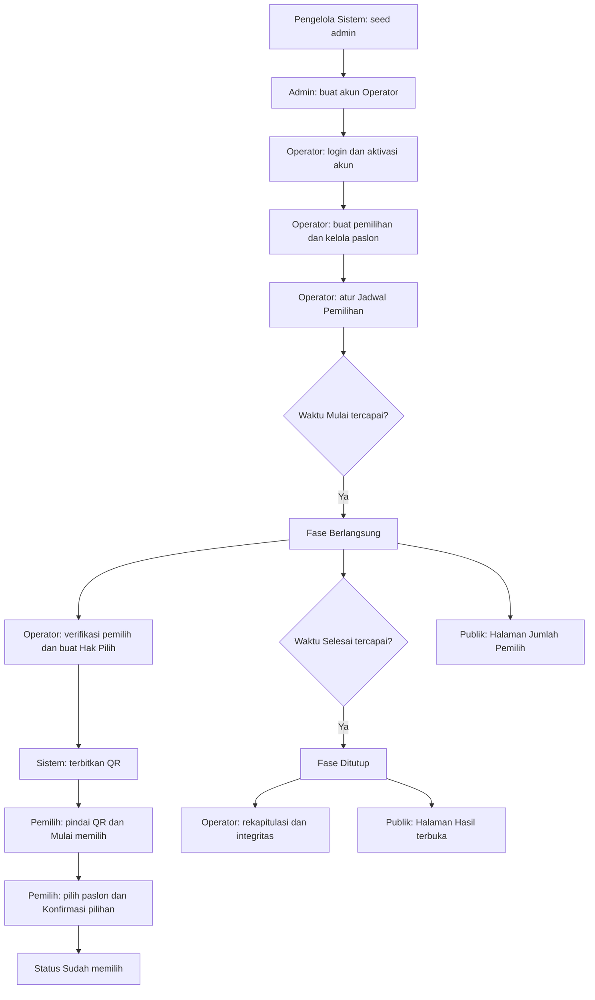

### Status Hak Pilih dan Fase Pemilihan

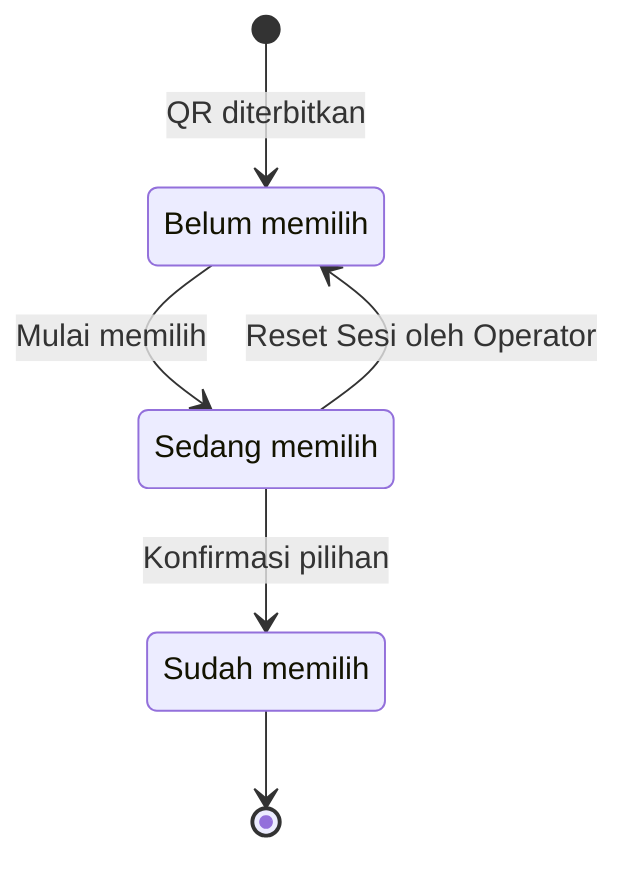

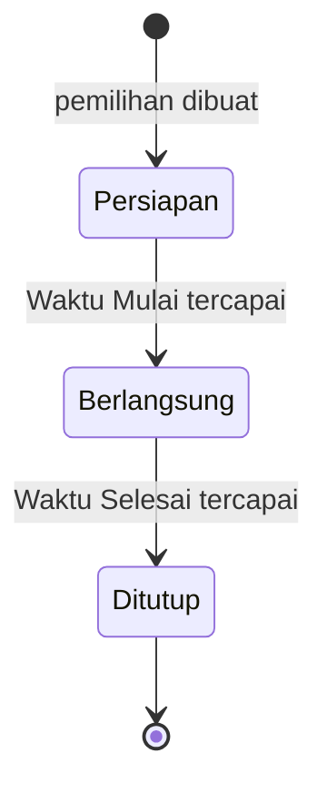

### WF-001 — Persiapan pemilihan oleh Operator

Kebutuhan: `FR-008`, `FR-009`, `FR-010`, `FR-011`, `FR-028`. Aturan: `BR-018`, `BR-023` – `BR-025`.

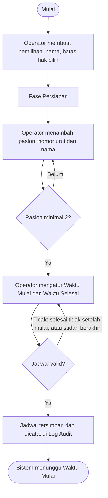

### WF-002 — Provisi dan pengelolaan akun staf

Kebutuhan: `FR-002`, `FR-005`, `FR-006`, `FR-007`, `FR-027`. Aturan: `BR-021`, `BR-022`.

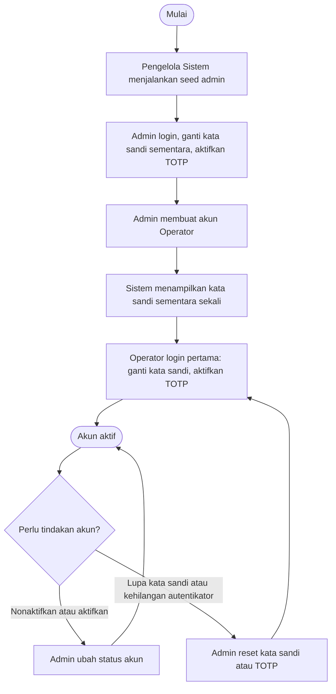

Operator juga dapat dibuat lewat CLI `seed:operator` (`KP-006`) dan mengikuti alur aktivasi yang sama mulai dari "Operator login pertama".

### WF-003 — Login staf

Kebutuhan: `FR-001`, `FR-003`, `FR-004`.

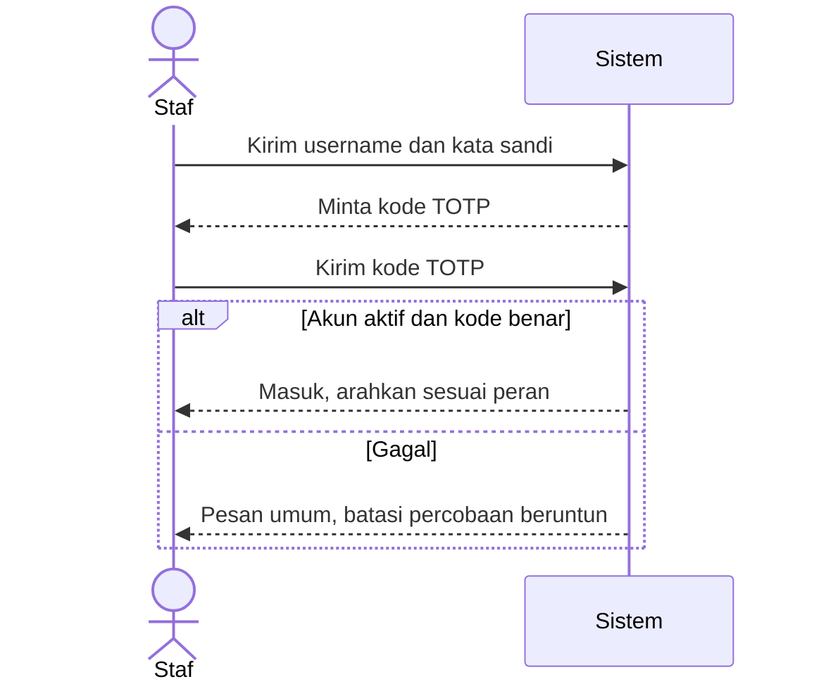

### WF-004 — Registrasi pemilih dan penerbitan QR

Kebutuhan: `FR-012`, `FR-013`, `FR-014`, `FR-028`. Aturan: `BR-001`, `BR-003`, `BR-004`, `BR-006`, `BR-018`, `BR-023`.

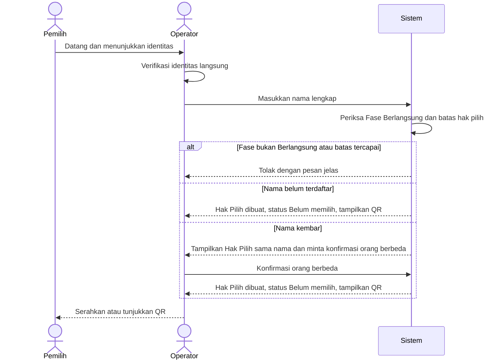

### WF-005 — Voting oleh Pemilih

Kebutuhan: `FR-015` – `FR-019`, `FR-024`. Aturan: `BR-007` – `BR-013`, `BR-016`, `BR-023`.

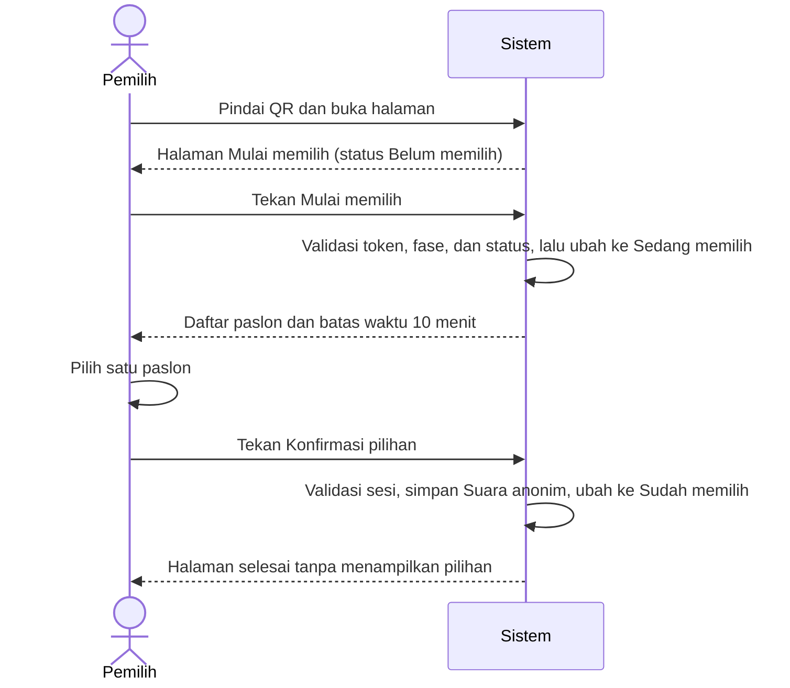

### WF-006 — Voting terputus

Kebutuhan: `FR-016`, `FR-030`. Aturan: `BR-013`, `BR-014`.

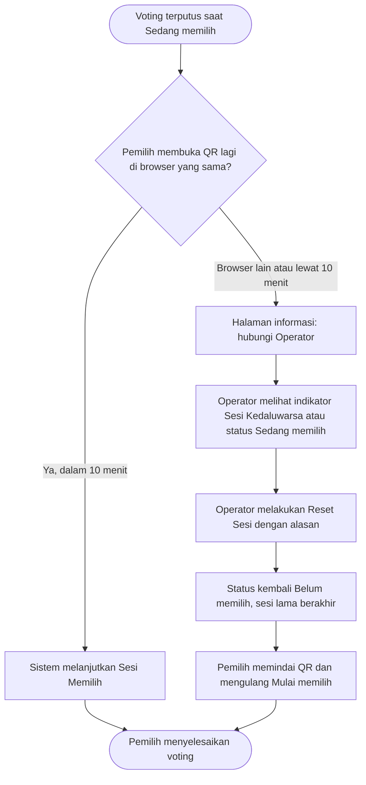

### WF-007 — QR bermasalah

Kebutuhan: `FR-029`. Aturan: `BR-027`.

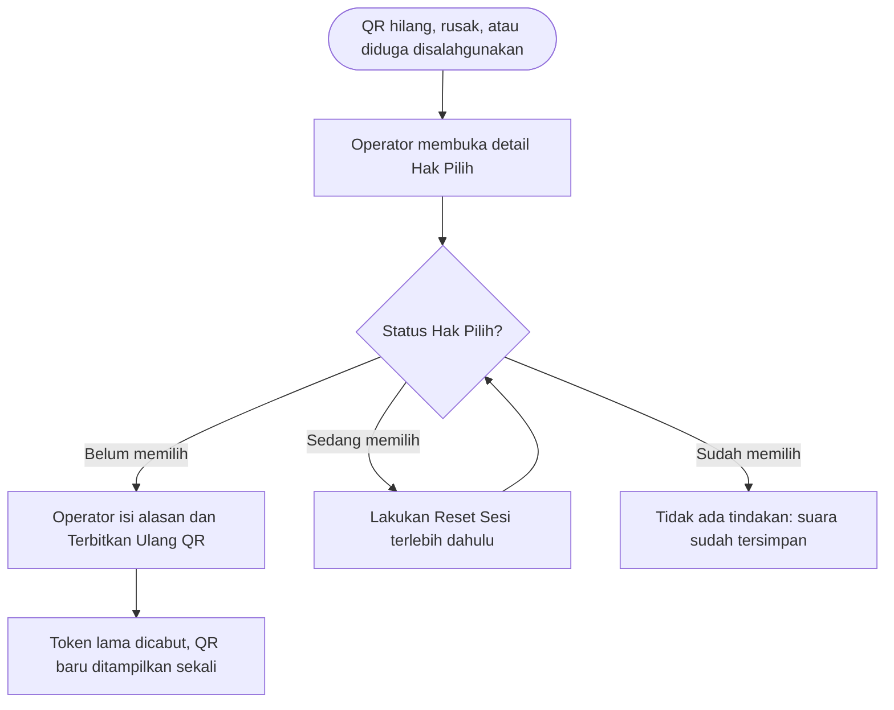

### WF-008 — Pemantauan, akhir masa pemilihan, dan rekapitulasi

Kebutuhan: `FR-009`, `FR-020` – `FR-023`, `FR-032`. Aturan: `BR-017`, `BR-019`, `BR-026`, `BR-031`, `BR-032`.

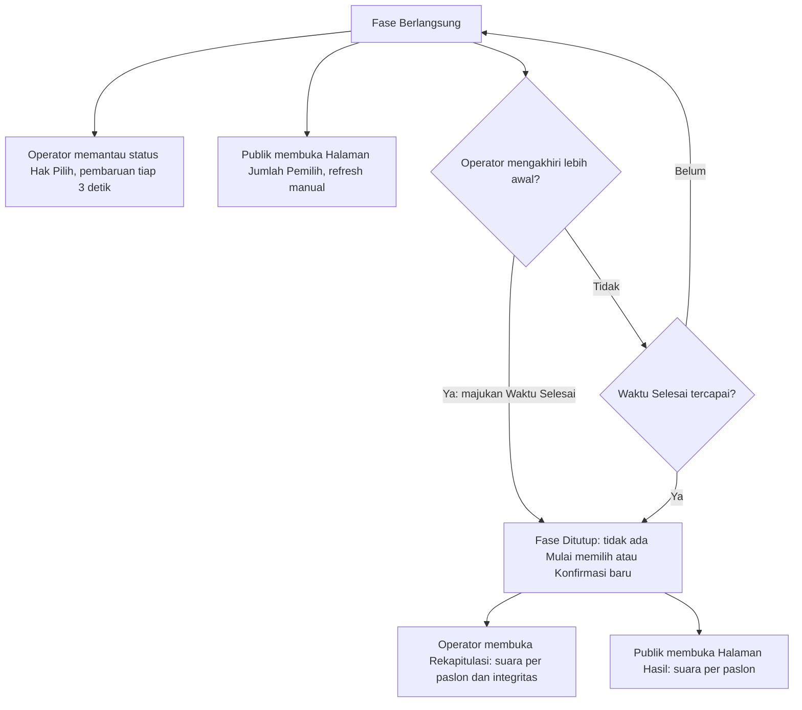

Sebelum Waktu Selesai, Halaman Hasil hanya menampilkan pesan "belum tersedia" dan Waktu Selesai.

### WF-009 — Penanganan Peringatan Perangkat

Kebutuhan: `FR-024`, `FR-025`. Aturan: `BR-015`, `BR-029`.

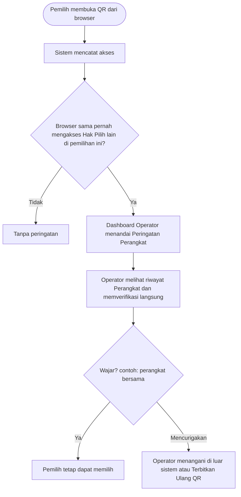

## 3.6 UI/UX Conceptual Workflow

Bagian ini hanya menjelaskan kebutuhan interaksi, bukan desain visual.

### Daftar halaman

| ID | Halaman | Aktor | Tujuan | `FR` |
|---|---|---|---|---|
| UI-001 | Masuk | Admin, Operator | Memasukkan username dan kata sandi | FR-001, FR-003 |
| UI-002 | Verifikasi 2FA | Admin, Operator | Memasukkan kode TOTP | FR-001 |
| UI-003 | Aktivasi Akun | Admin, Operator | Mengganti kata sandi sementara dan mengaktifkan TOTP | FR-002 |
| UI-004 | Daftar Akun Operator | Admin | Membuat, menonaktifkan/mengaktifkan, mereset kredensial | FR-005 – FR-007 |
| UI-005 | Panel Buat Akun Operator | Admin | Mengisi data akun dan melihat kata sandi sementara sekali | FR-005 |
| UI-006 | Log Audit | Admin | Meninjau dan memfilter Log Audit | FR-026, FR-027 |
| UI-007 | Daftar Pemilihan | Operator | Melihat dan membuat pemilihan | FR-008 |
| UI-008 | Detail Pemilihan | Operator | Mengubah nama dan batas, mengatur jadwal, mengelola paslon | FR-008 – FR-011, FR-028 |
| UI-009 | Pantau Pemilih | Operator | Memantau status Hak Pilih (pembaruan tiap 3 detik) | FR-023, FR-025 |
| UI-010 | Registrasi Pemilih | Operator | Memasukkan nama pemilih dan mengonfirmasi nama kembar | FR-012, FR-013, FR-028 |
| UI-011 | Panel QR | Operator | Menampilkan QR dan tautan sekali setelah pembuatan atau penerbitan ulang | FR-014, FR-029 |
| UI-012 | Detail Hak Pilih | Operator | Melihat riwayat perangkat; Reset Sesi; Terbitkan Ulang QR | FR-025, FR-029, FR-030 |
| UI-013 | Rekapitulasi | Operator | Melihat hasil per paslon dan integritas setelah Waktu Selesai | FR-020, FR-032 |
| UI-014 | Pemilih — Mulai memilih | Pemilih | Memulai proses voting | FR-015, FR-016 |
| UI-015 | Pemilih — Voting | Pemilih | Memilih paslon dan mengonfirmasi | FR-017, FR-018 |
| UI-016 | Pemilih — Selesai | Pemilih | Memberi kepastian suara tersimpan | FR-015, FR-018 |
| UI-017 | Pemilih — Informasi Kendala | Pemilih | Menjelaskan mengapa tidak dapat memilih dan apa langkah berikutnya | FR-015 |
| UI-018 | Publik — Jumlah Pemilih | Publik | Menampilkan jumlah yang sudah memilih | FR-021 |
| UI-019 | Publik — Hasil | Publik | Menampilkan hasil setelah masa pemilihan selesai | FR-022 |
| UI-020 | Halaman Galat Umum | Semua | Menangani akses tidak berhak, tidak ditemukan, terlalu banyak permintaan, dan galat sistem | FR-004, FR-031 |

### Rincian informasi, aksi, dan perubahan status

| ID | Informasi yang ditampilkan | Aksi tersedia | Perubahan setelah aksi |
|---|---|---|---|
| UI-001 | Isian username dan kata sandi; pesan galat umum | Masuk | Lolos tahap 1 → `UI-002`. Gagal → tetap di halaman |
| UI-002 | Isian kode TOTP | Verifikasi, Keluar | Lolos → beranda sesuai peran atau `UI-003` bila akun perlu aktivasi |
| UI-003 | Langkah 1: ganti kata sandi. Langkah 2: kode QR/kunci TOTP dan isian konfirmasi kode | Simpan kata sandi, Konfirmasi TOTP | Selesai → beranda sesuai peran |
| UI-004 | Daftar akun Operator: username, nama, aktif/nonaktif, status 2FA | Buat akun, Nonaktifkan/Aktifkan, Reset kata sandi, Reset TOTP | Akun baru/berubah; entri audit |
| UI-005 | Isian username dan nama lengkap; kata sandi sementara (sekali) | Buat | Akun dibuat; kata sandi sementara tampil sekali |
| UI-006 | Tabel entri audit (waktu, aktor, aksi, objek); filter waktu/aktor/aksi | Filter, halaman berikutnya | Tidak mengubah data |
| UI-007 | Daftar pemilihan: nama, Fase Pemilihan, jadwal, jumlah Hak Pilih/batas | Buat pemilihan, Buka detail | Pemilihan baru fase `Persiapan` |
| UI-008 | Nama, batas, jadwal (tahun, bulan, tanggal, jam, menit), Fase, daftar paslon, tautan halaman publik | Simpan nama/batas, Atur jadwal, Tambah/ubah/hapus paslon | Jadwal tersimpan; Fase mengikuti waktu |
| UI-009 | Ringkasan jumlah per Status Hak Pilih; daftar: nama, status, waktu perubahan, indikator Sesi Kedaluwarsa dan Peringatan Perangkat; pencarian | Cari, Buka detail, Registrasi baru | Tidak mengubah data (pembaruan otomatis tiap 3 detik) |
| UI-010 | Isian nama; sisa kuota; daftar Hak Pilih sama nama (bila ada) | Buat Hak Pilih, Konfirmasi "orang berbeda" | Hak Pilih baru `Belum memilih` → `UI-011` |
| UI-011 | QR, tautan teks, pengingat bahwa QR hanya tampil sekali | Selesai | Kembali ke `UI-010`/`UI-009`; QR tidak dapat dibuka lagi |
| UI-012 | Nama, status, waktu perubahan, sesi aktif dan batas waktunya, riwayat akses perangkat (waktu, jenis akses, Pengenal Browser disingkat, User-Agent, IP), Hak Pilih lain pada Perangkat yang sama | Reset Sesi (alasan wajib), Terbitkan Ulang QR (alasan wajib) | `Sedang memilih` → `Belum memilih`; token lama dicabut dan QR baru → `UI-011` |
| UI-013 | Sebelum Waktu Selesai: pesan belum tersedia. Sesudahnya: suara per paslon, total, status integritas | Muat ulang | Tidak mengubah data |
| UI-014 | Pesan sambutan umum, tombol `Mulai memilih` | `Mulai memilih` | `Belum memilih` → `Sedang memilih` → `UI-015` |
| UI-015 | Daftar paslon (nomor urut, nama), sisa waktu sesi, tombol `Konfirmasi pilihan` (nonaktif sampai ada pilihan) | Pilih satu paslon, `Konfirmasi pilihan` | `Sedang memilih` → `Sudah memilih` → `UI-016` |
| UI-016 | Pesan bahwa suara tersimpan, tanpa menampilkan pilihan atau nama | — | Tidak ada |
| UI-017 | Pesan sesuai penyebab (QR tidak valid atau dicabut, pemilihan belum/sudah berakhir, sesi berlangsung di browser lain, sesi kedaluwarsa) dan langkah berikutnya (umumnya "hubungi Operator") | — | Tidak ada |
| UI-018 | Nama pemilihan; satu angka jumlah Hak Pilih `Sudah memilih`; waktu pemuatan | Muat ulang manual | Tidak ada |
| UI-019 | Nama pemilihan. Sebelum Waktu Selesai: pesan dan Waktu Selesai. Sesudahnya: suara per paslon dan total | Muat ulang manual | Tidak ada |
| UI-020 | Pesan netral dan tautan kembali | Kembali | Tidak ada |

### Kondisi tampilan

| Kondisi | Aturan umum (berlaku untuk semua halaman kecuali disebut) | Pengecualian halaman |
|---|---|---|
| Normal | Data tampil lengkap sesuai tabel rincian | — |
| Loading | Tombol aksi menampilkan keadaan sibuk dan tidak dapat ditekan ulang selama proses berjalan | `UI-009`: pembaruan berkala tidak menghilangkan isi yang sudah tampil |
| Kosong | `UI-004`: "Belum ada Operator". `UI-007`: "Belum ada pemilihan". `UI-008`: "Belum ada paslon". `UI-009`: "Belum ada Hak Pilih". `UI-006`: "Tidak ada entri sesuai filter" | `UI-013`, `UI-019`: kosong = belum tersedia |
| Galat | Pesan Indonesia yang menjelaskan tindakan berikutnya; tidak memuat detail teknis; isian yang sudah diketik dipertahankan | `UI-015`: bila konfirmasi gagal karena jaringan, Pemilih tetap di halaman dan dapat mencoba lagi selama sesi berlaku |
| Sukses | Pesan konfirmasi singkat | `UI-016` adalah layar sukses itu sendiri |

### Navigasi antarlayar

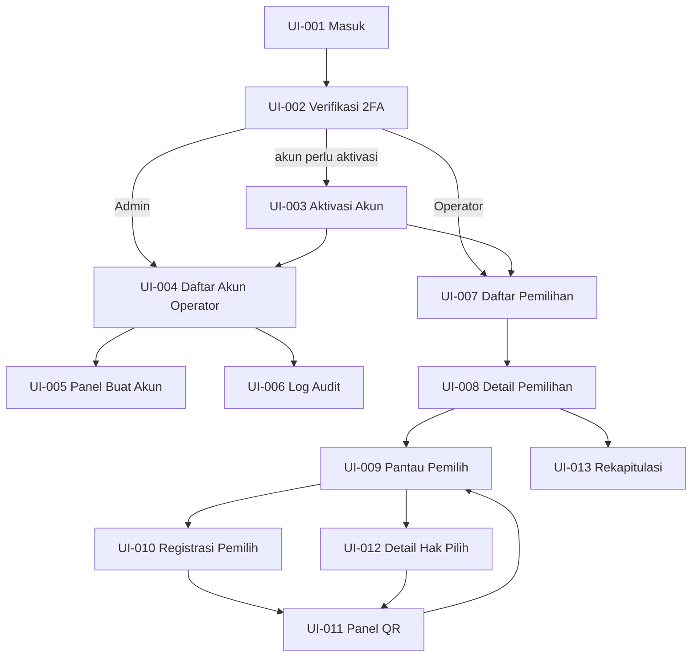

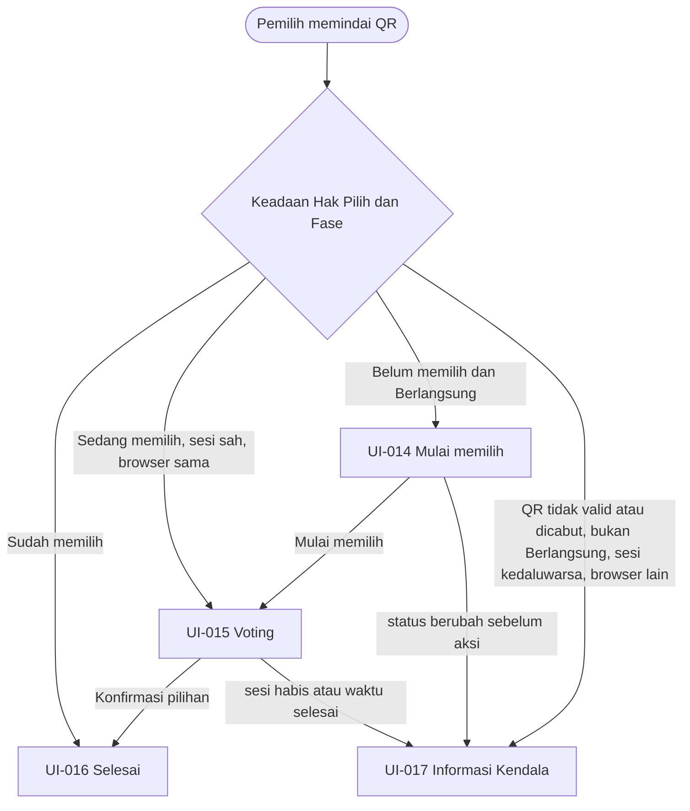

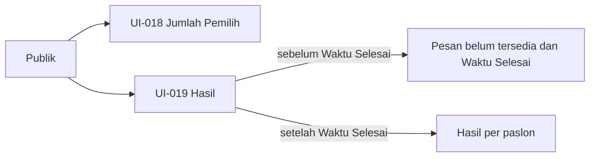

## 3.7 Business Rules

| ID | Aturan | Dasar | `FR` terkait |
|---|---|---|---|
| BR-001 | Operator adalah validator identitas pemilih secara langsung; Hak Pilih hanya dibuat setelah Operator memverifikasi pemilih. | `D§1` | FR-012 |
| BR-002 | Pemilih tidak memiliki akun atau kata sandi permanen; satu-satunya jalur akses adalah QR. | `D§1` | FR-014, FR-015 |
| BR-003 | Satu Hak Pilih per pemilih per pemilihan. Nama yang sudah terdaftar dikunci dan tidak dapat diubah atau didaftarkan ulang secara tidak sengaja. | `D§2` | FR-012, FR-013 |
| BR-004 | Bila terdapat Nama Kembar, Operator harus memastikan keduanya orang berbeda sebelum Hak Pilih terpisah dibuat. | `D§2` | FR-013 |
| BR-005 | Tidak ada kewajiban impor daftar pemilih atau integrasi data sekolah. | `D§2` | FR-012 |
| BR-006 | Status awal setelah QR diterbitkan adalah `Belum memilih`. | `D§2` | FR-012, FR-019 |
| BR-007 | Hanya tiga Status Hak Pilih dan hanya tiga transisi: `Belum memilih` → `Sedang memilih` (`Mulai memilih`); `Sedang memilih` → `Sudah memilih` (`Konfirmasi pilihan`); `Sedang memilih` → `Belum memilih` (Reset Sesi oleh Operator). `Sudah memilih` bersifat final. | `D§4`, `KP-004` | FR-016, FR-018, FR-019, FR-030 |
| BR-008 | Transisi `Belum memilih` → `Sedang memilih` bersifat atomik: satu token tidak dapat memulai sesi dari beberapa perangkat secara bersamaan. | `D§4` | FR-016 |
| BR-009 | Penyimpanan Suara dan perubahan status menjadi `Sudah memilih` terjadi dalam satu transaksi: keduanya berhasil atau keduanya tidak terjadi. | `D§4` | FR-018 |
| BR-010 | Satu Hak Pilih/token hanya dapat menghasilkan satu Suara. | `D§3`, `D§9` | FR-018 |
| BR-011 | Pemilih memilih tepat satu paslon dari paslon pemilihan tersebut. | `D§3` | FR-011, FR-017 |
| BR-012 | Token QR berupa nilai acak yang sulit ditebak, tidak memuat nama atau pilihan, dan dapat dicabut. | `D§3`, `D§9`, OD-003 | FR-014, FR-029 |
| BR-013 | Sesi Memilih berlaku **10 menit** sejak `Mulai memilih`. Selama belum lewat, Pemilih dapat melanjutkan di **browser yang sama**. Setelah itu, atau dari browser lain, hanya Operator yang dapat memulihkan lewat Reset Sesi. | `KP-004` | FR-016, FR-030 |
| BR-014 | Reset Sesi hanya dapat dilakukan Operator, hanya dari `Sedang memilih`, hanya pada Fase `Berlangsung`, wajib dengan alasan, dan dicatat di Log Audit. | `KP-004`, `D§6` | FR-030 |
| BR-015 | Data perangkat hanya indikator/audit. Tidak menjadi bukti identitas dan bukan dasar tunggal untuk menolak pemilih. Penggunaan satu perangkat oleh beberapa pemilih tetap diperbolehkan setelah Operator memverifikasi langsung. | `D§5` | FR-024, FR-025 |
| BR-016 | Data identitas/Hak Pilih dipisahkan dari data pilihan; tidak ada hubungan data apa pun antara Hak Pilih dan Suara. | `D§7` | FR-018, FR-021, FR-022 |
| BR-017 | Operator dapat melihat Status Hak Pilih tetapi tidak dapat melihat pilihan paslon per pemilih. Hasil dihitung hanya dari data Suara anonim. | `D§7` | FR-020, FR-023 |
| BR-018 | Batas maksimum Hak Pilih per pemilihan ditetapkan **Operator**; pembuatan Hak Pilih ditolak setelah batas tercapai; batas tidak boleh lebih kecil dari jumlah Hak Pilih yang sudah dibuat. | `D§8`, `CH-001` | FR-008, FR-028 |
| BR-019 | Jumlah Suara tidak boleh melebihi jumlah Hak Pilih yang berhasil dibuat; jumlah Suara harus sama dengan jumlah Hak Pilih `Sudah memilih`. | `D§8` | FR-018, FR-032 |
| BR-020 | Aktivitas penting staf dan peristiwa voting dicatat dalam Log Audit; entri tidak dapat diubah atau dihapus. | `D§6` | FR-026 |
| BR-021 | Pembagian wewenang: Admin hanya mengelola akun Operator dan meninjau Log Audit; Operator mengelola seluruh operasi pemilihan tetapi tidak mengelola akun staf; Admin tidak mengakses data pemilihan. | `D§6`, `KP-005` | FR-004 – FR-007, FR-027 |
| BR-022 | Akun staf wajib dilindungi autentikasi yang kuat (kata sandi dan TOTP). | `D§6` | FR-001, FR-002 |
| BR-023 | Hak Pilih hanya dapat dibuat, dan `Mulai memilih` serta `Konfirmasi pilihan` hanya diterima, pada Fase `Berlangsung`. | `KP-007` (Rekomendasi, OD-006) | FR-010, FR-012, FR-016, FR-018 |
| BR-024 | Paslon hanya dapat diubah pada Fase `Persiapan`. Jadwal hanya dapat diatur bila paslon minimal 2, dan setelah jadwal diatur paslon tidak boleh berkurang di bawah 2. | Rekomendasi (OD-007) | FR-009, FR-011 |
| BR-025 | Aturan jadwal: ketelitian sampai menit; Waktu Selesai setelah Waktu Mulai; jadwal baru tidak boleh sudah berakhir; Waktu Mulai terkunci setelah `Berlangsung`; Waktu Selesai dapat diperpanjang atau dimajukan saat `Berlangsung`; memajukan ke waktu sekarang mengakhiri pemilihan. | `KP-007` (rincian Rekomendasi, OD-006) | FR-009 |
| BR-026 | Hasil perolehan suara per paslon tidak ditampilkan kepada siapa pun (Publik maupun Operator) sebelum Waktu Selesai. | `KP-008` (untuk Publik); Operator = Rekomendasi, OD-005 | FR-020, FR-022 |
| BR-027 | Terbitkan Ulang QR hanya dapat dilakukan pada Status `Belum memilih` dan Fase `Berlangsung`, mencabut token lama, mewajibkan alasan, dan dicatat di Log Audit. Pada `Sedang memilih`, Reset Sesi harus dilakukan terlebih dahulu. | `D§6`, `D§9` (alasan wajib = Rekomendasi) | FR-029 |
| BR-028 | Halaman Pemilih tidak pernah menampilkan nama pemilih, dan setelah penyimpanan tidak menampilkan kembali pilihan. | `D§7` | FR-014, FR-015 |
| BR-029 | Sistem tidak mengasumsikan satu pemilih = satu perangkat. Pembatasan voting didasarkan pada Hak Pilih dan Token QR, bukan perangkat. | `D§5` | FR-015, FR-025 |
| BR-030 | Seluruh keputusan validasi dan otorisasi dilakukan di backend, bukan hanya di frontend. | `D§9` | FR-004, FR-010, FR-019 |
| BR-031 | Halaman Jumlah Pemilih hanya menampilkan satu angka total Hak Pilih `Sudah memilih` (tanpa nama, tanpa rincian paslon) dan dapat diakses kapan saja tanpa login. | `KP-008`, OD-006d | FR-021 |
| BR-032 | Waktu Selesai adalah batas keras: setelah tercapai tidak ada `Mulai memilih` atau `Konfirmasi pilihan` yang diterima, termasuk untuk Sesi Memilih yang sedang berjalan; pemilihan tidak dapat dibuka kembali. | Rekomendasi (OD-006c) | FR-009, FR-010, FR-018, FR-022 |

## 3.8 Acceptance Criteria

| ID | Menguji | Kriteria |
|---|---|---|
| AC-001 | FR-001 | **Given** akun aktif dengan TOTP aktif, **when** username dan kata sandi benar lalu kode TOTP benar, **then** staf masuk ke beranda sesuai peran. Bila kata sandi benar tetapi kode TOTP salah, **then** tidak masuk. |
| AC-002 | FR-001, NFR-001 | **Given** kredensial salah, **when** dikirim, **then** pesan galat tidak membedakan username salah dan kata sandi salah; setelah batas percobaan beruntun terlampaui, permintaan berikutnya ditolak sementara. |
| AC-003 | FR-002, BR-022 | **Given** akun baru atau hasil reset, **when** login, **then** staf dipaksa mengganti kata sandi dan mengaktifkan TOTP; sebelum selesai, semua halaman lain mengalihkan ke `UI-003`. |
| AC-004 | FR-003 | **Given** staf masuk, **when** menekan keluar atau tidak aktif melebihi batas, **then** sesi berakhir dan halaman berikutnya meminta login. |
| AC-005 | FR-004, BR-021 | **Given** Operator, **when** mengakses fitur akun Operator atau Log Audit, **then** ditolak. **Given** Admin, **when** mengakses data pemilihan, pemilih, atau hasil, **then** ditolak. **Given** pengunjung tanpa login, **when** mengakses halaman staf, **then** diarahkan ke `UI-001`. |
| AC-006 | FR-005 | **Given** Admin, **when** membuat akun Operator dengan username unik, **then** akun muncul di daftar dan kata sandi sementara tampil sekali; username yang sudah ada ditolak. |
| AC-007 | FR-006 | **Given** akun Operator aktif yang sedang login, **when** Admin menonaktifkannya, **then** permintaan berikutnya dari sesi itu ditolak dan login baru ditolak; akun tetap ada; mengaktifkan kembali memulihkan kemampuan login. |
| AC-008 | FR-007 | **Given** Admin, **when** mereset kata sandi Operator, **then** kata sandi sementara baru tampil sekali dan Operator wajib menggantinya; **when** mereset TOTP, **then** Operator wajib mengaktifkan ulang sebelum mengakses fitur. |
| AC-009 | FR-008, BR-018 | **Given** Operator, **when** membuat pemilihan dengan nama valid dan batas ≥ 1, **then** pemilihan muncul pada Fase `Persiapan`; nama kosong atau batas < 1 ditolak; batas yang lebih kecil dari jumlah Hak Pilih yang sudah dibuat ditolak. |
| AC-010 | FR-009, BR-024, BR-025 | **Given** pemilihan dengan ≥ 2 paslon, **when** Operator mengisi Waktu Mulai dan Waktu Selesai (tahun, bulan, tanggal, jam, menit) yang valid, **then** jadwal tersimpan. Ditolak bila: Waktu Selesai tidak setelah Waktu Mulai; jadwal baru sudah berakhir; paslon < 2. |
| AC-011 | FR-009, BR-025 | **Given** Fase `Berlangsung`, **when** Operator memperpanjang Waktu Selesai, **then** berhasil; **when** mengubah Waktu Mulai, **then** ditolak; **when** memajukan Waktu Selesai ke waktu sekarang, **then** Fase menjadi `Ditutup`. **Given** Fase `Ditutup`, **when** mengubah jadwal, **then** ditolak. |
| AC-012 | FR-010, BR-023, BR-032 | **Given** Fase `Persiapan` atau `Ditutup`, **when** Operator membuat Hak Pilih atau Pemilih menekan `Mulai memilih`/`Konfirmasi pilihan`, **then** ditolak dengan pesan fase. **Given** Fase `Berlangsung`, **then** diterima. Perubahan fase terjadi otomatis pada Waktu Mulai dan Waktu Selesai tanpa tindakan Operator. |
| AC-013 | FR-011, BR-024 | **Given** Fase `Persiapan`, **when** Operator menambah paslon dengan nomor urut unik dan nama, **then** tersimpan; nomor urut ganda ditolak. **Given** Fase `Berlangsung` atau `Ditutup`, **when** mengubah paslon, **then** ditolak. **Given** jadwal sudah diatur, **when** menghapus paslon hingga tersisa < 2, **then** ditolak. |
| AC-014 | FR-012, BR-001, BR-006 | **Given** Fase `Berlangsung`, **when** Operator memasukkan nama valid, **then** satu Hak Pilih berstatus `Belum memilih` dibuat dan QR ditampilkan; nama muncul pada `UI-009`. |
| AC-015 | FR-013, BR-003, BR-004 | **Given** nama sudah terdaftar (perbedaan huruf besar/kecil atau spasi ganda diabaikan), **when** Operator mendaftarkan nama itu, **then** tidak ada Hak Pilih dibuat sampai Operator menyatakan "orang berbeda"; setelah itu Hak Pilih terpisah dibuat. Mengirim konfirmasi dua kali berturut-turut membuat paling banyak satu Hak Pilih tambahan. |
| AC-016 | FR-014, BR-012, BR-028 | **Given** Hak Pilih baru, **then** QR dan tautan tampil; tautan tidak memuat nama atau pilihan; setelah panel QR ditutup, QR yang sama tidak dapat ditampilkan lagi. |
| AC-017 | FR-015, BR-028 | **Given** QR valid, **when** dipindai, **then** halaman sesuai keadaan (`UI-014`/`UI-015`/`UI-016`); **given** token tidak valid atau dicabut, **then** `UI-017` tanpa membocorkan apakah token pernah ada; nama pemilih tidak tampil pada halaman mana pun. |
| AC-018 | FR-016, BR-008, BR-013 | **Given** `Belum memilih` dan Fase `Berlangsung`, **when** `Mulai memilih`, **then** status menjadi `Sedang memilih` dan daftar paslon tampil. **Given** dua perangkat menekan `Mulai memilih` pada token yang sama secara bersamaan, **then** tepat satu berhasil dan yang lain mendapat `UI-017`. |
| AC-019 | FR-017, BR-011 | **Given** `UI-015`, **then** `Konfirmasi pilihan` nonaktif sampai tepat satu paslon dipilih; memilih paslon lain mengganti pilihan; tidak ada data tersimpan sebelum konfirmasi. |
| AC-020 | FR-018, BR-009, BR-010 | **Given** `Sedang memilih` dengan sesi sah, **when** `Konfirmasi pilihan`, **then** satu Suara tersimpan, status menjadi `Sudah memilih`, dan `UI-016` tampil tanpa menampilkan pilihan. **When** konfirmasi dikirim lagi (klik ganda atau ulang), **then** tidak ada Suara tambahan. |
| AC-021 | FR-018, BR-009 | **Given** konfirmasi gagal di tengah proses, **then** tidak ada Suara tersimpan dan status tetap `Sedang memilih`; Pemilih dapat mencoba lagi selama sesi berlaku. |
| AC-022 | FR-019, BR-007 | **Given** Hak Pilih apa pun, **when** diminta transisi di luar tiga transisi yang diizinkan (misalnya dari `Sudah memilih`), **then** ditolak. |
| AC-023 | FR-020, BR-017, BR-026 | **Given** Fase `Ditutup`, **then** Operator melihat Suara per paslon, total Suara, dan status integritas; **given** sebelum Waktu Selesai, **then** tidak ada angka per paslon yang tampil. |
| AC-024 | FR-021, BR-031 | **Given** pengunjung tanpa login, **when** membuka Halaman Jumlah Pemilih kapan saja, **then** tampil nama pemilihan dan satu angka jumlah `Sudah memilih`; tidak ada nama atau rincian paslon. **When** ada suara baru dan halaman dimuat ulang manual, **then** angka bertambah; halaman tidak memperbarui diri sendiri. |
| AC-025 | FR-022, BR-026 | **Given** sebelum Waktu Selesai, **when** Publik membuka Halaman Hasil, **then** tampil pesan belum tersedia dan Waktu Selesai tanpa angka. **Given** setelah Waktu Selesai, **then** tampil Suara per paslon dan total. |
| AC-026 | FR-023, NFR-016, KP-003 | **Given** `UI-009` terbuka, **when** status Hak Pilih berubah, **then** perubahan tampil dalam satu interval pembaruan (3 detik) tanpa refresh manual; Operator tidak melihat pilihan paslon; halaman non-Operator tidak memperbarui diri. |
| AC-027 | FR-024 | **Given** Hak Pilih diakses (QR dibuka, `Mulai memilih`, `Konfirmasi pilihan`, atau akses ditolak), **then** tercatat User-Agent, Pengenal Browser, Sesi Memilih (bila ada), IP, dan waktu; catatan tidak memuat pilihan. |
| AC-028 | FR-025, BR-015, BR-029 | **Given** browser yang sama telah mengakses Hak Pilih A, **when** Hak Pilih B diakses dari browser itu, **then** `UI-009`/`UI-012` menandai Peringatan Perangkat pada B dan menampilkan riwayat; B tetap dapat memilih. **Given** hanya IP yang sama, **then** tidak ada Peringatan Perangkat. |
| AC-029 | FR-026, BR-020, NFR-008 | **Given** tindakan pada daftar `FR-026`, **then** tepat satu entri audit tercatat dengan aktor, waktu, dan objek, tanpa isi pilihan; entri tidak dapat diubah atau dihapus melalui aplikasi. |
| AC-030 | FR-027, BR-021 | **Given** Admin, **when** membuka `UI-006`, **then** dapat melihat dan memfilter entri; **given** Operator, **then** ditolak. |
| AC-031 | FR-028, BR-018 | **Given** jumlah Hak Pilih = batas, **when** Operator membuat Hak Pilih, **then** ditolak dengan pesan batas tercapai; setelah batas dinaikkan, pembuatan berhasil. |
| AC-032 | FR-029, BR-027 | **Given** `Belum memilih` dan Fase `Berlangsung`, **when** Operator menerbitkan ulang dengan alasan, **then** QR lama tidak dapat dipakai dan QR baru tampil sekali. **Given** `Sedang memilih`, **then** ditolak dan Operator diarahkan melakukan Reset Sesi; tanpa alasan, ditolak. |
| AC-033 | FR-030, BR-014 | **Given** `Sedang memilih`, **when** Operator melakukan Reset Sesi dengan alasan, **then** status menjadi `Belum memilih`, sesi lama tidak dapat lagi mengonfirmasi, dan Pemilih dapat mengulang dari pemindaian QR; tercatat di Log Audit. Pada status lain atau tanpa alasan, ditolak. |
| AC-034 | BR-013, KP-004 | **Given** `Sedang memilih` dan belum 10 menit, **when** QR dibuka dari browser yang sama, **then** Pemilih melanjutkan ke `UI-015`. **Given** lebih dari 10 menit atau browser lain, **then** `UI-017` dan `UI-009` menandai Sesi Kedaluwarsa (untuk kasus lewat 10 menit). |
| AC-035 | FR-031 | **Given** aksi apa pun, **then** tampil keadaan sibuk lalu pesan sukses atau galat berbahasa Indonesia tanpa detail teknis. |
| AC-036 | FR-032, BR-019 | **Given** pemilihan berjalan atau selesai, **then** Operator melihat jumlah Suara, jumlah `Sudah memilih`, dan penanda konsisten/tidak konsisten; konsisten hanya bila keduanya sama dan jumlah Hak Pilih ≤ batas. |
| AC-037 | BR-016, BR-017, NFR-005 | **Given** seluruh layar, ekspor, dan data yang tersedia bagi Admin dan Operator, **then** tidak ada yang menampilkan atau memungkinkan penelusuran pilihan seorang pemilih. |
| AC-038 | BR-029, BR-015 | **Given** dua pemilih berbeda yang telah diverifikasi Operator memakai satu browser bergantian, **then** keduanya dapat memilih. |
| AC-039 | BR-032, FR-010 | **Given** Pemilih `Sedang memilih` saat Waktu Selesai tercapai, **when** menekan `Konfirmasi pilihan`, **then** ditolak dan tidak ada Suara tersimpan. |
| AC-040 | NFR-007 | **Given** banyak permintaan `Mulai memilih` dan `Konfirmasi pilihan` serentak pada satu token, **then** paling banyak satu Sesi Memilih dan satu Suara terbentuk, dan jumlah Suara = jumlah `Sudah memilih`. |

---

*Akhir PRD. Pemetaan teknis tiap `FR`/`NFR` ada di `BLUEPRINT.md` bagian 3.17.*
