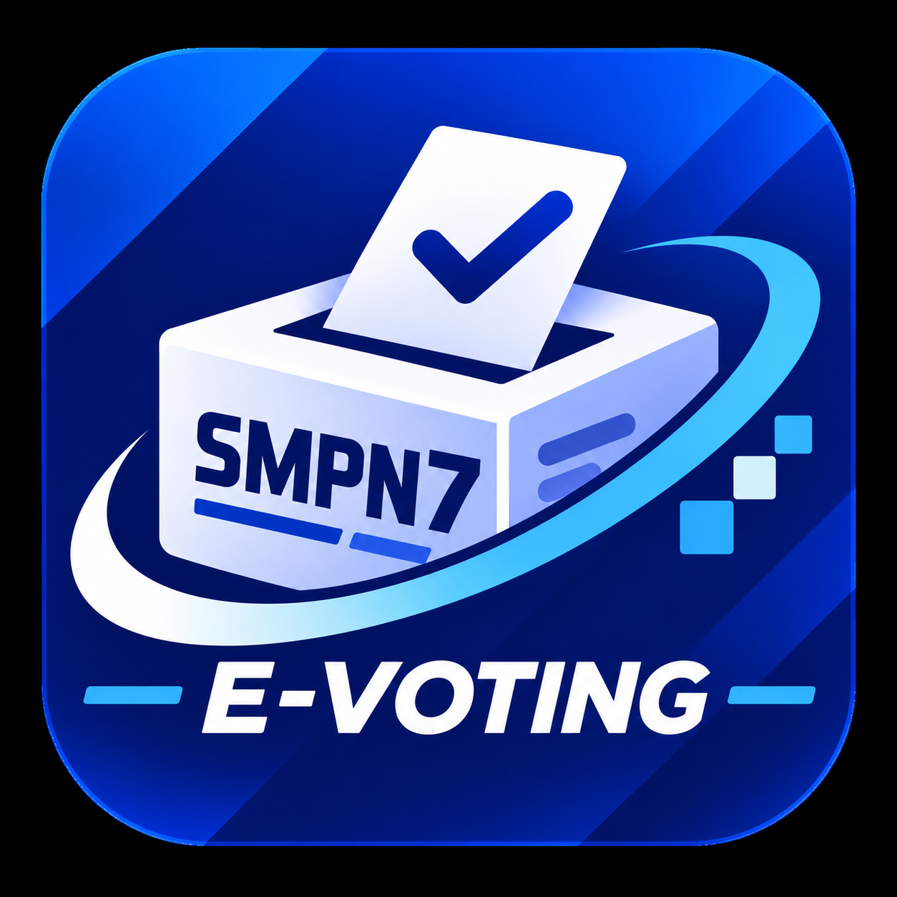

<div align="center">
  

  # DigiVoting — Sistem Pemungutan Suara Digital Sekolah Berbasis QR Token Sekali Pakai

  **Aplikasi pemungutan suara digital (DigiVoting) sekolah yang dirancang dengan pemisahan identitas pemilih dan pilihan suara secara struktural di tingkat basis data.**

  
  
  
  
</div>

---

## Daftar Isi

1. [Gambaran Umum](#-gambaran-umum)
2. [Prinsip Keamanan & Kerahasiaan Suara](#-prinsip-keamanan--kerahasiaan-suara)
3. [Fitur Utama per Peran](#-fitur-utama-per-peran)
4. [Arsitektur Teknis & Stack](#-arsitektur-teknis--stack)
5. [Struktur Direktori](#-struktur-direktori)
6. [Instalasi & Menjalankan di Lokal](#-instalasi--menjalankan-di-lokal)
7. [Provisi Akun Staf (CLI)](#-provisi-akun-staf-cli)
8. [Pengujian & Kualitas Kode](#-pengujian--kualitas-kode)
9. [Penyebaran Produksi (Deployment)](#-penyebaran-produksi-deployment)
10. [Referensi Dokumen Spesifikasi](#-referensi-dokumen-spesifikasi)

---

## 🎯 Gambaran Umum

Proyek ini adalah sistem **E-Voting berbasis web** untuk penyelenggaraan pemilihan di lingkungan sekolah (seperti Pemilihan Ketua & Wakil Ketua OSIS). Pemilih tidak perlu membuat akun atau mengingat kata sandi:

1. **Verifikasi Langsung di Meja Operator:** Petugas Operator memeriksa identitas fisik pemilih (mis. kartu pelajar/daftar hadir) lalu mendaftarkan nama pemilih ke sistem.
2. **Penerbitan QR Sekali Tampil:** Sistem menerbitkan token kriptografis 256-bit dalam bentuk **Kode QR** (dan tautan akses) yang hanya ditampilkan **satu kali** di layar Operator.
3. **Bilik Suara 4 Tahap Tanpa Identitas:** Pemilih memindai QR menggunakan perangkat masing-masing (atau perangkat bilik bersama) dan melewati 4 tahap linear: **Verifikasi → Memilih → Konfirmasi → Selesai**.
4. **Rekapitulasi Terkunci Otomatis:** Hasil perolehan suara per pasangan calon dikunci di tingkat fungsi PostgreSQL selama masa pemilihan berlangsung dan baru dapat diakses setelah **Waktu Selesai** tercapai.

---

## 🔒 Prinsip Keamanan & Kerahasiaan Suara

Sistem ini menerapkan pengamanan berlapis dari tingkat antarmuka hingga skema PostgreSQL (`evoting`):

- **Anonimitas Struktural (Tanpa Relasi Pemilih ke Suara):**
  Tabel `evoting.votes` **tidak memiliki** kolom `voter_right_id`, nama pemilih, maupun pengenal perangkat. Perubahan status hak pilih menjadi `sudah_memilih` dan penyisipan suara ke `evoting.votes` dilakukan dalam satu transaksi atomik melalui fungsi `SECURITY DEFINER` (`evoting.fn_confirm_vote`).
- **Penyimpanan Hash Token Satu Arah (SHA-256):**
  Token mentah 256-bit hanya ditampilkan satu kali saat QR diterbitkan. Basis data hanya menyimpan `token_hash` (SHA-256 hex 64 karakter).
- **Hak Akses Basis Data Minimum (*Least Privilege*):**
  Jalur publik dan pemilih memakai `evoting_app`. Jalur staf memakai `evoting_staff`. Keduanya membaca hasil melalui fungsi database. Hasil publik tersedia sesudah penutupan, rekap Operator setelah kuota terpakai atau penutupan, dan rekap langsung memerlukan kunci aktif.
- **Sesi Memilih Berbatas 10 Menit & Pengikatan Browser:**
  Sejak pemilih menekan **Mulai memilih**, sesi dikunci pada pengenal browser (`HttpOnly` cookie) yang sama dengan batas waktu **10 menit**. Jika perangkat mati atau waktu habis sebelum konfirmasi, Operator dapat melakukan **Reset Sesi** disertai alasan yang tercatat di Log Audit.
- **Pemisahan Wewenang Staf (*Role Separation*):**
  - **Admin** wajib menggunakan autentikasi dua faktor (**TOTP 2FA**), hanya berwenang mengelola akun Operator, mengatur mode QR (Kustom vs Standar), dan meninjau Log Audit — **tanpa akses** ke konfigurasi pemilihan, daftar pemilih, maupun hasil suara.
  - **Operator** masuk menggunakan *username* dan kata sandi kuat (minimum 10 karakter dengan kombinasi huruf besar, huruf kecil, dan angka/simbol) untuk mengelola pemilihan, pasangan calon, dan pemantauan hak pilih.

---

## 👥 Fitur Utama per Peran

### 1. Administrator (`/admin/*`)
- **Kelola Akun Operator:** Membuat akun Operator baru (dengan kata sandi sementara sekali tampil), mengaktifkan/menonaktifkan akun (sekaligus memutus sesi aktif), dan mereset kata sandi Operator.
- **Konfigurasi Mode Kode QR Pemilih:** Beralih secara langsung antara **Mode QR Kustom** (dengan logo sekolah di tengah dan *Error Correction Level H*) dan **Mode QR Standar** (tanpa logo tengah sebagai *fallback* apabila kamera pemindai di lapangan mengalami kendala).
- **Log Audit Sistem:** Meninjau jejak audit kronologis seluruh aksi penting di sistem dengan filter jenis aktor dan kata kunci.

### 2. Operator (`/operator/*`)
- **Manajemen Pemilihan & Fase Otomatis:** Membuat pemilihan, mengatur batas kuota hak pilih, serta mengatur jadwal `Waktu Mulai` dan `Waktu Selesai` (presisi menit) yang menentukan fase `Persiapan`, `Berlangsung`, dan `Ditutup`.
- **Pengelolaan Pasangan Calon:** Menambah, mengubah, dan menghapus pasangan calon pada fase `Persiapan`, lengkap dengan unggahan foto ke **Supabase Storage** (bucket publik-baca `paslon-foto`).
- **Dashboard Pantau Pemilih & Registrasi QR:**
  - Mendaftarkan pemilih terverifikasi dengan **deteksi nama kembar instan** dan konfirmasi eksplisit orang berbeda.
  - Menampilkan **Panel QR Sekali Tampil** (mendukung cetak langsung dan salin tautan).
  - Menangani kendala di lapangan: **Reset Sesi** (untuk sesi terputus/lewat 10 menit) dan **Terbitkan Ulang QR** (mencabut token lama secara permanen).
  - Memantau indikator **Peringatan Perangkat Bersama** dan **Pemeriksaan Integritas Suara** (`Total Suara == Sudah Memilih <= Hak Pilih`).
- **Rekapitulasi Akhir:** Melihat laporan integritas dan rincian perolehan suara per pasangan calon setelah masa pemilihan berakhir.

### 3. Pemilih (`/v/{token}`)
- **4 Tahap Linear Tanpa Identitas:**
  1. **Verifikasi:** Menampilkan nama pemilihan dan tiket suara anonim tanpa menampilkan nama pemilih.
  2. **Memilih:** Memilih satu kartu pasangan calon lengkap dengan foto, nomor urut, visi, dan misi.
  3. **Konfirmasi:** Memeriksa kembali pasangan calon yang dipilih sebelum disimpan permanen.
  4. **Selesai:** Konfirmasi suara tersimpan secara anonim tanpa menampilkan kembali pilihan paslon (mencegah paksaan/intimidasi pasca-memilih).

### 4. Publik (`/p/{election}/*`)
- **Partisipasi Pemilih (`/p/{election}/partisipasi`):** Menampilkan jumlah pemilih yang sudah memilih secara *snapshot* tanpa membocorkan nama pemilih maupun rincian suara per paslon.
- **Hasil Pemilihan (`/p/{election}/hasil`):** Terkunci selama pemilihan berlangsung dan menampilkan pemenang serta rincian perolehan suara setelah `Waktu Selesai` tercapai.

---

## 🛠 Arsitektur Teknis & Stack

| Lapisan | Teknologi |
| :--- | :--- |
| **Backend Framework** | Laravel 13 (PHP 8.4+) |
| ** Komponen Reaktif** | Livewire 4 + Alpine.js (navigasi SPA `wire:navigate`, *skeleton loading*, dan filter/interaksi instan di *client*) |
| **Basis Data** | Supabase PostgreSQL (Skema terisolasi `evoting`, koneksi persisten `PDO::ATTR_PERSISTENT` via Supavisor Session Pooler port `5432`) |
| **Penyimpanan Objek** | Supabase Storage (Bucket `paslon-foto`, unggahan *server-side* dengan `SUPABASE_SECRET_KEY`) |
| **Generator QR & 2FA** | `bacon/bacon-qr-code` (SVG QR *Level H* dengan *overlay* logo tengah) & RFC 6238 TOTP (`TotpService`) |
| **Styling & Motion** | Custom Design System CSS (`public/css/suarasekolah.css`) responsif *desktop* & *mobile* |

---

## 📁 Struktur Direktori

```text
├── app/
│   ├── Console/Commands/        # Perintah CLI seed:admin & seed:operator
│   ├── Http/Middleware/         # Middleware autentikasi staf, peran, & security headers
│   ├── Livewire/
│   │   ├── Admin/               # Halaman Kelola Operator, Mode QR, & Log Audit
│   │   ├── Auth/                # Login Staf, Aktivasi Sandi/2FA Pertama, & Verifikasi TOTP
│   │   ├── Concerns/            # Trait HandlesSafeErrors (logging galat aman ber-timestamp)
│   │   ├── Operator/            # Daftar Pemilihan, Detail & Paslon, Pantau Pemilih, Rekapitulasi
│   │   ├── Public/              # Halaman Partisipasi & Hasil Pemilihan Publik
│   │   └── Voter/               # Alur Bilik Suara 4 Tahap (BallotPage)
│   ├── Models/                  # Eloquent Models (StaffAccount, Election, Candidate, VoterRight, dll.)
│   └── Services/                # VotingService, TokenService, TotpService, SupabaseStorageService, dll.
├── config/
│   ├── app.php                  # Konfigurasi nama aplikasi (APP_NAME dengan fallback "E-Voting")
│   ├── database.php             # Konfigurasi PostgreSQL skema evoting & persistent PDO
│   └── evoting.php              # Konfigurasi Supabase Storage, cookie browser, & zona waktu
├── public/
│   ├── css/suarasekolah.css     # Stylesheet utama, skeleton loader, & step-line responsif
│   └── SMPN7-e-voting_logo.png  # Logo identitas sekolah pada header & bagian tengah QR
├── resources/views/
│   ├── components/              # Komponen Blade bersama (action-button, modal, stat-card, dll.)
│   ├── layouts/                 # Layout utama staf/publik (app.blade.php) & bilik suara (voter.blade.php)
│   └── livewire/                # Template Blade modular per halaman & partial
├── tests/Feature/
│   └── EvotingSystemTest.php    # Pengujian integrasi menyeluruh siklus pemilihan & keamanan
├── DEPLOY.md                    # Daftar periksa penyebaran produksi (AWS Ubuntu & Supabase)
└── schema.sql                   # Skema lengkap PostgreSQL (tabel, view, trigger, & fungsi SECURITY DEFINER)
```

---

## 🚀 Instalasi & Menjalankan di Lokal

### 1. Prasyarat
- **PHP 8.4+** dengan ekstensi `pdo_pgsql`, `pgsql`, `curl`, `openssl`, `mbstring`, `gd` / `fileinfo`.
- **Composer 2.x**.
- Proyek **Supabase** (PostgreSQL + Storage).

> **Catatan Penting untuk Pengguna Windows (Sertifikat SSL cURL):**
> PHP di Windows secara bawaan tidak menyertakan bundel sertifikat CA sehingga permintaan HTTPS ke Supabase Storage dapat menghasilkan `cURL error 60: unable to get local issuer certificate`.
> Unduh berkas [`cacert.pem`](https://curl.se/ca/cacert.pem) lalu atur pada `php.ini` Anda:
> ```ini
> curl.cainfo = "C:\path\to\cacert.pem"
> openssl.cafile = "C:\path\to\cacert.pem"
> ```

### 2. Pasang Dependensi & Konfigurasi `.env`
```bash
composer install
cp .env.example .env
php artisan key:generate
```

Sesuaikan variabel berikut di berkas `.env`:
```dotenv
APP_NAME="E-Voting"
APP_ENV=local
APP_DEBUG=true
APP_URL=http://localhost:8000
APP_TIMEZONE=Asia/Makassar

DB_CONNECTION=pgsql
DB_HOST=db.<project-ref>.supabase.co
DB_PORT=5432
DB_DATABASE=postgres
DB_USERNAME=evoting_app
DB_PASSWORD=<password_evoting_app>
STAFF_DB_USERNAME=evoting_staff
STAFF_DB_PASSWORD=<password_evoting_staff>
DB_SEARCH_PATH=evoting
DB_SSLMODE=require
DB_PERSISTENT=true

SESSION_DRIVER=file
CACHE_STORE=file

SUPABASE_URL=https://<project-ref>.supabase.co
SUPABASE_PUBLISHABLE_KEY=<anon_or_publishable_key>
SUPABASE_SECRET_KEY=<service_role_or_secret_key>
SUPABASE_STORAGE_BUCKET=paslon-foto
```

### 3. Inisialisasi Skema Database
Jalankan isi berkas [`schema.sql`](schema.sql) **satu kali** melalui **Supabase SQL Editor** (jangan gunakan `php artisan migrate`, karena seluruh tabel, *view*, *trigger*, dan fungsi `SECURITY DEFINER` dikelola secara eksplisit di dalam skema `evoting`).

### 4. Jalankan Server Pengembangan
```bash
php artisan serve --host=127.0.0.1 --port=8000
```

---

## 🔑 Provisi Akun Staf (CLI)

Gunakan perintah Artisan berikut untuk membuat akun **Admin** atau **Operator** awal. Perintah ini akan menghasilkan **kata sandi sementara** yang hanya ditampilkan satu kali di terminal:

```bash
# Membuat akun Administrator baru (wajib ganti sandi & aktivasi TOTP 2FA saat login pertama)
php artisan seed:admin admin "Administrator Sistem"

# Membuat akun Operator baru (wajib ganti sandi saat login pertama)
php artisan seed:operator operator1 "Petugas Operator Bilik 1"
```

---

## 🧪 Pengujian & Kualitas Kode

Jalankan pemeriksaan format kode (**Laravel Pint**) dan rangkaian pengujian otomatis (**PHPUnit**):

```bash
# Memeriksa kerapian standar kode PHP
php vendor/bin/pint --test

# Menjalankan seluruh pengujian fitur & integritas siklus pemilihan
php artisan test
```

Pengujian integrasi memakai PostgreSQL di `127.0.0.1` dan membuat database sementara per metode uji. Siapkan cluster pengembangan dengan database template `evoting_test_template`. Pada PostgreSQL biasa, buat role kosong `anon`, `authenticated`, dan `service_role`, serta tabel tiruan `storage.buckets(id text primary key, name text, public boolean)` dan `storage.objects(bucket_id text)` pada schema `storage` di template. Terapkan `schema.sql` di template lalu tetapkan password lokal berbeda untuk kedua role aplikasi.

Sediakan `EVOTING_TEST_PORT`, `EVOTING_TEST_OWNER_PASSWORD` (role lokal `postgres`), `EVOTING_TEST_APP_PASSWORD`, dan `EVOTING_TEST_STAFF_PASSWORD` pada proses PHPUnit. Suite memakai HTTP tiruan untuk Supabase Storage. Tanpa konfigurasi PostgreSQL uji, PHPUnit menandai pengujian integrasi sebagai dilewati.

---

## 🌐 Penyebaran Produksi (Deployment)

Untuk panduan lengkap penyebaran ke server produksi (**AWS Ubuntu + PHP 8.4 + Nginx/PHP-FPM + Supabase**), silakan baca dokumen [**DEPLOY.md**](DEPLOY.md) yang mencakup:
- Verifikasi paket `ca-certificates` untuk koneksi TLS Supabase Storage.
- Konfigurasi koneksi Supavisor *Session Mode* (port `5432`) dengan role `evoting_app`.
- Pemeriksaan hak akses tabel (`least privilege`).
- Pengujian unggah foto paslon pasca-deploy.

---

## 📄 Referensi Dokumen Spesifikasi

- [`PRD.md`](PRD.md) & [`AMANDEMEN-PRD.md`](AMANDEMEN-PRD.md) — Dokumen Kebutuhan Produk & Amandemen Spesifikasi.
- [`bp_a.md`](bp_a.md) — Blueprint Teknis Arsitektur & Kontrak Antarmuka.
- [`schema.sql`](schema.sql) — Definisi Skema PostgreSQL, View, Trigger, & Stored Functions.
- [`docs/UI.md`](docs/UI.md) & [`docs/MOTION.md`](docs/MOTION.md) — Panduan Sistem Desain Antarmuka & Transisi.
- [`DEPLOY.md`](DEPLOY.md) — Daftar Periksa Penyebaran Produksi.
