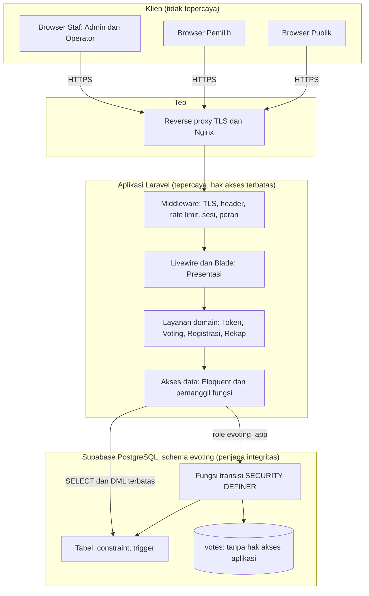
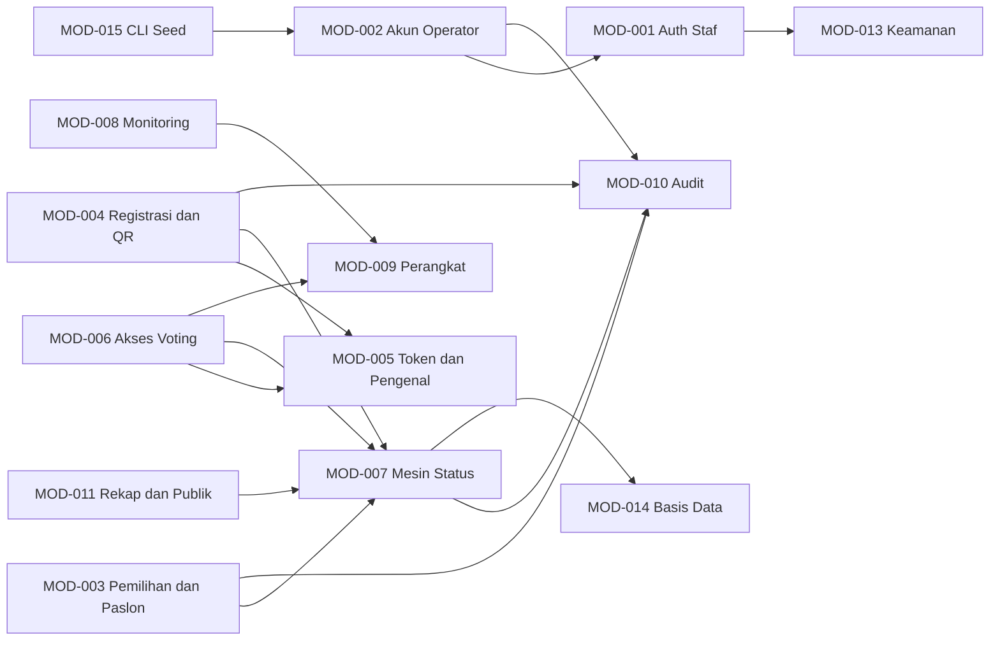
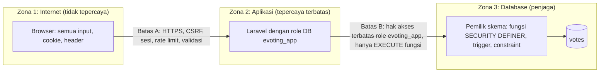

# BLUEPRINT — Arsitektur Teknis dan Panduan Implementasi Sistem E-Voting

| Atribut | Nilai |
|---|---|
| Versi | 1.0 (draf; mengikuti PRD v1.0) |
| Tanggal | 17 November 2026 |
| Dokumen sumber | `PRD.md` (sumber kebenaran kebutuhan produk) |
| Basis teknologi | Laravel + Supabase (PostgreSQL) — `KP-001`, `KP-002` |
| Bahasa | Indonesia |

---

# 1. Cara Membaca Dokumen

## 1.1 Struktur dan hierarki

| Bagian | Isi |
|---|---|
| 2. Penjelasan Awal | Tujuan, referensi PRD, prinsip, batasan, asumsi, keputusan teknis |
| 3.1 – 3.3 | Stack, arsitektur sistem, arsitektur modul |
| 3.4 | Arsitektur database **dan SQL migrasi lengkap** |
| 3.5 – 3.9 | Autentikasi, alur voting teknis, manajemen status, token QR, identifikasi perangkat |
| 3.10 – 3.14 | Spesifikasi endpoint, keamanan, validasi, penanganan galat, pemetaan UI |
| 3.15 – 3.16 | Strategi pengujian, penyebaran dan lingkungan |
| 3.17 | Matriks keterlacakan (PRD → modul → tabel → endpoint → validator → test) |
| 4. | Hasil validasi konsistensi sebelum finalisasi |

Alur baca untuk coding agent: 2 (batasan) → 3.1 (stack) → 3.4 (SQL, dijalankan lebih dulu) → 3.2/3.3 (struktur) → 3.5 – 3.9 (perilaku) → 3.10 (kontrak endpoint) → 3.12 – 3.13 → 3.14 → 3.15 → 3.17 (cek kelengkapan).

## 1.2 Konvensi ID

ID berformat `PREFIX-NNN` (tiga digit), tidak berubah antarversi, dan tidak digunakan ulang. Prefix `FR`, `NFR`, `BR`, `WF`, `UI`, `AC`, `ACT`, `KP`, `CH`, `OD` **didefinisikan di PRD** dan hanya dirujuk di sini.

| Prefix | Arti | Didefinisikan di |
|---|---|---|
| `MOD` | Modul teknis | 3.3 |
| `DB` | Entitas/struktur database | 3.4 |
| `API` | Endpoint, rute halaman, atau aksi server | 3.10 |
| `VAL` | Aturan validasi | 3.12 |
| `SEC` | Kebutuhan keamanan | 3.11 |
| `TC` | Test case | 3.15 |
| `PRM` | Parameter konfigurasi | 3.5.6 |

## 1.3 Notasi

| Notasi | Arti |
|---|---|
| **[DITETAPKAN]** | Berasal dari PRD, `discussion.md`, atau `KP`. Mengikat. |
| **[REKOMENDASI]** | Keputusan teknis penyusun yang masuk akal tetapi belum disepakati; dapat diganti tanpa mengubah kebutuhan PRD. |
| **[TERBUKA]** | Belum dapat diputuskan; merujuk ke `OD` di PRD 2.8. |
| `` `Belum memilih` `` | Nama resmi (label) dari PRD. Nilai teknis (enum) diberikan di 2.7. |
| `o_result_code` | Kode hasil yang dikembalikan fungsi database (3.4.6). |
| `EVnnn` | Kode SQLSTATE khusus aplikasi untuk pelanggaran aturan basis data (3.4.7). |

## 1.4 Hubungan dengan PRD

BLUEPRINT adalah terjemahan teknis PRD. BLUEPRINT **tidak mengubah, mengurangi, atau menambah** kebutuhan produk. Setiap keputusan teknis memuat rujukan `FR`/`NFR`/`BR`/`KP`. Bila PRD berubah, bagian BLUEPRINT yang terdampak diperbarui melalui matriks 3.17.

---

# 2. Penjelasan Awal

## 2.1 Tujuan blueprint

Menyediakan panduan kerja yang cukup lengkap agar coding agent dapat membangun sistem tanpa menebak keputusan arsitektural: stack, struktur layer dan modul, skema database lengkap (SQL siap jalankan), kontrak endpoint, aturan keamanan, validasi, pengujian, dan penyebaran.

BLUEPRINT bukan kumpulan kode aplikasi. Satu-satunya kode yang disertakan adalah **SQL migrasi awal** (3.4.8), yang telah dijalankan dan diuji pada PostgreSQL kosong.

## 2.2 Referensi PRD

| Dokumen | Peran |
|---|---|
| `PRD.md` | Kebutuhan (`FR`, `NFR`), aturan (`BR`), workflow (`WF`), UI (`UI`), kriteria penerimaan (`AC`), keputusan (`KP`, `CH`, `OD`) |
| `discussion.md` | Keputusan awal yang menjadi sumber kebenaran utama (`D§n`) |

## 2.3 Prinsip arsitektur

| # | Prinsip | Konsekuensi |
|---|---|---|
| AP-1 | **Backend otoritatif** `[BR-030]`. Frontend hanya menyajikan; setiap keputusan divalidasi di server. | Semua aksi Livewire memeriksa otorisasi dan prasyarat sendiri (Livewire action dapat dipanggil langsung). |
| AP-2 | **Database sebagai penjaga integritas terakhir**. Aturan yang menyangkut kebenaran suara ditegakkan di PostgreSQL (fungsi transisi, trigger, constraint, hak akses), bukan hanya di PHP. | Bug aplikasi tidak dapat menghasilkan suara ganda, status ilegal, atau mengubah suara. |
| AP-3 | **Pemisahan identitas dan suara secara struktural** `[BR-016]`. Tabel suara tidak memiliki kolom atau relasi ke identitas; role aplikasi tidak punya hak apa pun pada tabel suara. | Kerahasiaan tidak bergantung pada disiplin kode. |
| AP-4 | **Hak akses minimum**. Role database aplikasi hanya diberi hak yang dibutuhkan; mutasi kritis hanya lewat fungsi `SECURITY DEFINER`. | Lihat 3.4.5 dan 3.11. |
| AP-5 | **Tanpa komponen yang tidak perlu**. Tidak ada antrean, tidak ada scheduler, tidak ada Redis, tidak ada WebSocket pada MVP. Fase Pemilihan dan Sesi Kedaluwarsa diturunkan dari waktu saat query. | Lebih sedikit titik gagal; cocok untuk operasi sekali pakai. |
| AP-6 | **Idempoten dan dapat dipulihkan**. Konfirmasi diulang tidak menambah suara; sesi terputus dipulihkan lewat Reset Sesi `[NFR-009]`. | Lihat 3.6. |
| AP-7 | **Indikator perangkat bukan identitas** `[BR-015]`. Data perangkat tidak pernah menjadi syarat atau penolak voting. | Lihat 3.9. |
| AP-8 | **Server tidak menyimpan rahasia pemilih dalam bentuk yang dapat dipakai ulang**. Token QR dan rahasia sesi hanya disimpan sebagai hash. | Lihat 3.8. |

## 2.4 Batasan teknis

1. Laravel hanya memakai Supabase sebagai PostgreSQL terkelola; **tidak** menggunakan Supabase Auth, Data API (PostgREST), Realtime, Storage, maupun Edge Functions `[KP-002]`.
2. Antarmuka Blade + Livewire; polling hanya pada halaman Operator, interval 3 detik; halaman lain refresh manual `[KP-003]`.
3. Tidak ada integrasi sistem sekolah, tidak ada layanan email `[PRD 2.5]`. Konsekuensi: tidak ada "lupa kata sandi" mandiri; pemulihan akun lewat Admin `[FR-007]`.
4. Koneksi aplikasi ke database memakai Supavisor *session mode* (lihat 3.16). Mode *transaction* **tidak** dipakai agar status sesi koneksi dan prepared statements aman.
5. Skema dikelola dengan satu berkas SQL (3.4.8), **bukan** migrasi Laravel. Laravel tidak menjalankan `migrate` terhadap database produksi.
6. Aplikasi tidak menyimpan berkas pengguna (tidak ada upload).

## 2.5 Asumsi

| # | Asumsi | Dampak bila salah |
|---|---|---|
| AS-1 | Pemilihan berskala sekolah (ratusan hingga ribuan hak pilih per pemilihan). Angka resmi: `OD-001`. | Perlu uji beban dan penyesuaian ukuran infrastruktur |
| AS-2 | Pemilih memakai browser modern (dua versi mayor terakhir Chrome, Safari, Firefox, Edge) dan dapat memindai QR dengan kamera atau aplikasi pembaca QR. Pemindaian **tidak** dilakukan di dalam aplikasi. | Bila perlu pemindai dalam aplikasi, tambah `FR` baru |
| AS-3 | Operator mengisi jadwal dalam satu zona waktu (`OD-013`). Penyimpanan selalu UTC. | Hanya tampilan |
| AS-4 | Aplikasi berjalan di belakang reverse proxy yang mengakhiri TLS dan meneruskan IP klien lewat header terpercaya. | IP pada log perangkat dan rate limit menjadi tidak akurat |
| AS-5 | Operator dapat menampilkan QR kepada pemilih (layar atau cetak lewat fitur cetak browser). | — |

## 2.6 Keputusan teknis yang sudah ditetapkan

| Keputusan | Status | Rujukan |
|---|---|---|
| Laravel + Supabase; Supabase hanya PostgreSQL; autentikasi di Laravel | [DITETAPKAN] | `KP-001`, `KP-002` |
| Blade + Livewire; polling Operator 3 detik; halaman lain manual | [DITETAPKAN] | `KP-003` |
| Sesi Memilih 10 menit; lanjut di browser sama; reset manual | [DITETAPKAN] | `KP-004`, `BR-013` |
| Tiga aktor aplikasi (Admin terbatas, Operator, Pemilih) ditambah Publik | [DITETAPKAN] | `KP-005`, `KP-008` |
| Seed akun lewat CLI `npm run seed:admin` dan `npm run seed:operator` | [DITETAPKAN] | `KP-006` |
| Jadwal berpresisi menit; Fase Pemilihan mengikuti jadwal | [DITETAPKAN] (adanya jadwal); aturan rinci [REKOMENDASI] | `KP-007`, `OD-006` |
| Dua halaman publik | [DITETAPKAN] | `KP-008` |
| Tiga Status Hak Pilih tanpa status tambahan | [DITETAPKAN] | `D§4` |
| Validasi di backend; satu token satu suara; transaksi atomik | [DITETAPKAN] | `D§4`, `D§9` |
| Perangkat hanya indikator | [DITETAPKAN] | `D§5` |

## 2.7 Terminologi teknis — label resmi ke nilai teknis

Satu konsep, satu istilah. Label resmi dipakai di UI dan dokumen; nilai teknis hanya di database dan kode.

| Konsep (PRD) | Label resmi | Nilai teknis (enum) |
|---|---|---|
| Status Hak Pilih | `Belum memilih` | `belum_memilih` |
| | `Sedang memilih` | `sedang_memilih` |
| | `Sudah memilih` | `sudah_memilih` |
| Fase Pemilihan (diturunkan) | `Persiapan` | `persiapan` |
| | `Berlangsung` | `berlangsung` |
| | `Ditutup` | `ditutup` |
| Peran akun staf | Admin | `admin` |
| | Operator | `operator` |
| Alasan berakhirnya Sesi Memilih | selesai (konfirmasi berhasil) | `selesai` |
| | direset (Reset Sesi) | `direset` |
| Jenis peristiwa akses perangkat | QR dibuka / mulai memilih / konfirmasi pilihan / akses ditolak | `qr_dibuka` / `mulai_memilih` / `konfirmasi_pilihan` / `akses_ditolak` |
| Aktor audit | Admin / Operator / Pemilih / proses non-interaktif (CLI) | `admin` / `operator` / `pemilih` / `sistem` |

`Sesi Kedaluwarsa` dan `Peringatan Perangkat` adalah **indikator turunan** (kolom `session_expired` dan `device_warning` pada view monitoring), bukan status.

---

# 3. Isi Utama

## 3.1 Technology Stack

Satu pilihan utama untuk tiap lapisan. Tidak ada alternatif yang dicantumkan sebagai opsi.

| Lapisan | Pilihan | Peran | Alasan | Status |
|---|---|---|---|---|
| Bahasa | **PHP 8.4** | Bahasa aplikasi | Didukung Laravel 13 (PHP 8.3–8.5) dan tetap kompatibel dengan Laravel 14 (mensyaratkan PHP ≥ 8.4) | [REKOMENDASI] versi minor |
| Framework | **Laravel 13.x** | Routing, middleware, sesi, ORM, validasi, rate limiter, konsol | Versi mayor terbaru pada tanggal dokumen; `KP-001` | [DITETAPKAN] Laravel; versi [REKOMENDASI] |
| Runtime/server | **PHP-FPM + Nginx** dalam container | Menjalankan aplikasi di belakang reverse proxy TLS | Sederhana, stabil, sesuai Laravel; mendukung masking log token (3.8) | [REKOMENDASI] |
| Antarmuka | **Blade + Livewire 4** (Alpine.js bawaan Livewire) | Render halaman dan interaksi server-driven; `wire:poll` pada halaman Operator | `KP-003`; Livewire 4.2+ mendukung Laravel 13 | [DITETAPKAN] |
| Styling | **Tailwind CSS** (via Vite) | Gaya responsif dan aksesibel | Selaras ekosistem Livewire; tidak ada komponen UI pihak ketiga tambahan | [REKOMENDASI] |
| Build aset | **Vite + Node.js LTS** | Hanya untuk kompilasi aset dan skrip `npm run seed:*` | Node tidak berjalan di produksi sebagai server | [REKOMENDASI] |
| Database | **Supabase PostgreSQL** (versi yang disediakan proyek; SQL kompatibel PostgreSQL 15+), schema `evoting` | Penyimpanan, integritas, fungsi transisi, hak akses | `KP-001`, `KP-002` | [DITETAPKAN] |
| Akses database | **Driver `pgsql` Laravel** (Eloquent dan Query Builder), koneksi lewat Supavisor *session mode* (port 5432) | Membaca data, menulis data non-kritis, memanggil fungsi transisi | Persistent backend; mendukung prepared statements dan state sesi | [REKOMENDASI] mode koneksi |
| Migrasi skema | **Satu berkas SQL** (3.4.8) dijalankan oleh pemilik database lewat Supabase CLI atau SQL editor | Membangun skema dari database kosong | Menjaga fungsi, trigger, dan hak akses dalam satu sumber | [DITETAPKAN] (SQL wajib) |
| Autentikasi staf | **Laravel Fortify** (headless) + guard sesi `staff` + TOTP | Login, tantangan 2FA, ganti kata sandi, kode pemulihan | Fortify menyediakan 2FA TOTP yang terpelihara; `KP-002` | [REKOMENDASI] Fortify/TOTP (OD-012) |
| Otorisasi | **Middleware peran + Policy/Gate Laravel + hak akses database** | Pembatasan akses berlapis | `BR-021`, `NFR-004` | [DITETAPKAN] (prinsip) |
| Backend/API | **Rute web Laravel + komponen Livewire + kelas layanan domain**. **Tidak ada API JSON publik** | Semua aksi pengguna | Tidak ada klien non-browser | [REKOMENDASI] |
| Pembuatan QR | **`bacon/bacon-qr-code`** (keluaran SVG di server) | Menghasilkan QR dari URL token | Tanpa dependensi JS, tidak mengirim token ke layanan pihak ketiga | [REKOMENDASI] |
| Pemindaian QR | **Kamera/aplikasi pembaca QR bawaan perangkat** (tanpa pemindai dalam aplikasi) | Pemilih membuka URL pada QR | `AS-2`; menghindari pustaka dekoder JS dan izin kamera | [REKOMENDASI] |
| Validasi | **Validator Laravel (Livewire Form Object) + constraint, trigger, dan fungsi database** | Validasi dua lapis | `AP-1`, `AP-2` | [DITETAPKAN] (prinsip) |
| State management | **State komponen Livewire (server) + database**. Tanpa pustaka state JS | Menjaga state UI | Server-driven; `AP-5` | [REKOMENDASI] |
| Sesi dan cache | **Driver `database`** (tabel `sessions`, `cache`, `cache_locks`) | Sesi staf, rate limiter | Tanpa Redis (`AP-5`) | [REKOMENDASI] |
| Antrean/penjadwal | **Tidak digunakan** (`QUEUE_CONNECTION=sync`, tanpa cron) | — | Fase dan kedaluwarsa diturunkan dari waktu | [REKOMENDASI] |
| Rate limiting | **Laravel RateLimiter** (cache `database`) | Membatasi login, akses token, halaman publik | `SEC-002`, `SEC-006` | [REKOMENDASI] |
| Penyebaran/hosting | **Image Docker (PHP-FPM + Nginx)** di belakang reverse proxy TLS; penyedia dan region: **[TERBUKA] `OD-010`** | Menjalankan aplikasi | Bawa-ke-mana-saja; region dekat region Supabase | [REKOMENDASI]; penyedia [TERBUKA] |
| Pengujian | **Pest** (unit, fitur, Livewire), **Pest Browser Testing** (E2E), **PostgreSQL nyata** untuk uji database/konkurensi, **pgbench** untuk beban konkurensi fungsi, **Larastan** dan **Laravel Pint** | Lihat 3.15 | Uji integritas harus pada PostgreSQL sungguhan | [REKOMENDASI] |
| Logging | **Log Laravel ke `stderr` (JSON)**, entri audit pada tabel `audit_logs` | Diagnostik dan audit | Dikumpulkan oleh platform; audit dipisah dari log teknis | [REKOMENDASI] |
| Monitoring | **Rute kesehatan `/up`** + pemantau uptime eksternal + dasbor metrik Supabase | Ketersediaan dan kesehatan DB | `NFR-010`; layanan pemantau [TERBUKA] `OD-010` | [REKOMENDASI] |
| Zona waktu | Penyimpanan **UTC**; tampilan dan input jadwal memakai `APP_TIMEZONE` | Konsistensi waktu | `OD-013` | [TERBUKA] nilai |

Catatan pengambilan keputusan versi: nomor versi mayor di atas dikunci oleh `composer.lock` dan `package-lock.json` saat implementasi; yang mengikat hanya versi mayor Laravel, Livewire, dan PHP minimal.

## 3.2 System Architecture

### 3.2.1 Gambaran arsitektur

### 3.2.2 Batas tanggung jawab layer

| Layer | Bertanggung jawab atas | Tidak boleh |
|---|---|---|
| **Presentasi** (Blade, Livewire, Alpine) | Render, state tampilan, pesan, polling Operator | Mengambil keputusan hak akses, status, atau fase |
| **Aplikasi** (middleware, komponen Livewire, form validator) | Autentikasi, otorisasi, validasi input, rate limit, pengelolaan cookie, orkestrasi layanan, pemetaan `o_result_code` ke pesan | Mengubah status Hak Pilih, token, sesi memilih, atau suara selain lewat fungsi database |
| **Domain** (kelas layanan) | Membuat token acak dan hash, menyusun URL/QR, memanggil fungsi database, menerjemahkan hasil | Menyimpan token atau rahasia mentah |
| **Data** (PostgreSQL) | Atomisitas transisi, constraint, trigger, pemisahan hak akses, hitungan agregat | Bergantung pada kebenaran input dari aplikasi untuk integritas suara |

### 3.2.3 Relasi antarmodul (ringkas)

### 3.2.4 Alur komunikasi

| Alur | Jalur |
|---|---|
| Halaman statis/awal | Browser → Proxy → Middleware → Controller/Livewire (halaman) → Blade → browser |
| Aksi pengguna | Browser → permintaan pembaruan Livewire (POST, CSRF + sesi) → Middleware → komponen → layanan → database → hasil → komponen merender ulang |
| Polling Operator | Browser → pembaruan Livewire berkala (3 detik) → komponen `VoterMonitor` → `SELECT` pada view monitoring → render |
| Aksi voting | Komponen `VoterPage` → layanan voting → fungsi `fn_start_voting` / `fn_confirm_vote` → hasil |
| Aksi staf kritis | Komponen → layanan → fungsi `fn_create_voter_right`, `fn_reset_session`, `fn_reissue_token`, `fn_set_election_schedule` |
| Halaman publik | Browser → Proxy → Controller/komponen publik → `v_elections`, `fn_integrity_report`, `fn_election_results` |

### 3.2.5 Batas kepercayaan (trust boundary)

| Batas | Kontrol | `SEC` |
|---|---|---|
| A. Internet → Aplikasi | HTTPS, CSRF Livewire, sesi/cookie aman, rate limit, validasi input, otorisasi per aksi | SEC-001 – SEC-007, SEC-011 – SEC-013 |
| B. Aplikasi → Database | Role `evoting_app` tanpa akses ke `votes`; mutasi kritis hanya via fungsi; kolom yang boleh ditulis dibatasi | SEC-008, SEC-009 |
| C. Database → Data publik Supabase | Schema `evoting` tidak diekspos Data API; RLS aktif; role `anon`/`authenticated`/`service_role` dicabut | SEC-010 |

### 3.2.6 Komponen eksternal

| Komponen | Dibutuhkan | Catatan |
|---|---|---|
| Supabase PostgreSQL | Ya | Hanya database `[KP-002]` |
| Reverse proxy/TLS | Ya | Bagian penyebaran (3.16) |
| Pemantau uptime | Disarankan | `OD-010` |
| Layanan email, SMS, pihak ketiga QR, CDN skrip | **Tidak** | Tidak ada integrasi |

## 3.3 Module Architecture

Setiap kelompok kebutuhan PRD diterjemahkan menjadi modul. Nama kelas diberikan sebagai petunjuk penamaan, bukan implementasi.

### MOD-001 — Autentikasi dan Sesi Staf

| Aspek | Penjelasan |
|---|---|
| Tanggung jawab | Login, tantangan TOTP, logout, kedaluwarsa sesi, gerbang aktivasi akun, pemeriksaan akun aktif per permintaan, middleware peran |
| Input → Output | Kredensial/kode → sesi staf terautentikasi atau penolakan |
| Ketergantungan | Fortify, MOD-013 (rate limit), DB-001, DB-011 |
| Relasi | Dipakai oleh semua modul staf; MOD-002 menonaktifkan sesi |
| Kebutuhan PRD | FR-001, FR-002, FR-003, FR-004; NFR-001, NFR-003, NFR-004; BR-021, BR-022 |

### MOD-002 — Manajemen Akun Operator

| Aspek | Penjelasan |
|---|---|
| Tanggung jawab | Admin membuat akun Operator, menonaktifkan/mengaktifkan, reset kata sandi/TOTP; menghasilkan kata sandi sementara; menghapus sesi akun nonaktif |
| Input → Output | Data akun → akun baru + kata sandi sementara (sekali tampil) |
| Ketergantungan | MOD-001, MOD-010, DB-001, DB-010, DB-011 |
| Relasi | Memakai logika pembuatan akun yang sama dengan MOD-015 |
| Kebutuhan PRD | FR-005, FR-006, FR-007; BR-021, BR-022 |

### MOD-003 — Pemilihan, Jadwal, dan Paslon

| Aspek | Penjelasan |
|---|---|
| Tanggung jawab | Membuat/mengubah pemilihan (nama, batas), mengatur jadwal lewat `fn_set_election_schedule`, mengelola paslon, menampilkan Fase Pemilihan dari `v_elections` |
| Input → Output | Data pemilihan/jadwal/paslon → data tersimpan atau kode penolakan |
| Ketergantungan | MOD-010, DB-002, DB-003, DB-026, DB-027, DB-030 |
| Relasi | Menentukan Fase yang dipakai MOD-004, MOD-006, MOD-011 |
| Kebutuhan PRD | FR-008, FR-009, FR-010, FR-011, FR-028; BR-018, BR-023 – BR-025, BR-032 |

### MOD-004 — Registrasi Pemilih dan Penerbitan QR

| Aspek | Penjelasan |
|---|---|
| Tanggung jawab | Registrasi nama oleh Operator, penguncian dan konfirmasi Nama Kembar, penegakan batas, penerbitan dan penerbitan ulang QR, tampilan QR sekali |
| Input → Output | Nama + urutan yang diharapkan → Hak Pilih dan token (QR/URL) atau kode penolakan |
| Ketergantungan | MOD-005, MOD-007, MOD-010, DB-004, DB-005, DB-020, DB-025 |
| Relasi | Memakai MOD-005 untuk token; hasil tampil pada UI-011 |
| Kebutuhan PRD | FR-012, FR-013, FR-014, FR-028, FR-029; BR-001, BR-003 – BR-006, BR-018, BR-027 |

### MOD-005 — Token dan Pengenal (kriptografi pembantu)

| Aspek | Penjelasan |
|---|---|
| Tanggung jawab | Membuat token acak 256-bit (base64url), rahasia sesi, dan pengenal browser; menghitung hash SHA-256; menyusun URL dan SVG QR; mengatur cookie pemilih |
| Input → Output | — → nilai acak + hash |
| Ketergantungan | PHP CSPRNG, `bacon/bacon-qr-code` |
| Relasi | Dipakai MOD-004, MOD-006, MOD-009 |
| Kebutuhan PRD | FR-014, FR-016, FR-024; NFR-002; BR-012 |

### MOD-006 — Akses dan Proses Voting (Pemilih)

| Aspek | Penjelasan |
|---|---|
| Tanggung jawab | Menyelesaikan token dari URL, menampilkan halaman sesuai keadaan, `Mulai memilih`, memilih paslon, `Konfirmasi pilihan`, memetakan hasil ke pesan |
| Input → Output | Token URL + cookie + pilihan → halaman UI-014..UI-017 |
| Ketergantungan | MOD-005, MOD-007 (fungsi DB-021, DB-022, DB-023), MOD-009, MOD-013 |
| Relasi | Satu-satunya modul yang dipakai pemilih |
| Kebutuhan PRD | FR-010, FR-015, FR-016, FR-017, FR-018; BR-007 – BR-013, BR-023, BR-028, BR-032 |

### MOD-007 — Mesin Status dan Integritas (lapisan database)

| Aspek | Penjelasan |
|---|---|
| Tanggung jawab | Fungsi transisi atomik (`fn_create_voter_right`, `fn_start_voting`, `fn_confirm_vote`, `fn_reset_session`, `fn_reissue_token`, `fn_set_election_schedule`), trigger penjaga, laporan integritas |
| Input → Output | Parameter fungsi → `o_result_code` + data |
| Ketergantungan | DB-004 – DB-007, DB-020 – DB-030 |
| Relasi | Satu-satunya jalur mutasi Hak Pilih, token, sesi memilih, suara |
| Kebutuhan PRD | FR-019, FR-030, FR-032, FR-010; BR-007 – BR-010, BR-014, BR-019, BR-023 |

### MOD-008 — Monitoring Operator

| Aspek | Penjelasan |
|---|---|
| Tanggung jawab | Ringkasan dan daftar Hak Pilih, pencarian, indikator Sesi Kedaluwarsa dan Peringatan Perangkat, polling 3 detik, detail Hak Pilih |
| Input → Output | Filter/pencarian → data dari `v_voter_right_monitor` |
| Ketergantungan | DB-013, DB-009, MOD-009 |
| Relasi | Menjadi pintu masuk ke Reset Sesi dan Terbitkan Ulang QR |
| Kebutuhan PRD | FR-023, FR-025, FR-030; BR-017; NFR-016 |

### MOD-009 — Perangkat dan Peringatan Perangkat

| Aspek | Penjelasan |
|---|---|
| Tanggung jawab | Mencatat akses (User-Agent, pengenal browser, sesi, IP, waktu) — dilakukan di dalam fungsi DB; menyusun riwayat perangkat untuk UI-012 |
| Input → Output | Konteks permintaan → baris `device_access_logs`; riwayat |
| Ketergantungan | DB-008, DB-009, DB-013, DB-033 |
| Relasi | Hanya indikator; tidak dipakai sebagai syarat voting |
| Kebutuhan PRD | FR-024, FR-025; BR-015, BR-029 |

### MOD-010 — Audit

| Aspek | Penjelasan |
|---|---|
| Tanggung jawab | Menulis entri audit (dari fungsi DB untuk aksi kritis, dari aplikasi untuk aksi akun/pemilihan/paslon); halaman peninjauan Admin |
| Input → Output | Peristiwa → baris `audit_logs`; filter → daftar entri |
| Ketergantungan | DB-010 |
| Relasi | Dipanggil oleh MOD-001, 002, 003, 004, 007 |
| Kebutuhan PRD | FR-026, FR-027; BR-020; NFR-008, NFR-014 |

### MOD-011 — Rekapitulasi dan Halaman Publik

| Aspek | Penjelasan |
|---|---|
| Tanggung jawab | Rekap Operator (hasil + integritas), Halaman Jumlah Pemilih, Halaman Hasil — semuanya hanya data agregat dan hanya melalui fungsi DB |
| Input → Output | ID pemilihan → angka agregat atau pesan "belum tersedia" |
| Ketergantungan | DB-027, DB-028, DB-029 |
| Relasi | Bergantung pada Fase dari MOD-003 |
| Kebutuhan PRD | FR-020, FR-021, FR-022, FR-032; BR-016, BR-017, BR-019, BR-026, BR-031 |

### MOD-012 — Notifikasi dan Antarmuka Bersama

| Aspek | Penjelasan |
|---|---|
| Tanggung jawab | Layout, komponen pesan sukses/galat, keadaan sibuk pada tombol, halaman galat umum (403/404/419/429/500), pemetaan `o_result_code` ke pesan Indonesia (3.13) |
| Input → Output | Hasil aksi → pesan terstandar |
| Ketergantungan | Blade, Livewire |
| Relasi | Dipakai semua halaman |
| Kebutuhan PRD | FR-031, FR-004; NFR-012, NFR-013 |

### MOD-013 — Keamanan Lintas-Modul

| Aspek | Penjelasan |
|---|---|
| Tanggung jawab | Header keamanan, CSP, rate limiter, proxy tepercaya, penutup log token, pencegahan cache halaman sensitif |
| Input → Output | Permintaan → permintaan terlindungi |
| Ketergantungan | Middleware Laravel, konfigurasi Nginx |
| Relasi | Membungkus semua rute |
| Kebutuhan PRD | NFR-001, NFR-003, NFR-004, NFR-006; BR-030 |

### MOD-014 — Basis Data dan Migrasi

| Aspek | Penjelasan |
|---|---|
| Tanggung jawab | Berkas SQL awal (3.4.8), role `evoting_app`, hak akses, RLS, prosedur menjalankan dan memverifikasi |
| Input → Output | Database kosong → skema siap pakai |
| Ketergantungan | PostgreSQL/Supabase |
| Relasi | Fondasi bagi semua modul |
| Kebutuhan PRD | NFR-005, NFR-007, NFR-008, NFR-015; BR-016 |

### MOD-015 — CLI Provisioning

| Aspek | Penjelasan |
|---|---|
| Tanggung jawab | Skrip `npm run seed:admin` dan `npm run seed:operator` — pembungkus tipis perintah artisan yang membuat akun staf dengan kata sandi sementara; menulis audit dengan aktor `sistem` |
| Input → Output | Username, nama lengkap → akun + kata sandi sementara tercetak sekali di konsol |
| Ketergantungan | MOD-002 (logika pembuatan akun), DB-001, DB-010 |
| Relasi | Menjadi titik awal rantai akun (`KP-006`) |
| Kebutuhan PRD | FR-005, FR-002; BR-022; `KP-006` |

